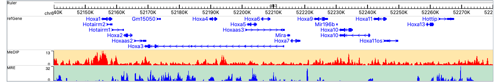

# Example data hub

Pasted below is an example data hub for mouse mm10. It displays a ruler, the RefSeq genes and two
bigWig tracks:

``` json
[
    {
    "type": "ruler",
    "name": "Ruler",
    "showOnHubLoad": true
    },
    {
    "type": "geneAnnotation",
    "name": "refGene",
    "genome": "mm10",
    "showOnHubLoad": true
    },
    {
    "type": "bigwig",
    "url": "https://vizhub.wustl.edu/public/tmp/TW463_20-5-bonemarrow_MeDIP.bigWig",
    "name": "MeDIP",
    "showOnHubLoad": true,
    "options": {
        "color": "red",
        "backgroundColor":"#FFE7AB"
        },
    "metadata": {
        "sample": "bone",
        "assay": "MeDIP"
        }
    },
    {
    "type": "bigwig",
    "url": "https://vizhub.wustl.edu/public/tmp/TW551_20-5-bonemarrow_MRE.CpG.bigWig",
    "name": "MRE",
    "showOnHubLoad": true,
    "options": {
        "color": "blue",
        "backgroundColor":"#C0E3CC"
        },
    "metadata": {
        "sample": "bone",
        "assay": "MRE"
        }
    }
]
```

Loaded with `?genome=mm10&position=chr6:52140000-52280000&noDefaultTracks=1&hub=…` (see
[URL parameters](../url-params.md)), it shows:



The sections below give one track of each type. Add `"showOnHubLoad": true` to a track to display
it when the hub is loaded. The file formats themselves are described in
[Track file formats](../tracks/file-tracks.md).

## Example bigWig track

``` json
{
    "type": "bigwig",
    "name": "example bigwig",
    "url": "https://vizhub.wustl.edu/hubSample/hg19/GSM429321.bigWig",
    "options": {
        "color": "blue"
    }
}
```

## Example dynseq track

A dynseq track reads a bigWig file. Here, the phyloP conservation scores of hg38:

``` json
{
    "type": "dynseq",
    "name": "example dynseq",
    "url": "https://vizhub.wustl.edu/public/hg38/conservation/hg38.phyloP100way.bw",
    "options": {
        "color": "blue",
        "height": 100
    }
}
```

## Example methylC track

``` json
{
  "type": "methylc",
  "name": "H1",
  "url": "https://vizhub.wustl.edu/public/hg19/methylc2/h1.liftedtohg19.gz",
  "options": {
    "label": "Methylation",
    "colorsForContext": {
      "CG": { "color": "#648bd8", "background": "#d9d9d9" },
      "CHG": { "color": "#ff944d", "background": "#ffe0cc" },
      "CHH": { "color": "#ff00ff", "background": "#ffe5ff" }
    },
    "depthColor": "#01E9FE"
  }
}
```

See also the methylC options [isCombineStrands](./track_properties.md#iscombinestrands),
[depthFilter](./track_properties.md#depthfilter), [depthColor](./track_properties.md#depthcolor)
and [maxMethyl](./track_properties.md#maxmethyl).

## Example categorical track

``` json
{
  "type": "categorical",
  "name": "ChromHMM",
  "url": "https://egg.wustl.edu/d/hg19/E017_15_coreMarks_dense.gz",
  "options": {
      "category": {
          "1": {"name": "Active TSS", "color": "#ff0000"},
          "2": {"name": "Flanking Active TSS", "color": "#ff4500"},
          "3": {"name": "Transcr at gene 5' and 3'", "color": "#32cd32"},
          "4": {"name": "Strong transcription", "color": "#008000"},
          "5": {"name": "Weak transcription", "color": "#006400"},
          "6": {"name": "Genic enhancers", "color": "#c2e105"},
          "7": {"name": "Enhancers", "color": "#ffff00"},
          "8": {"name": "ZNF genes & repeats", "color": "#66cdaa"},
          "9": {"name": "Heterochromatin", "color": "#8a91d0"},
          "10": {"name": "Bivalent/Poised TSS", "color": "#cd5c5c"},
          "11": {"name": "Flanking Bivalent TSS/Enh", "color": "#e9967a"},
          "12": {"name": "Bivalent Enhancer", "color": "#bdb76b"},
          "13": {"name": "Repressed PolyComb", "color": "#808080"},
          "14": {"name": "Weak Repressed PolyComb", "color": "#c0c0c0"},
          "15": {"name": "Quiescent/Low", "color": "#ffffff"}
      }
  }
}
```

`category` gives, for each value of the 4th column of the file, the name and the color of the
category. Other supported options: [backgroundColor](./track_properties.md#backgroundcolor),
[rowHeight](./track_properties.md#rowheight), [maxRows](./track_properties.md#maxrows) and
[hiddenPixels](./track_properties.md#hiddenpixels).

## Example longrange track

``` json
{
    "type": "longrange",
    "name": "ES-E14 ChIA-PET",
    "url": "https://egg.wustl.edu/d/mm9/GSE28247_st3c.gz"
}
```

This is an mm9 track. Interaction tracks (`longrange`, `biginteract`, `hic`) are displayed as a
heatmap by default; see [displayMode](./track_properties.md#displaymode) and the
[interaction track options](./track_properties.md#options-for-interaction-tracks).

## Example bigInteract track

``` json
{
    "type": "biginteract",
    "name": "test bigInteract",
    "url": "https://your.host/interactExample3.inter.bb"
}
```

Replace the `url` with the location of your own bigInteract file. The file
`interactExample3.inter.bb` is an example file (hg19) from the
[UCSC bigInteract format](https://genome.ucsc.edu/goldenPath/help/interact.html) page.

## Example repeatmasker track

``` json
{
    "type": "repeatmasker",
    "name": "RepeatMasker",
    "url": "https://vizhub.wustl.edu/public/mm10/rmsk16.bb"
}
```

## Example geneAnnotation track

``` json
{
    "type": "geneAnnotation",
    "name": "refGene",
    "genome": "mm10"
}
```

:::info note

Please specify the `genome` attribute for gene annotation tracks. The gene annotation tracks
available for a genome are listed in **Tracks** > **Annotation Tracks**.
:::

## Example bigbed track

``` json
{
    "type": "bigbed",
    "name": "test bigbed",
    "url": "https://vizhub.wustl.edu/hubSample/hg19/bigBed1"
}
```

## Example bed track

``` json
{
    "type": "bed",
    "name": "hg19 bed",
    "url": "https://vizhub.wustl.edu/hubSample/hg19/bed.gz"
}
```

A `bed` track reads a bgzip-compressed, tabix-indexed file: the index (`bed.gz.tbi`) must sit next
to the file.

## Example refbed track

``` json
{
    "type": "refbed",
    "name": "mm10 gencode basic",
    "url": "https://vizhub.wustl.edu/public/tmp/gencodeM18_load_basic_Gene.bed.gz",
    "options": {
            "categoryColors": {
                "coding": "rgb(101,1,168)",
                "nonCoding": "rgb(1,193,75)",
                "pseudo": "rgb(230,0,172)",
                "problem": "rgb(224,2,2)",
                "other":"rgb(128,128,128)"
            }
        }
}
```

:::info note

`categoryColors` designates colors for the gene type as indicated in the 9th column. The default scheme is shown above for the five classes created by the `Converting_Gencode_or_Ensembl_GTF_to_refBed.bash` script, but any number of categories can be defined.
:::

## Example HiC track

``` json
{
    "type": "hic",
    "name": "test hic",
    "url": "https://4dn-open-data-public.s3.amazonaws.com/fourfront-webprod/wfoutput/c4812c8a-74ac-4ee9-ac9e-abf5abd59318/4DNFI8I2WYXS.hic",
    "options": {
        "displayMode": "arc"
    }
}
```

This is an hg38 file from the 4DN data portal.

## Example genomealign track

``` json
{
    "name": "hg38tomm10",
    "label": "Query mouse mm10 to hg38 blastz",
    "type": "genomealign",
    "querygenome": "mm10",
    "url": "https://vizhub.wustl.edu/public/hg38/weaver/hg38_mm10_axt.gz"
}
```

A genome alignment track belongs to the reference genome (here hg38) and needs the `url` of the
alignment file and the name of the other genome in `querygenome`. Tracks of the other genome can
then be displayed through the alignment by giving them `"metadata": { "genome": "mm10" }`. See
[Comparative browsing](../use-the-browser/comparative-browsing.md).

## Example qBED track

``` json
{
    "type":"qbed",
    "url":"https://vizhub.wustl.edu/public/misc/callingcard/hg38/HCT116-PBase.ccf.gz",
    "name":"piggyBac insertions",
    "showOnHubLoad":true,
    "options":{
        "color":"#D12134",
        "height":100,
        "logScale":"log10",
        "show":"sample",
        "sampleSize":1000,
        "markerSize":5,
        "opacity":[50]
      }
}
```

:::info note

Default qBED track options are `"logScale":"none"`, `"show":"all"`, `"markerSize":3`, and `"opacity":[100]`. Log-scaling can be set by specifying `"logScale":"log10"`. To change opacity, pass a single value in brackets, as in the above example. qBED tracks will, by default, plot all entries in view. For information-dense regions, this can lead to excessive memory consumption. To plot a random subsample instead, specify `"show":"sample"` and pass the number of points to visualize to `"sampleSize"`, e.g. `"sampleSize":1000`
:::

## Example matplot track

``` json
{
    "type": "matplot",
    "name": "matplot wrap",
    "tracks": [
        {
        "type": "bigwig",
        "url": "https://vizhub.wustl.edu/public/tmp/TW463_20-5-bonemarrow_MeDIP.bigWig",
        "name": "MeDIP",
        "options": {
            "color": "red",
            "backgroundColor":"#FFE7AB"
            },
        "metadata": {
            "sample": "bone",
            "assay": "MeDIP"
            }
        },
        {
        "type": "bigwig",
        "url": "https://vizhub.wustl.edu/public/tmp/TW551_20-5-bonemarrow_MRE.CpG.bigWig",
        "name": "MRE",
        "options": {
            "color": "blue",
            "backgroundColor":"#C0E3CC"
            },
        "metadata": {
            "sample": "bone",
            "assay": "MRE"
            }
        }
    ]
}
```

A matplot track draws its numerical tracks as lines in one plot, each in its own `color`.

## Example g3d track

``` json
{
    "type": "g3d",
    "url": "https://vizhub.wustl.edu/public/g3d/hg19/GSM3271347_gm12878_01.g3d",
    "name": "example 3d track",
    "showOnHubLoad": true
}
```

A g3d track (hg19 here) is not drawn as a track row: it opens in a 3D viewer panel next to the
browser. See [3D structure](../tracks/3d.md).

## Example Ruler track

``` json
{
    "type": "ruler",
    "name": "Ruler"
}
```
