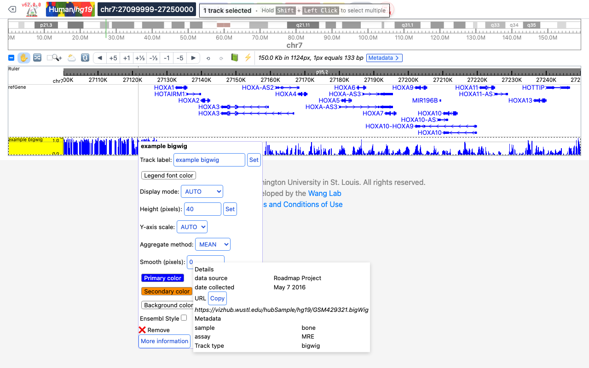
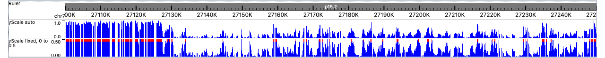
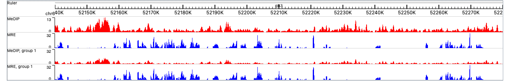
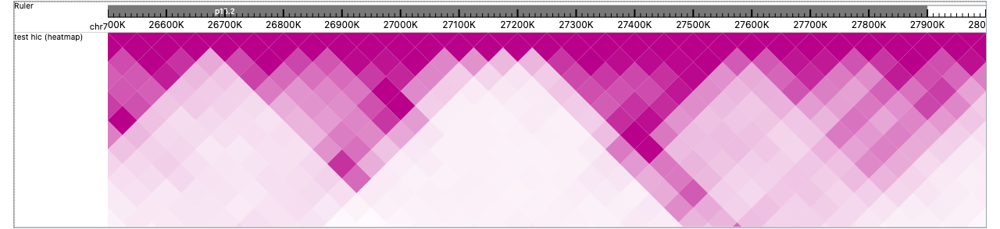
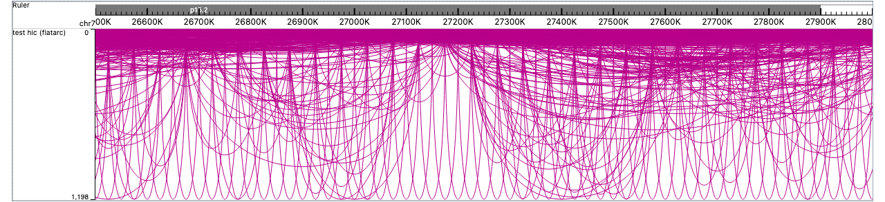
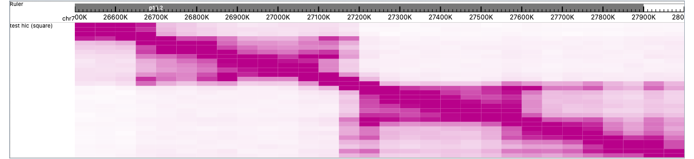
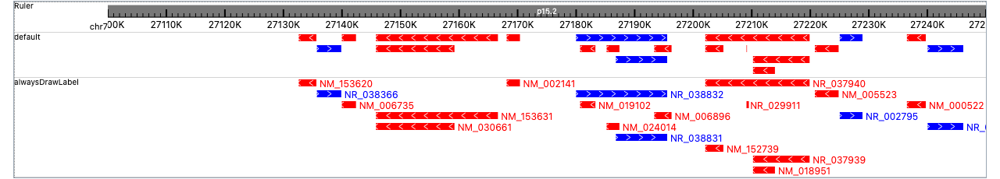

# Track properties

## type

*Required*. `type` specifies the track type. The track types the Browser can display are:

| kind | types |
| --- | --- |
| annotation | `bed`, `bedcolor`, `bigbed`, `bigbedcolor`, `refbed`, `hammock`, `geneAnnotation`, `categorical`, `repeatmasker`, `rmskv2`, `jaspar`, `snp`, `vcf` |
| numerical | `bigWig`, `bedGraph`, `qBED`, `boxplot`, `dynseq`, `matplot` |
| methylation | `methylC`, `modbed` |
| interaction | `hic`, `longrange`, `bigInteract` |
| alignment | `bam`, `genomealign` |
| dynamic | `dynamic`, `dynamicbed`, `dbedgraph`, `dynamichic`, `dynamiclongrange` |
| other | `ruler`, `omeroidr`, `g3d` |

The file format behind each type is described in [Track file formats](../tracks/file-tracks.md).
A `g3d` track is shown in a 3D viewer panel rather than as a track row. A track whose type is not
in this list is not displayed.

:::info note

`type` is case insensitive.
:::

## name

*Required*. `name` specifies the track name used internally by the browser. It is also displayed as the track legend if no [label](#label) is specified. Value can be any string.

## label

*Optional*. `label` specifies the track legend displayed in the browser. It overrides the [name](#name) attribute. Value can be any string. The label can also be changed later with **Track label** in the menu that opens when you right-click a track.

## url

*Required*. `url` contains the URL to the track file and needs to be HTTP or HTTPS location string.

:::danger important

A `url` is required for all the tracks read from a file. Gene annotation tracks, like `refGene`, do not need a `url`, as they are served by the Browser for each genome. The `ruler` track does not need a `url` either.
:::

:::caution caution

Each user-provided `url` must link to a publicly available website, without password protection, so that the browser can read in the file.
:::

:::info note

`url` can use a path relative to the datahub URL. Say you have a file `a.bigWig` next to your datahub `http://your.host/your.hub.json`: the `url` of its track can be either `http://your.host/a.bigWig` or just `a.bigWig`. Relative paths work when the hub is loaded by its URL from **Tracks** > **Remote Tracks** > **Add Data Hubs**. A hub opened with the `hub` [URL parameter](../url-params.md), or uploaded as a file, needs full URLs.
:::

## indexUrl

*Optional*. For a tabix-indexed file (such as `bed`, `bedGraph`, `methylC` or `categorical`), the Browser reads the index from the file URL followed by `.tbi`. If the index is somewhere else, give its URL in `indexUrl`.

## showOnHubLoad

*Optional*. If specified to `true`, the track will be displayed when hub is loaded. Default value: `false`.

## metadata

*Optional*. An object specifying the metadata of the track. Metadata are shown as colored boxes next
to the tracks (choose the terms to show with **Metadata** in the toolbar above the tracks) and are
used to sort and filter tracks in **Tracks** > **Track Facet Table**.

In this basic example the value of each metadata term is a **string**:

```json
    "metadata": {
        "sample": "bone",
        "assay": "MRE"
    }
```

To choose the color of a term's box yourself, give the value as an object with a `name` and a
`color` (any CSS color, such as `"red"` or `"#FF0000"`):

```json
    "metadata": {
        "sample": { "name": "bone", "color": "#FF0000" }
    }
```

This example from the public Roadmap data hub has more complex metadata definitions and makes use of a **list of strings** to build a *hierarchical structure*:

```json
    {
        "url": "https://egg.wustl.edu/d/hg19/GSM997242_1.bigWig",
        "metadata": {
            "Sample": [
                "Adult Cells/Tissues",
                "Blood",
                "Other blood cells",
                "CD4+_CD25-_Th_Primary_Cells"
            ],
            "Donor": [
                "Donor Identifier",
                "Donor_332"
            ],
            "Assay": [
                "Epigenetic Mark",
                "Histone Mark",
                "H3",
                "H3K9",
                "H3K9me3"
            ],
            "Institution": [
                "Broad Institute"
            ]
        },
        "type": "bigwig",
        "options": {
            "color": "rgb(159,0,72)"
        },
        "name": "H3K9me3 of CD4+_CD25-_Th_Primary_Cells"
    }
```

The list of metadata is ordered from more generic to more specific and
helps build the facet table hierarchy making the **search** and
**filter** functions in track table easier.

The metadata term `genome` has a special meaning: it names the genome a track belongs to when that
genome is not the one being viewed, and the track is then displayed through a genome alignment
track. See [Comparative browsing](../use-the-browser/comparative-browsing.md).

## details

*Optional*. If you want to add more information for each track then the `details` attribute is helpful. After right clicking on the track you can click **More information** and see the `details`, `url`, and `metadata` for each track:

```json
    "details": {
        "data source": "Roadmap Project",
        "date collected": "May 7 2016"
    }
```



## queryEndpoint

*Optional*. Most of the time this parameter is used with a geneAnnotation track. When users deal with a custom genome, or a genome not listed in the NCBI or Ensembl databases, the gene search link would not work. In such a case, you can specify a custom database to query detailed information. For example, for some trypanosome genomes, genes should be queried through TriTrypDB, so the track can be defined like this:

```js
    {
        type: "geneAnnotation",
        name: "gene",
        label: "TriTrypDB genes",
        genome: "TbruceiLister427",
        queryEndpoint: { name: "TriTrypDB", endpoint: "https://tritrypdb.org/tritrypdb/app/search?q=" },
    }
```

## querygenome

*Required for `genomealign` tracks*. The name of the other genome of the alignment, for example
`"querygenome": "mm10"`. See the [genomealign example](./example_datahub.md#example-genomealign-track).

## options

*Optional*. All track render options are placed in an object called `options`. Most of them can also
be changed after the track is displayed, in the menu that opens when you right-click the track. This
object can have the following properties:

### color

`color` is used to define the color for each track. A color name, RGB values, or hex color code can be used. For more about color name or RGB please see [https://www.w3schools.com/css/css_colors.asp](https://www.w3schools.com/css/css_colors.asp).

### color2

`color2` is used to define the color for negative values from the track data. In annotation tracks
(such as `bed`, `bigbed` and gene annotation tracks), `color` is used for items on the forward
strand and `color2` for items on the reverse strand.

### backgroundColor

`backgroundColor` defines the background color of the track.

### legendFontColor

`legendFontColor` defines the color of the track legend text.

### height

`height` controls the height of the track which is specified as a number and displayed in *pixels*.
For annotation tracks it applies in `density` [display mode](#displaymode); in `full` mode the
height follows the number of rows, see [maxRows](#maxrows).

### ensemblStyle

For a file whose chromosomes are named `1`, `2`, `3`… (Ensembl style) instead of `chr1`, `chr2`,
`chr3`…, set `ensemblStyle` to `true`. When the option is not set, the Browser detects the naming
from the file. In the right-click menu this is **Ensembl Style**.

### yScale

`yScale` allows you to configure the track's y-scale. Options include *auto* or *fixed*. *auto* sets the y-scale from 0 to the max value of values in the view region for a given track. *fixed* means you can specify the *minimal* and *maximal* value.

### yMax

`yMax` is used to define the *maximum* value of a track's y-axis. Value is number.

### yMin

`yMin` is used to define the *minimum* value of a track's y-axis. Value is number.

:::danger important

If you need the track to be in *fixed* scale, you need to specify `yScale` to *fixed* besides setting `yMax` and `yMin`.
:::

```json
    "options": { "yScale": "fixed", "yMax": 0.5, "yMin": 0 }
```

The same bigWig file with `auto` and with a `fixed` scale from 0 to 0.5; values above `yMax` are
drawn in the [colorAboveMax](#colorabovemax) color:



### colorAboveMax

`colorAboveMax` defines the color displayed when a *fixed* [yScale](#yscale) is used and a value exceeds the [yMax](#ymax) defined. Default: `red`.

### color2BelowMin

`color2BelowMin` defines the color displayed when a *fixed* [yScale](#yscale) is used and a value is below the [yMin](#ymin) defined. Default: `darkgreen`.

### group

Numerical tracks can be grouped to same group, tracks from same group will share y-axis scale settings. For example, when 2 tracks are in one group, the y-axis will both set to max value of current views of both tracks. The value is a number:

```json
    "options": { "color": "red", "group": 1 }
```

In this example the two top tracks have their own scales (13 and 32); the two bottom tracks show
the same files in group 1 and share the scale 0–32:



### displayMode

`displayMode` specifies display mode for each tracks. Different tracks have different display modes as listed below.

| type | display mode |
| --- | --- |
| bigWig, bedGraph | *auto* (default), *bar*, *heatmap* |
| bed, bigBed, refBed, geneAnnotation, repeatmasker | *full* (default), *density* |
| hic, longrange, bigInteract | *heatmap* (default), *arc*, *flatarc*, *square* |

In *auto* mode a numerical track is drawn as bars, or as a heatmap when the track is very short.
In *density* mode an annotation track shows the number of items along the genome as a bar chart.

A `genomealign` track has no display mode option: it switches by itself between the *rough* view
(when zoomed out) and the *fine* view, which shows the aligned bases, when you zoom in to less than
about 10 bases per pixel. See [Comparative browsing](../use-the-browser/comparative-browsing.md).

The four display modes of an interaction track, here the same Hi-C file:

`heatmap`



`flatarc`: like `arc` mode, but the curves are flatter (they are cubic curves).



`square`: a JuiceBox-like view of a Hi-C map.



### aggregateMethod

At high zoom-out level when 1 on-screen pixel spans >1bp, the underlying track data needs to be summarized into a single value for browser display. `aggregateMethod` is used to control how the data is summarized. Supported values include: `MEAN`, `SUM`, `COUNT`, `MAX`, `MIN`. Default value is `MEAN`.

### smooth

`smooth` option allows you to smooth the graph of a quantitative track using window mean values. The browser will use the mean values from region \[current_position - smooth, current_position + smooth\]. Default value is 0 (no smooth applied).

### maxRows

`maxRows` controls the number of rows of an annotation track in `full` mode, like a geneAnnotation
track. Items that do not fit are counted in a "… items hidden" line. Default: 20.

### rowHeight

For `categorical` tracks, the height of the track row in pixels. Default: 20.

### hiddenPixels

For annotation tracks, when an element spans less than `hiddenPixels` on the screen, this item will not be displayed. Default value is 0.5 pixel. Set to 0 will display all elements.

### alwaysDrawLabel

For `bed` and `bigbed` tracks. The label of an item is normally drawn only when there is enough
space inside the item block; with `alwaysDrawLabel` set to `true`, the label is always drawn, next to
the block when it does not fit inside.



### italicizeText

For gene annotation tracks, `true` writes the gene names in italics.

### categoryColors

For `refbed` and gene annotation tracks, the colors of the gene categories, see the
[refbed example](./example_datahub.md#example-refbed-track).

### isCombineStrands

For methylC tracks, `isCombineStrands` will specify if the strands should be combined `true` or not combined `false`. We recommend combining strands for viewing CpG methylation, but leaving strand information for non-CpG methylation.

### depthFilter

For methylC tracks a `depthFilter` can be set to filter out any bases with less than the depth (coverage) specified.

### depthColor

For methylC tracks specify a `depthColor` for the depth line that overlays the bars.

### maxMethyl

For methylC tracks specify the y-axis max (for both strands) using `maxMethyl`. Options range from (0-1\].

### colorsForContext

For methylC tracks, the bar and background colors of each methylation context, see the
[methylC example](./example_datahub.md#example-methylc-track).

### Options for interaction tracks

These options apply to `hic`, `longrange` and `bigInteract` tracks.

- `scoreScale`, `scoreMax`, `scoreMin`: these work like [yScale](#yscale), [yMax](#ymax) and
  [yMin](#ymin), for the interaction scores. With `scoreScale` set to `fixed`, the colors go from
  `scoreMin` to `scoreMax`.
- `scalePercentile`: with an `auto` score scale, the score at this percentile of the interactions in
  view is used as the maximum. Default: 95.
- `lineWidth`: the width of the lines in pixels in `arc` and `flatarc` modes. Default: 1.
- `minValueFilter`, `maxValueFilter`: interactions with a score below `minValueFilter` or above
  `maxValueFilter` are not drawn.
- `bothAnchorsInView`: `true` draws only the interactions whose two ends are both in the view.

`color` and `color2` are the colors of the interactions (default `#B8008A` and `#006385`).

### Options for genome alignment tracks

For `genomealign` tracks, `primaryColor` is the color of the reference genome (default `darkblue`)
and `queryColor` the color of the other genome (default `#B8008A`).

### Options for qBED tracks

`logScale`, `show`, `sampleSize`, `markerSize` and `opacity`, see the
[qBED example](./example_datahub.md#example-qbed-track).
