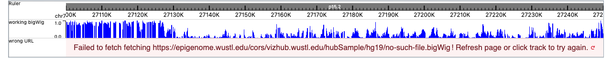

# FAQ

## A new version of the browser is available

The Browser checks for a new version every five minutes, and each time you come back to its tab.
When one has been published, a message appears at the bottom of the page:
**A new version of the browser is available.** Click **Refresh** to load it, or **×** to keep working
and refresh later. Your session is kept in your web browser and is restored after the refresh.

If you still see an old version after refreshing, your web browser may have cached the old
JavaScript code. Do a hard reload: in Chrome, open *Developer Tools*, then click and hold the
reload button and choose **Hard Reload** (or **Empty Cache and Hard Reload**).

## Data fetch failed

When a track file cannot be read, the track shows an error message instead of data. Click the
message to try again.

Please check that the URL to your file is correct and that the file can be downloaded without a
password. If it is, most often your web server does not allow other web sites to read the file
(CORS). For bigWig, bigBed, BAM and tabix-indexed files, the Browser then tries again through a WashU
relay server (`epigenome.wustl.edu/cors`), and the error appears only when that fails too. The best
fix is to enable CORS on your server; see [Track file formats](../tracks/file-tracks.md).

## Use HTTP or HTTPS

The Browser is served over HTTPS
([https://epigenomegateway.wustl.edu/browser/](https://epigenomegateway.wustl.edu/browser/)), and a
web page served over HTTPS is not allowed by your web browser to read files from a plain `http://`
address. Host your track files on an HTTPS server.

## Do I need Firebase to run my own copy?

No. A copy of the Browser that you run yourself starts and displays tracks without any Firebase
settings. Firebase is only needed to save and retrieve session bundles (the **Session Bundle ID**);
sessions are always kept in your web browser and can be downloaded to and loaded from a file
without it. How to set up your own Firebase database is described in
[Run your own copy](../installation.md).

## Local track security

Local track function is perfect for viewing protected or private data, since there is no data
transfer on the web: the files stay on your computer and are read by your web browser. See
[Local tracks](../tracks/local-tracks.md). More discussions about this please check
[here](https://github.com/lidaof/eg-react/issues/114).

## What's the difference between the `hub` and `sessionFile` URL parameters?

Both browser links with `hub` or `sessionFile` can be shared with others or be used for publication
purposes.

- A `hub` link names a genome and a [datahub](../datahub/datahub.md): a list of tracks. The page
  opens with the genome's default tracks plus the hub tracks marked `showOnHubLoad`, at the region
  given by `position`. A datahub is simple to write by hand.
- A `sessionFile` link restores a whole session: the genome, the region, the tracks in their order
  with all their settings, the metadata terms shown, highlights and region sets. A session file is
  made by the Browser: arrange the view, then download the session from the session panel (see
  [Manage sessions](../use-the-browser/manage-sessions.md)).

So a `sessionFile` link contains more information than a `hub` link. See
[URL parameters](../url-params.md) for both, and
[Publish with the browser](../contact.md) for advice on links in publications.
