# View 3D genome structure

The Browser can show 3D genome structure data next to your tracks. 3D structures are stored in the `g3d` format. Adding a `g3d` track opens a 3D viewer panel beside the genome browser instead of adding a track row. The viewer has a menu to change the resolution, the layout and the display style, to label genes and regions, and to paint the structure with numerical or annotation data.

## Video tutorial

A video tutorial on 3D visualization is available on YouTube: [3D visualization playlist](https://www.youtube.com/playlist?list=PLE0UMwf5se6nroiymaQFo1C6mEeo7M2xj). The videos were recorded with an earlier version of the Browser, so the menus look different, but the features are the same as described on this page.

## The g3d format

`g3d` is a format we developed for visualizing 3D structure data in the Browser. It is a binary format based on a bed-like layout: for each genomic bin it stores the x, y and z coordinates. A `g3d` file is a container: it can hold several models (for example the maternal and paternal haplotypes, or different cells) and each model at several resolutions. How to prepare a `.g3d` file is described in the [g3dtools documentation](https://g3d.readthedocs.io/en/latest/g3dtools.html).

## Add a g3d track

1. Click **Tracks**, then **Remote Tracks**.
2. On the **Add Tracks** tab, choose **g3d — 3D structure in .g3d format** as the **Track type**.
3. Paste the URL of the `.g3d` file into **File URL**, and optionally type a **Track label**.
4. Click **Add Track**, then close the Remote Tracks panel.

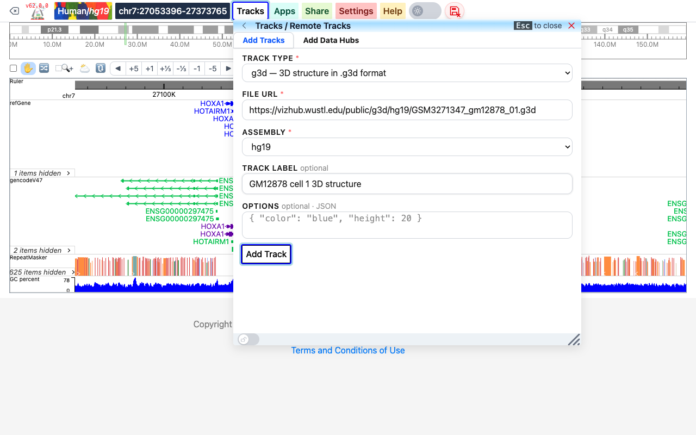

:::tip
To try it out, use the example file [https://vizhub.wustl.edu/public/g3d/hg19/GSM3271347_gm12878_01.g3d](https://vizhub.wustl.edu/public/g3d/hg19/GSM3271347_gm12878_01.g3d) on the **hg19** genome. It holds the maternal and paternal models of one GM12878 cell (GEO sample GSM3271347).
:::

A `g3d` track can also be added from a datahub (see [Datahub](../datahub/datahub.md)):

```json
[
  {
    "type": "g3d",
    "name": "GM12878 cell 1 3D structure",
    "url": "https://vizhub.wustl.edu/public/g3d/hg19/GSM3271347_gm12878_01.g3d",
    "showOnHubLoad": true
  }
]
```

The 3D viewer opens in a new panel to the right of the browser, with the track label as the panel title. Drag the bar between the two panels to change their widths; close the viewer with the **×** on its tab.

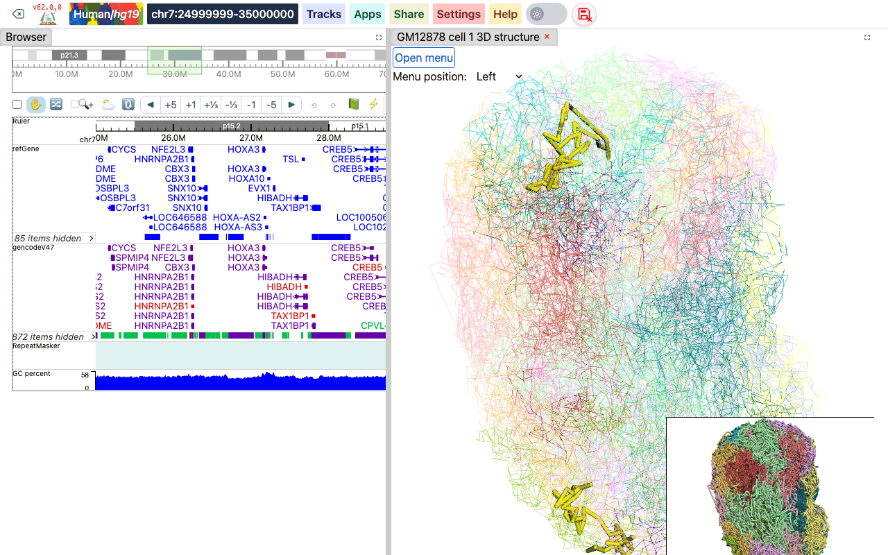

The viewer has a **main viewer** and a smaller **thumbnail viewer** (bottom right). Drag in either one to rotate the structure and scroll to zoom; the two viewers stay in sync. The part of the structure that belongs to the region shown in the browser is highlighted in yellow. When you move to another region in the browser, the highlight follows.

## The 3D viewer menu

Click **Open menu** at the top left of the 3D viewer to open the **3D Viewer Settings** menu. The **Menu position** dropdown next to the button places the menu on the **Left** (default), **Top**, **Right** or **Bottom** of the window. Close the menu with the **×** at the top of the menu.

The menu is divided into sections: **Model Data**, **Layout**, **Highlighting & Labeling**, **Numerical Painting**, **Annotation Painting**, **Animation** and **Export**. Click a section title to collapse or expand it.

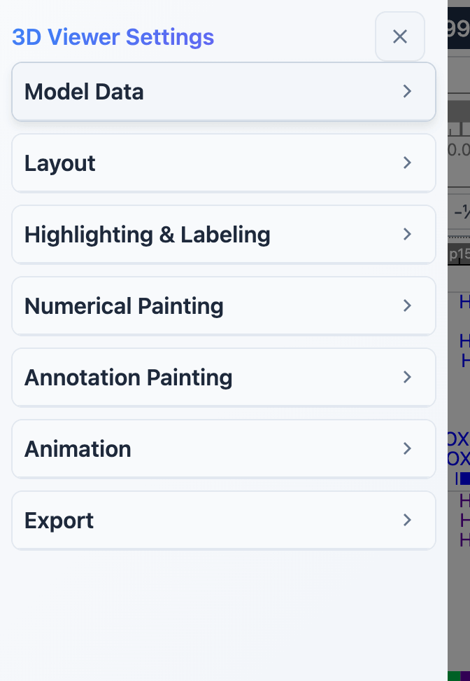

## Model data

- **Choose resolution**: pick one of the resolutions stored in the file and click **Go**. By default the lowest resolution (largest bins) is used.
- **Models**: all models in the file are listed. Click the eye icon next to a model to hide or show it.
- **Show Envelope**: draws a sphere around the structure to mimic the nuclear envelope. When it is on, you can set its **Color** and **Opacity**.
- **Spin**: makes the structure rotate. Spinning is off when the viewer opens. When it is on, choose the **Direction** (X-, Y- or Z-axis), the **Speed** (Normal, Fast, Faster) and whether to **Reverse direction**.

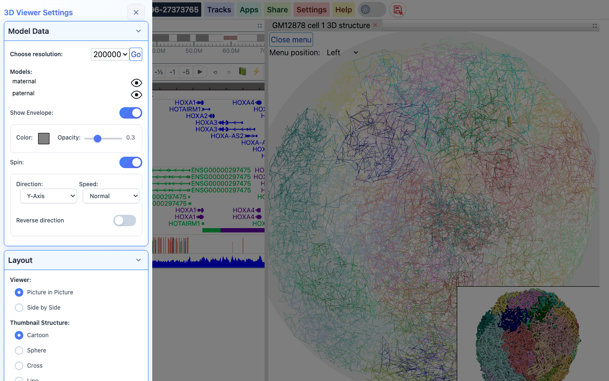

## Layout

- **Viewer**: **Picture in Picture** (default) puts the thumbnail viewer in the bottom right corner of the main viewer; **Side by Side** places the two viewers next to each other.
- **Thumbnail Structure**: the style of the thumbnail viewer: **Cartoon** (default), **Sphere**, **Cross** or **Line**. **Hide** removes the thumbnail viewer.

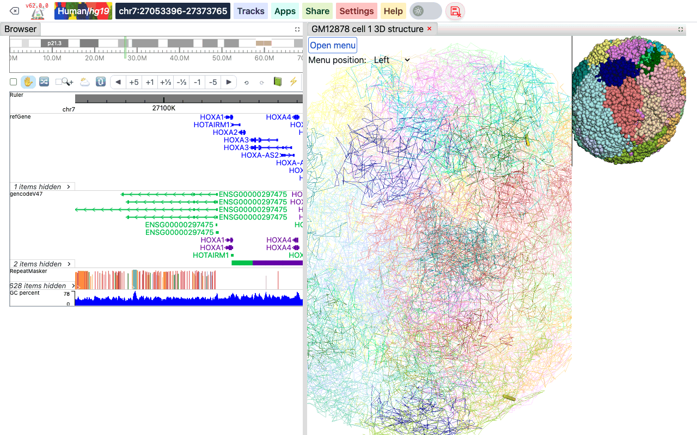

## Highlighting and labeling

### Highlight the browser region

Under **Highlight Controls** you can change how the browser region is highlighted in the main viewer: the **line opacity**, the **thickness/radius** of the tube, the **paint style** (cartoon or sphere) and the highlight color (click the color box). Click **Highlight** to apply the changes, or **Remove** to turn the highlighting off.

### Label genes and regions

Labels mark genes or regions on the structure, either with a shape (a sphere or box with a text label) or with an arrow. Choose the kind under **Label Style** (**Shape** or **Arrow**) before you add a label.

- **Gene Labeling**: start typing a gene symbol, pick the gene from the suggestions, then pick the isoform.
- **Region Labeling**: type a region as `chr start end` (for example `chr7 27900000 28100000`), type a **Label**, and click **Add**.
- **Upload genes/regions file**: choose a text file with one gene symbol or region per line to label them all at once. The whole file is added as one label, named after the file. Regions can be written as `chr7:5566779-5570232` or as tab-separated bed lines; the 4th column of a bed line is used as its label. For example:

```text
CYP3A4
chr7:5566779-5570232
EGFR
chr7	127471196	127495720	my region
```

The labels you add are listed under **Shape Management** and **Arrow Management**. There you can change a shape's color, size, outline (sphere or box), and whether it is drawn as a wireframe (**frame**) and shows its text (**label**). For an arrow you can change its color, **radius** and the starting point (**From x, y, z**). Click the check button to apply the change, or the x button to delete the label.

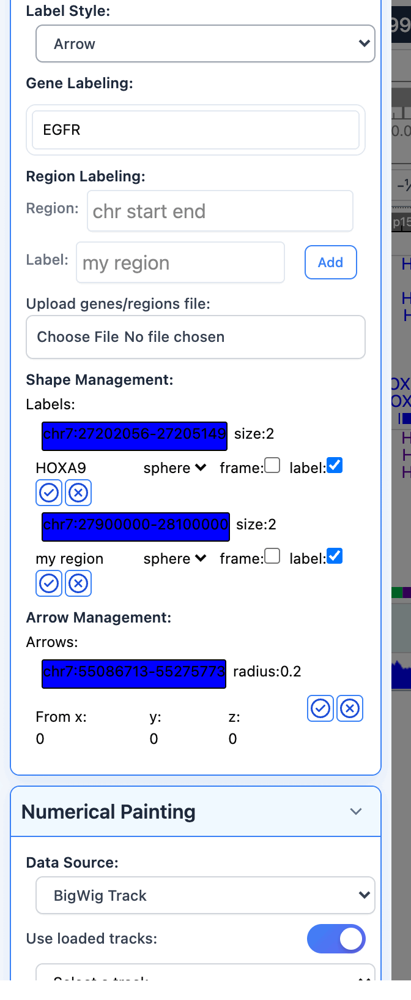

Labels are drawn on every model, so in a structure with a maternal and a paternal model each label appears twice:

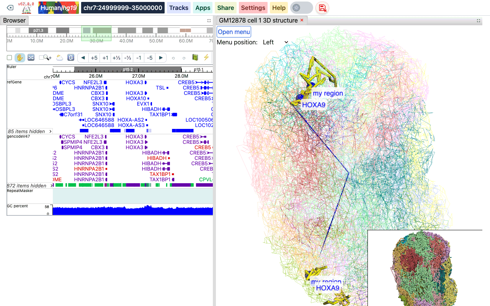

## Interact with the 3D structure

Click a segment of the structure to open a box with its position, the resolution and the model it belongs to, and these buttons:

- **Browser region**: moves the browser to the region of this segment.
- **Add to set view**: adds the region of this segment to a region set together with the current browser region, and shows the region set in the browser. Click it on more segments to add them too.
- **Close set view**: leaves the region set view.
- **Label as shape** / **Label as arrow**: adds the segment to the labels.
- **Close**: closes the box.

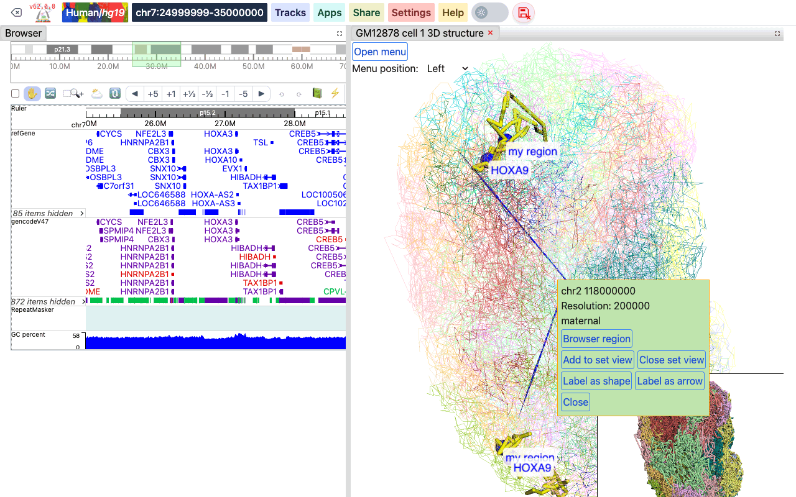

## Numerical painting

Numerical data can be used to color the structure, from low (yellow) to high (red) values by default.

Under **Data Source**, choose:

- **BigWig Track**: with **Use loaded tracks** on, pick one of the bigWig tracks loaded in the browser. Turn **Use loaded tracks** off to type a **BigWig URL** instead.
- **Gene Expression**: upload a gene expression file (see below).

Then click **Paint Region** (the browser region only), **Paint Chromosome** (the chromosome of the browser region) or **Paint Genome**. The **line opacity**, **thickness/radius** and **paint style** fields in this section are the same settings as under **Highlight Controls**. Click **Remove Paint** to remove the painting.

A color legend appears at the top of the viewer. Click one of its color boxes to choose another color. After painting, **Scale Controls** in the menu show the current data range; turn **Auto scale** off to set the **Min** and **Max** of the color scale yourself.

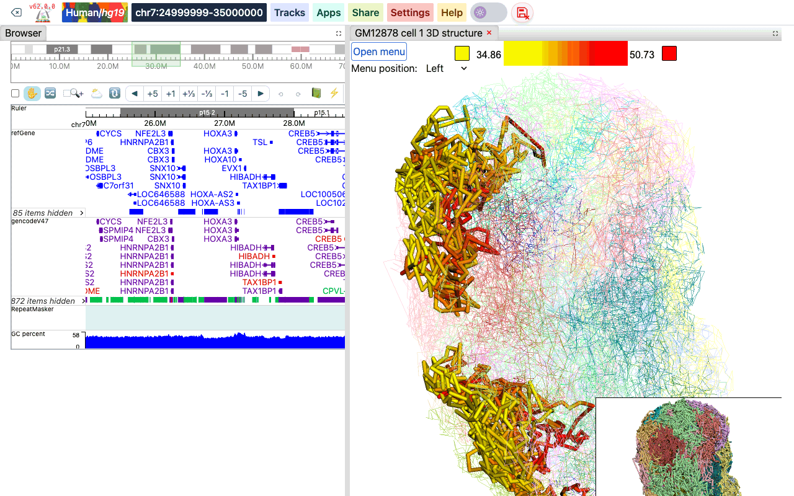

### Gene expression file format

A gene expression file has 5 tab-separated columns: chromosome, start, end, gene ID or symbol, and the expression value (FPKM, RPKM or any value you want to plot):

```text
chr3	168903366	168921996	ENSG00000242268.2	2.40146671319
chr18	46756487	46764408	ENSG00000270112.3	0.0287250976522
chr3	11900011	11901245	ENSG00000225275.4	0.0
chr15	41921417	41928883	ENSG00000259883.1	0.305029986379
chr13	98949719	98950447	ENSG00000231981.3	0.0806509326125
```

## Annotation painting

The structure can also be colored by categories, such as cytobands, genes, chromatin states or compartments. Choose the **File Format**, upload the file (not needed for cytobands), and click **Paint Region**, **Paint Chromosome** or **Paint Genome**. **Remove Paint** removes the painting. A legend of the categories appears in the viewer; click a color box to change a category's color.

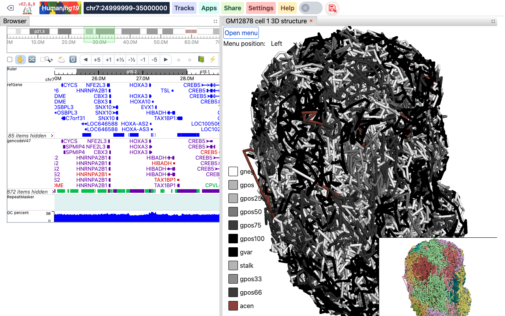

The uploaded file can be plain text or compressed with gzip, but **not** with bgzip.

### Ideogram Cytoband

No file is needed: the cytoband data of the current genome are used.

### UCSC refGene

The standard `refGene` table format from UCSC (16 columns). Turn on **Use promoter only** to paint only the promoter of each gene.

```text
2085	NR_046630	chr3	+	196666747	196669405	196669405	196669405	3	196666747,196667841,196669263,	196666995,196668013,196669405,	0	NCBP2-AS1	unk	unk	-1,-1,-1,
2051	NR_046598	chr3	+	192232810	192234362	192234362	192234362	2	192232810,192234269,	192233297,192234362,	0	FGF12-AS2	unk	unk	-1,-1,
585	NR_106918	chr1	-	17368	17436	17436	17436	1	17368,	17436,	0	MIR6859-1	unk	unk	-1,
```

### BED (9 columns)

A bed file with an RGB color in the 9th column, such as the chromHMM files from the Roadmap project. The 4th column is the category name.

```text
chr10	0	94800	15_Quies	0	.	0	94800	255,255,255
chr10	94800	95600	9_Het	0	.	94800	95600	138,145,208
chr10	95600	102200	15_Quies	0	.	95600	102200	255,255,255
```

### BED Color (4 columns)

A simple 4-column bed file with a color value in the 4th column:

```text
chr11	108280000	109080000	#ff0100
chr11	109080000	109480000	#0000ff
chr11	109720000	110160000	#018100
```

### 4DN Compartment

The compartment calls table from the 4DN data portal (for example [4DNFIL65C8ZI](https://data.4dnucleome.org/files-processed/4DNFIL65C8ZI/)). The file has a header line and 8 columns; bins with an `E1` value of 0 or more are painted as compartment A, the others as compartment B.

```text
chrom	start	end	gene_count	gene_coverage	E1	E2	E3
chr1	0	100000	595	0.8812700000000001
chr1	100000	200000	952	1.0
```

### Rao et al. Compartment

The compartment format from Rao et al. (Cell, 2014). The 4th column is the compartment name.

```text
chr19	0	200000	NA	0	.	0	200000	255,255,255
chr19	200000	500000	B1	-1	.	200000	500000	220,20,60
chr19	500000	3800000	A1	2	.	500000	3800000	34,139,34
```

## Animation

When several models are available, the viewer can play them as an animation: each model is shown as one frame, in a loop. The **Animation** section lists the frames: all models of the loaded file, plus the models of any file you add. To add the models of another `g3d` file, paste its URL into **New G3D URL** and click **Add Model**.

Click **Play** to start the animation, **Stop** to stop it, and **Reset** to go back to the normal view.

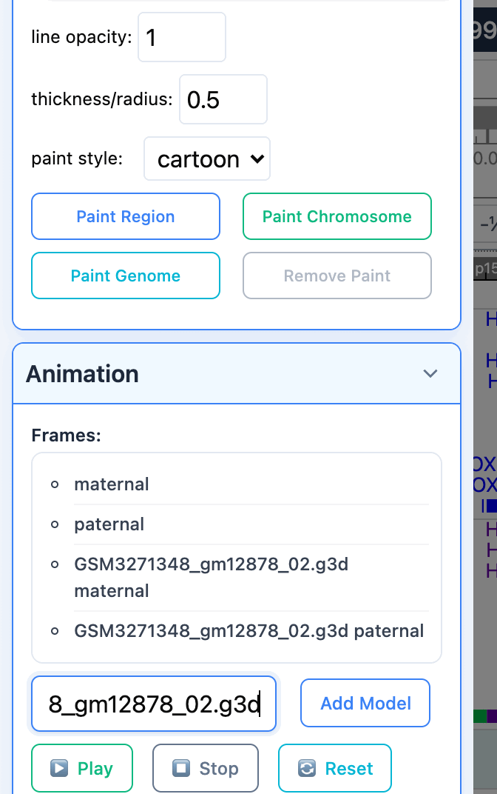

## Export

The **Export** section saves the current view as a PNG image: click **Save Main Viewer** or **Save Thumbnail**.
