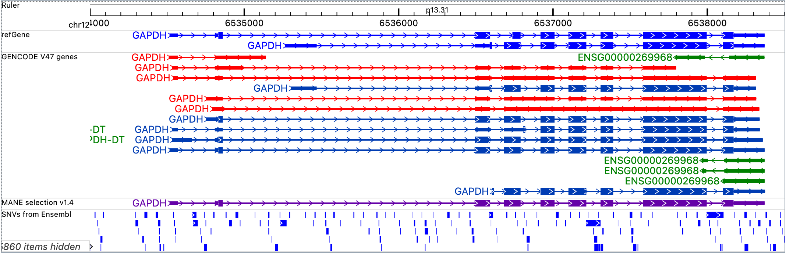
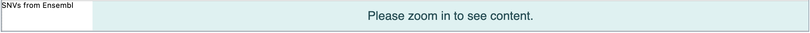

# API based tracks

API based tracks get their data by sending requests to a web service (an API) instead of reading a track file. Two track types work this way: gene annotation tracks (`geneAnnotation`) and the SNV track (`snp`).



## Gene annotation tracks

:::info note

The gene annotation API is at `https://lambda.epigenomegateway.org/v3`.

:::

The Browser uses this API both for gene name search and for the data of `geneAnnotation` tracks. Each genome hosted by the Browser has one or more gene sets. They are listed in **Tracks** > **Annotation Tracks**, under **GENES**. For hg38 these are:

| Name in a datahub | Shown as |
| --- | --- |
| `refGene` | RefSeq genes |
| `MANE_select_1.4` | MANE selection v1.4 |
| `MANE_select_1.0` | MANE selection v1.0 |
| `gencodeV47` | GENCODE V47 genes |
| `gencodeV39` | GENCODE V39 genes |

Genes are colored by type (coding, non-coding, pseudogene, ...). Click a gene to see its details.

To include a gene annotation track in your datahub, use `"type": "geneAnnotation"`, the gene set as `name` and the genome as `genome`. For example, the GENCODE V47 track, with its colors for each type of gene:

```json
{
    "type": "geneAnnotation",
    "name": "gencodeV47",
    "label": "GENCODE V47 genes",
    "genome": "hg38",
    "options": {
        "categoryColors": {
            "coding": "rgb(0,60,179)",
            "nonCoding": "rgb(0,128,0)",
            "pseudogene": "rgb(230,0,172)",
            "problem": "rgb(255,0,0)",
            "polyA": "rgb(0,0,51)"
        }
    }
}
```

Right-click a gene annotation track to change its **Display mode** (**FULL** or **DENSITY**), **Max rows (including overflow row)**, **Primary color**, **Secondary color**, **Background color**, **Italicize text**, **Hide item less than (pixels)** and **Hide minimal items**.

The API only knows the gene sets of the genomes the Browser hosts. For your own gene annotation, use a [refbed](file-tracks.md#refbed) file instead.

## SNV track

For human hg19 and hg38, the `snp` track shows single nucleotide variants (and other short variants) from [Ensembl](https://rest.ensembl.org), queried from these APIs:

| Genome | API |
| --- | --- |
| hg19 | `https://grch37.rest.ensembl.org/overlap/region/human` |
| hg38 | `https://rest.ensembl.org/overlap/region/human` |

The track is listed in **Tracks** > **Annotation Tracks** under **VARIATION**, as **SNVs from Ensembl**. To include it in a datahub:

```json
{
    "type": "snp",
    "name": "SNVs from Ensembl",
    "label": "SNVs from Ensembl"
}
```

The Ensembl API only answers for small regions: when the view is wider than 30 kb, the track asks you to zoom in.



Click a variant to see its details. Right-click the track to change its **Display mode** (**FULL** or **DENSITY**), **Max rows (including overflow row)**, colors, **Hide item less than (pixels)** and **Always draw label**.

:::info

The `cool` track type of the previous version of the Browser, which got Hi-C data from the HiGlass server, is not supported in this version. Use [.hic files](file-tracks.md#hic) instead.
:::
