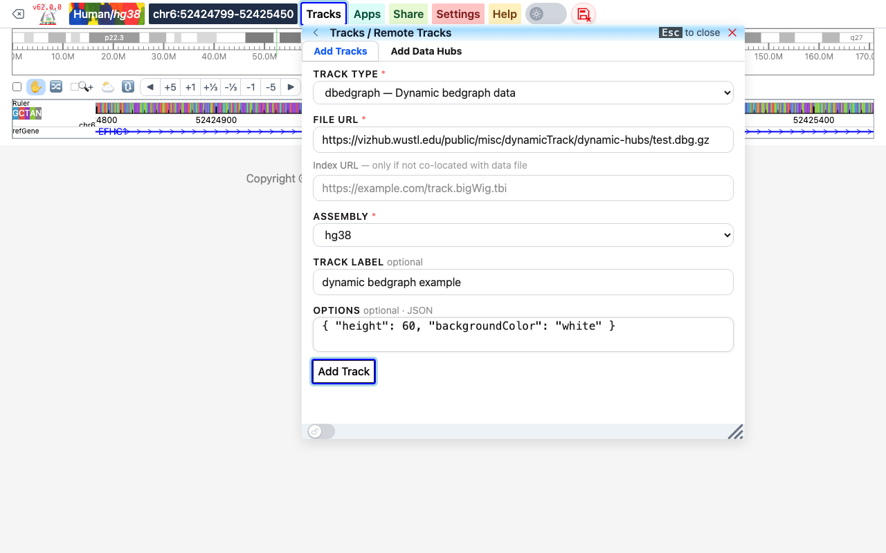
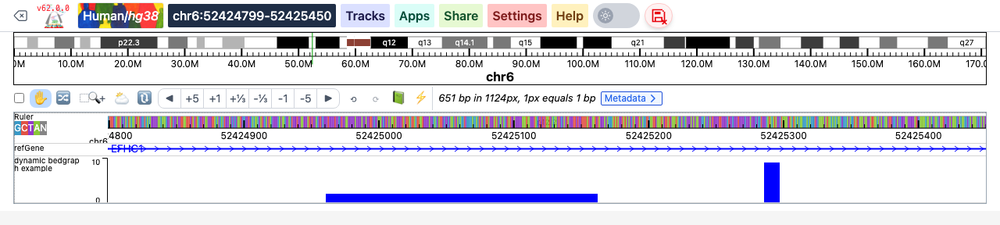
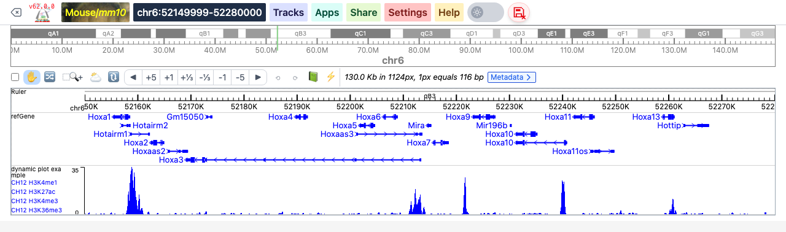
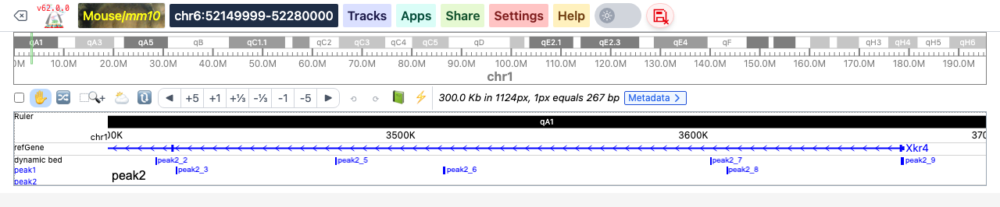
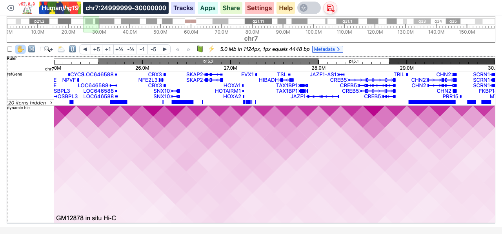
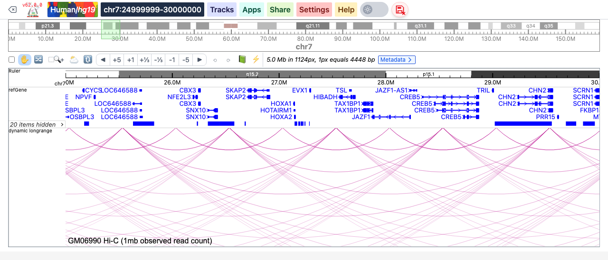
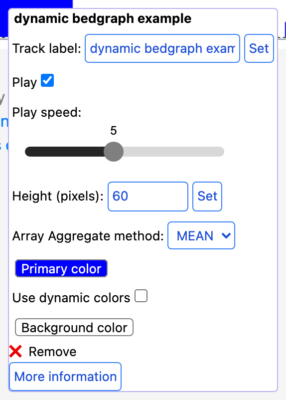

# Dynamic tracks

Dynamic tracks show how data change across a series of steps (time points, developmental stages, cell types, ...) as an animation. Instead of stacking several tracks, a dynamic track draws one step at a time in the same track row and cycles through the steps in a loop.

The Browser supports these dynamic track types:

| Track type | What it animates | How the steps are defined |
| --- | --- | --- |
| `dbedgraph` | numerical data | one file; each line holds an array of values, one per step |
| `dynamic` | numerical data (`bigWig`, `bedGraph`) | several member tracks, one per step |
| `dynamicbed` | annotation data (`bed`) | several member tracks, one per step |
| `dynamichic` | Hi-C contact maps (`hic`) | several member tracks, one per step |
| `dynamiclongrange` | chromatin interactions (`longrange`) | several member tracks, one per step |

:::note
The screenshots on this page show a single frame. In the Browser these tracks keep cycling through their frames until you pause them.
:::

## Dynamic bedgraph (`dbedgraph`)

### File format

The dynamic bedgraph format is almost the same as the regular bedGraph format, except that the last column is an array of values, one value per step:

```text
chr6    52424961        52425161        [10,9,8,7,6,5,4,3,2,1]
chr6    52425286        52425296        [1,2,3,4,5,6,7,8,9,10]
```

The arrays do not all need to have the same length. When a region has a shorter array than other regions in the view, its values are reused from the beginning of the array. To avoid this, fill the missing steps with `0`.

Negative values are allowed. When the view contains negative values, a line is drawn at zero and the bars for negative values point downward.

Sort the file, compress it with `bgzip` and index it with `tabix`, the same as a bedGraph file (see [File based tracks](./file-tracks.md)). An example file is available at [https://vizhub.wustl.edu/public/misc/dynamicTrack/dynamic-hubs/test.dbg.gz](https://vizhub.wustl.edu/public/misc/dynamicTrack/dynamic-hubs/test.dbg.gz).

### Add a dynamic bedgraph track

1. Click **Tracks**, then **Remote Tracks**.
2. On the **Add Tracks** tab, choose **dbedgraph — Dynamic bedgraph data** as the **Track type**.
3. Paste the URL of the `.dbg.gz` file into **File URL**. The index URL is only needed if the `.tbi` file is not next to the data file.
4. Optionally type a **Track label** and track **Options** in JSON.
5. Click **Add Track**.



The new track starts playing as soon as it is loaded:



A `dbedgraph` file stored on your computer can be added the same way from **Tracks** → **Local Tracks** (see [Local tracks](./local-tracks.md)).

In a datahub, a dynamic bedgraph track is defined like any other file track:

```json
[
  {
    "type": "dbedgraph",
    "name": "dynamic bedgraph example",
    "url": "https://vizhub.wustl.edu/public/misc/dynamicTrack/dynamic-hubs/test.dbg.gz",
    "options": { "height": 60, "backgroundColor": "white" },
    "showOnHubLoad": true
  }
]
```

## Dynamic tracks made from member tracks

The other four dynamic types are built from a list of existing tracks of the same kind. Each member track becomes one step of the animation, in the order given. They are defined in a datahub, with the member tracks listed in a `tracks` attribute. Load the hub from **Tracks** → **Remote Tracks** → **Add Data Hubs**, or pass it in the URL (see [Datahub](../datahub/datahub.md)).

### Dynamic plot (`dynamic`)

A dynamic plot animates several numerical tracks (`bigWig` or `bedGraph`). The track legend lists the member tracks. This example shows four histone marks in the mouse CH12 cell line on the mm10 genome:

```json
[
  {
    "type": "dynamic",
    "name": "dynamic plot example",
    "showOnHubLoad": true,
    "tracks": [
      {
        "type": "bigwig",
        "url": "https://vizhub.wustl.edu/public/misc/dynamicTrack/markers/ENCFF051LQD_H3K4me1.bigWig",
        "name": "CH12 H3K4me1"
      },
      {
        "type": "bigwig",
        "url": "https://vizhub.wustl.edu/public/misc/dynamicTrack/markers/ENCFF096TSJ_H3K27ac.bigWig",
        "name": "CH12 H3K27ac"
      },
      {
        "type": "bigwig",
        "url": "https://vizhub.wustl.edu/public/misc/dynamicTrack/markers/ENCFF011TAF_H3K4me3.bigWig",
        "name": "CH12 H3K4me3"
      },
      {
        "type": "bigwig",
        "url": "https://vizhub.wustl.edu/public/misc/dynamicTrack/markers/ENCFF700XWH_H3K36me3.bigWig",
        "name": "CH12 H3K36me3"
      }
    ]
  }
]
```

This hub is also available at [https://vizhub.wustl.edu/public/misc/dynamicTrack/dynamic-hubs/plot.hub](https://vizhub.wustl.edu/public/misc/dynamicTrack/dynamic-hubs/plot.hub).



### Dynamic bed (`dynamicbed`)

A dynamic bed track animates several `bed` annotation tracks, for example peak calls from different samples. The name of the member track being shown is written in the track.

```json
[
  {
    "type": "dynamicbed",
    "name": "dynamic bed",
    "showOnHubLoad": true,
    "options": { "backgroundColor": "white" },
    "tracks": [
      {
        "type": "bed",
        "url": "https://vizhub.wustl.edu/public/misc/dynamicTrack/bed/peak1.bed.gz",
        "name": "peak1"
      },
      {
        "type": "bed",
        "url": "https://vizhub.wustl.edu/public/misc/dynamicTrack/bed/peak2.bed.gz",
        "name": "peak2"
      }
    ]
  }
]
```



### Dynamic Hi-C (`dynamichic`)

A dynamic Hi-C track animates several `hic` tracks. The name of the Hi-C map being shown is written at the bottom left of the track. This example (hg19) cycles through in situ Hi-C maps of three cell lines:

```json
[
  {
    "type": "dynamichic",
    "name": "dynamic hic",
    "showOnHubLoad": true,
    "options": { "height": 300 },
    "tracks": [
      {
        "type": "hic",
        "url": "https://s3.us-east-1.wasabisys.com/hicfiles/hiseq/gm12878/in-situ/combined.hic",
        "name": "GM12878 in situ Hi-C"
      },
      {
        "type": "hic",
        "url": "https://s3.us-east-1.wasabisys.com/hicfiles/hiseq/k562/in-situ/combined.hic",
        "name": "K562 in situ Hi-C"
      },
      {
        "type": "hic",
        "url": "https://s3.us-east-1.wasabisys.com/hicfiles/hiseq/imr90/in-situ/combined.hic",
        "name": "IMR90 in situ Hi-C"
      }
    ]
  }
]
```



A dynamic Hi-C track can be drawn as a heatmap (the default) or as arcs: right-click the track and change **Display mode**. Its right-click menu also has the Hi-C settings **Normalization**, **Bin size** and **Score scale**.

### Dynamic longrange (`dynamiclongrange`)

A dynamic longrange track animates several `longrange` interaction tracks. Like the dynamic Hi-C track, it can be shown as a heatmap or as arcs (**Display mode** in the right-click menu, or `"displayMode": "arc"` in the options).

```json
[
  {
    "type": "dynamiclongrange",
    "name": "dynamic longrange",
    "showOnHubLoad": true,
    "options": { "height": 250, "displayMode": "arc" },
    "tracks": [
      {
        "type": "longrange",
        "url": "https://egg.wustl.edu/d/hg19/K562_pearson_100kb.gz",
        "name": "K562 Hi-C (100kb pearson correlation)"
      },
      {
        "type": "longrange",
        "url": "https://egg.wustl.edu/d/hg19/GM06990_obs_1mb.gz",
        "name": "GM06990 Hi-C (1mb observed read count)"
      }
    ]
  }
]
```



## Dynamic track options

Right-click a dynamic track to open its settings menu. Besides the usual options such as the track label, height, colors and background color, dynamic tracks have their own options:



The same options can be set in a datahub, in the track's `options` (see [Track properties](../datahub/track_properties.md)).

### playing

Whether the animation is playing (`true`, the default) or paused (`false`). In the right-click menu this is the **Play** checkbox. When paused, the track stays on the current frame.

### speed

The speed of the animation, from 1 (slowest) to 10 (fastest). In a datahub the value is written as an array, for example `[1]` or `[5]`. In the right-click menu it is the **Play speed** slider.

### useDynamicColors and dynamicColors

`dynamicColors` is a list of colors, one for each step of the animation. Each color can be a color name or any CSS color, such as `"red"` or `"#00FF00"`. If there are more steps than colors, the colors are reused from the beginning of the list.

`dynamicColors` only takes effect when `useDynamicColors` is `true`. It then overrides the `color` (and `color2`) settings. When `useDynamicColors` is `false`, the track is painted with `color`. The **Use dynamic colors** checkbox in the right-click menu switches this option on and off for `dbedgraph`, `dynamic`, `dynamicbed` and `dynamichic` tracks.

```json
[
  {
    "type": "dbedgraph",
    "name": "dynamic bedgraph with colors",
    "url": "https://vizhub.wustl.edu/public/misc/dynamicTrack/dynamic-hubs/test.dbg.gz",
    "options": {
      "dynamicColors": ["red", "blue", "#00FF00", "black"],
      "useDynamicColors": true,
      "backgroundColor": "white"
    },
    "showOnHubLoad": true
  }
]
```

### Array Aggregate method (`dbedgraph` only)

When several data points of a dynamic bedgraph fall into the same screen pixel, their values are combined step by step. **Array Aggregate method** in the right-click menu (`arrayAggregateMethod` in a datahub) chooses how; the default is `MEAN`.

:::tip
Set `"backgroundColor": "white"` (or another color) in the options of `dbedgraph` and `dynamicbed` tracks, as in the examples above, to give the track a light background. You can also change it later with **Background color** in the right-click menu.
:::
