# File-based tracks

**File-based tracks** read their data directly from a track file. Only the part of the file that covers the region you are viewing is transferred, so even very large files display quickly. For this to work:

- the web server hosting the files must allow **CORS** (Cross-Origin Resource Sharing) and **byte-range requests** (see [Configure your web server to enable CORS](#configure-your-web-server-to-enable-cors));
- text formats such as bed and bedGraph must be sorted, compressed with `bgzip` and indexed with `tabix` (see [Prepare track files](#prepare-track-files)). Binary formats such as bigWig, bigBed and hic carry their own index.

This page describes every file format the Browser can display, how to prepare it, and the display options of each track type.

## Where track files come from

Track files fall into two groups: text files and binary (or compressed and indexed) files. Binary files hosted on a website are added as **Remote Tracks**; the same files on your own computer are added as **Local Tracks**. Plain text files on your computer are added as **Local Text Tracks**.

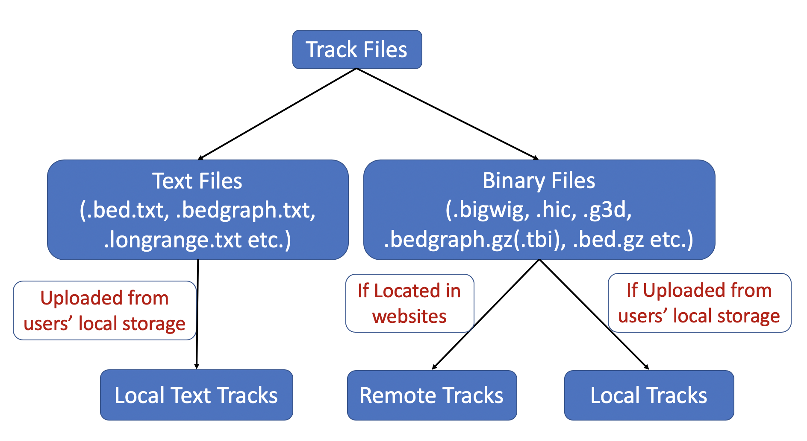

- To add a file from a website, open **Tracks** > **Remote Tracks**, choose the **Track Type**, paste the **File URL**, pick the **Assembly**, optionally give a **Track Label** and **Options** (JSON), and click **Add Track**. For types that need an index, an **Index URL** box appears; fill it in only when the index file is not next to the data file.
- To add files from your computer, see [Local tracks](local-tracks.md) and [Local text tracks](text-tracks.md).
- To add many tracks at once, or to set options in advance, list them in a [datahub](../datahub/datahub.md).

A few types in this page (`bigbedcolor`, `jaspar`, `matplot`) are not offered in the **Track Type** list of **Remote Tracks**; add them through a datahub.

## Configure your web server to enable CORS

:::danger important

Remote track files are read by the Browser over HTTP or HTTPS. The web server hosting the files must have Cross-Origin Resource Sharing (CORS) enabled.

:::

Quoted from [MDN](https://developer.mozilla.org/en-US/docs/Web/HTTP/CORS):

> Cross-Origin Resource Sharing (CORS) is a mechanism that uses additional HTTP headers to tell a browser to let a web application running at one origin (domain) have permission to access selected resources from a server at a different origin. A web application makes cross-origin HTTP request when it requests a resource that has a different origin (domain, protocol, and port) than its own origin.

The Browser is almost always served from a different domain than your track files, so the server hosting the files needs CORS enabled. For an Apache web server, try one of the following.

### Enable CORS on Apache2 under Ubuntu

Add this to the enabled `.conf` file:

```sh
Header always set Access-Control-Allow-Origin "*"
Header always set Access-Control-Allow-Headers: Range
Header always set Access-Control-Max-Age: 86400
```

Then restart your Apache server.

### Enable CORS on Apache2 under CentOS

Add this to the main configuration file `/etc/httpd/conf/httpd.conf`:

```sh
Header always set Access-Control-Allow-Origin "*"
Header always set Access-Control-Allow-Headers: Range
Header always set Access-Control-Max-Age: 86400
```

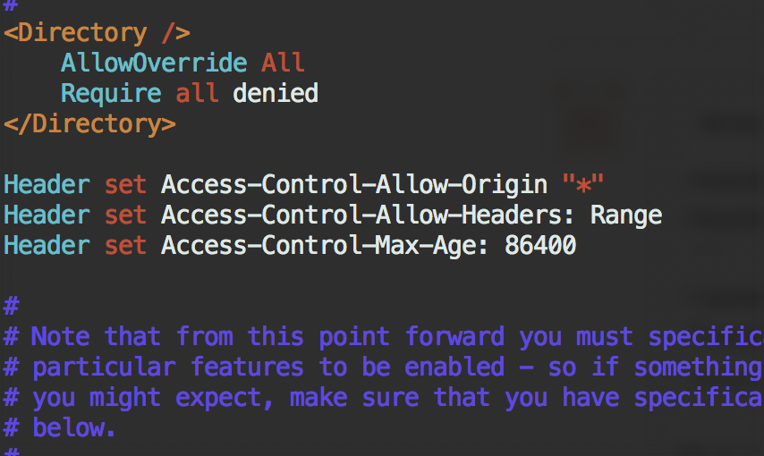

In `/etc/httpd/conf.modules.d/00-base.conf`, the headers module must be enabled:


Then restart your Apache server.

### Enable CORS on an Amazon S3 bucket

The test bucket `http://washu-track-host.s3-website-us-east-1.amazonaws.com` serves the [bigWig](#bigwig) file `http://washu-track-host.s3-website-us-east-1.amazonaws.com/bigwig/TW551_20-5-bonemarrow_MRE.CpG.bigWig`, which displays in the Browser with this CORS setup:

```json
[
    {
        "AllowedHeaders": ["*"],
        "AllowedMethods": ["GET", "HEAD"],
        "AllowedOrigins": ["*"]
    }
]
```

If you use the older XML settings:

```xml
<?xml version="1.0" encoding="UTF-8"?>
<CORSConfiguration xmlns="http://s3.amazonaws.com/doc/2006-03-01/">
<CORSRule>
    <AllowedOrigin>*</AllowedOrigin>
    <AllowedMethod>GET</AllowedMethod>
    <AllowedHeader>*</AllowedHeader>
</CORSRule>
</CORSConfiguration>
```

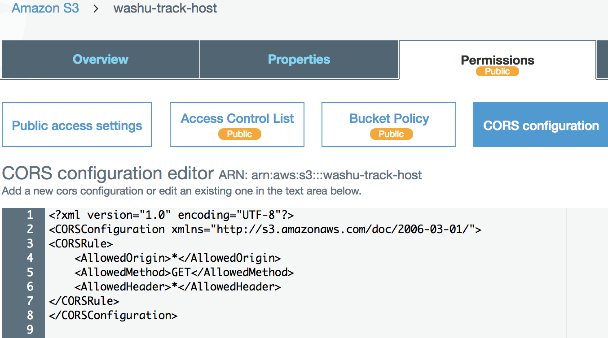

### Enable CORS on Google Cloud Storage

Track files in Google Cloud Storage can be viewed after setting a CORS policy.

First make the bucket public (see the [Google documentation](https://cloud.google.com/storage/docs/access-control/making-data-public)):

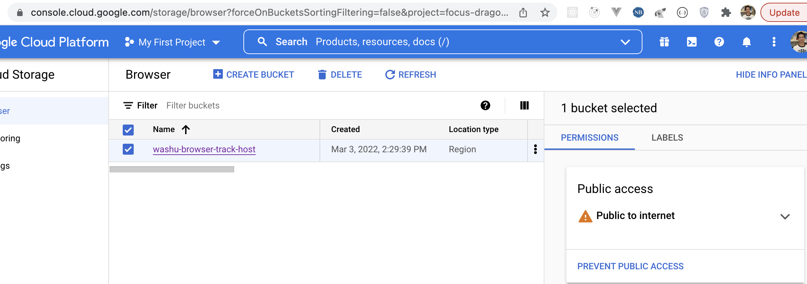

Then, with the [gsutil](https://cloud.google.com/storage/docs/quickstart-gsutil?cloudshell=true) tool or the Cloud Shell of the Google Cloud web console, create a file called `cors.json`:

```json
[
    {
    "origin": ["*"],
    "method": ["GET", "HEAD"],
    "responseHeader": ["Authorization", "Content-Range", "Accept", "Content-Type", "Origin", "Range"],
    "maxAgeSeconds": 3600
    }
]
```

and apply it to your bucket:

```sh
gsutil cors set cors.json gs://washu-browser-track-host
```

This is how it looks in Cloud Shell:

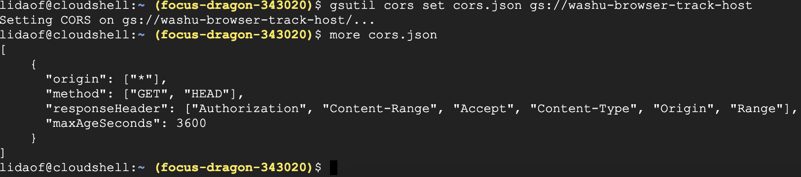

After this, copy the URL of the file and add it to the Browser.

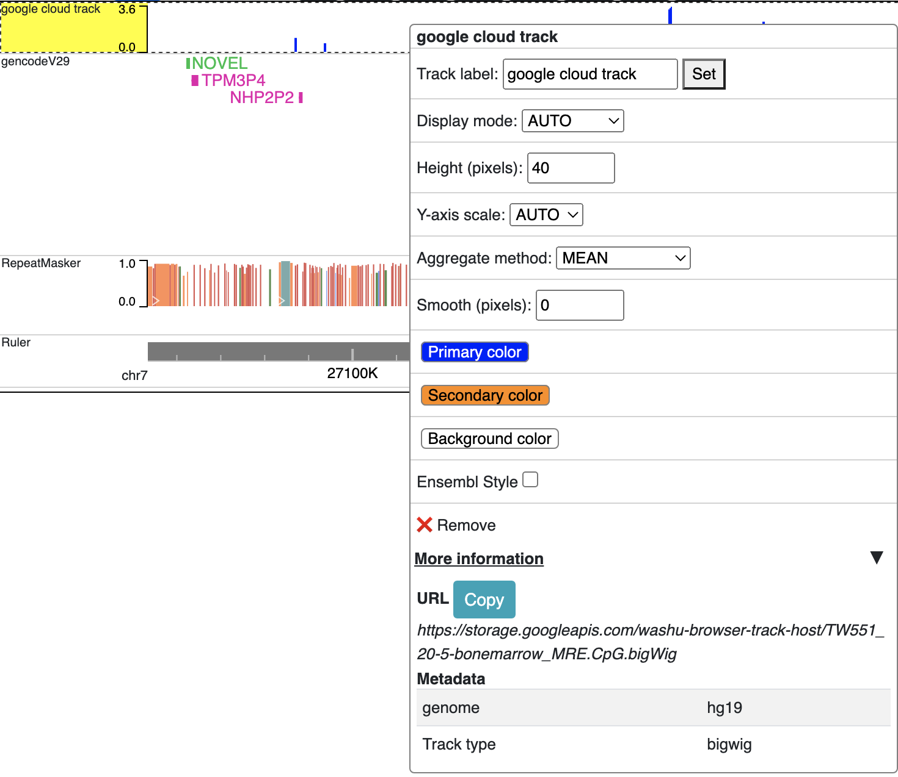

## Prepare track files

The Browser reads track files from their URL and transfers only the data inside the region on screen. All track files therefore need to be on a web server reachable over HTTP or HTTPS.

Binary formats ([bigWig](#bigwig), [bigBed](#bigbed), [hic](#hic), [bigInteract](#biginteract)) can be used directly.

Text formats ([bed](#bed), [bedGraph](#bedgraph), [bedcolor](#bedcolor), [refBed](#refbed), [hammock](#hammock), [categorical](#categorical), [methylC](#methylc), [modbed](#modbed), [qBED](#qbed), [longrange](#longrange), [VCF](#vcf)) must be [compressed by bgzip and indexed by tabix](http://www.htslib.org/doc/tabix.html). The index file (suffix `.tbi`) must sit at the same URL as the `.gz` file, with `.tbi` added; otherwise give its address in **Index URL** (or `indexUrl` in a datahub).

Bed-like files must be sorted first. For a file named `track.bedgraph` you can use the Linux `sort` command, `bedSort` from UCSC, or `sort-bed` from BEDOPS:

```sh
# Using Linux sort
sort -k1,1 -k2,2n track.bedgraph > track.bedgraph.sorted
# Using bedSort
bedSort track.bedgraph track.bedgraph.sorted
# Using sort-bed
sort-bed track.bedgraph > track.bedgraph.sorted
```

Then compress with bgzip and index with tabix:

```sh
bgzip track.bedgraph.sorted
tabix -p bed track.bedgraph.sorted.gz
```

Put `track.bedgraph.sorted.gz` and `track.bedgraph.sorted.gz.tbi` in the same directory of a web server, and use the URL of `track.bedgraph.sorted.gz`.

SAM files must be converted to [BAM](#bam), coordinate sorted and indexed. The index (suffix `.bai`) must sit next to the `.bam` file:

```sh
# convert SAM to BAM
samtools view -Sb test.sam > test.bam
# coordinate sort
samtools sort test.bam > test.sorted.bam
# index
samtools index test.sorted.bam
```

## Display options

Right-click a track to open its menu. All tracks have **Track label**, **Remove** and **More information** (the track's details); most also have **Legend font color**. The other items depend on the track type and are listed in each section below. When you change an option it applies to all selected tracks (hold **Shift** and click tracks to select several).

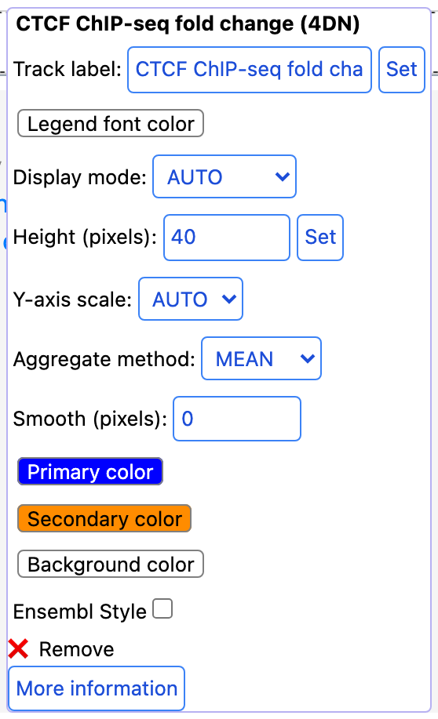

In a datahub, the same settings go in the track's `options`; see [Track properties](../datahub/track_properties.md).

## Annotation tracks

Annotation tracks show genomic features or intervals, such as peaks, genes, CpG islands or blacklisted regions.

### bed

`bed` files annotate elements across the genome or represent sequencing reads. For the format, see the [UCSC bed](https://genome.ucsc.edu/FAQ/FAQformat.html#format1) page.

Example lines:

```sh
chr9    3035610 3036180 Blacklist_155   .   +
chr9    3036200 3036480 Blacklist_156   .   +
chr9    3036420 3036660 Blacklist_157   .   +
```

Every line has at least 3 fields separated by a `Tab`: `chromosome`, `start position` (0-based) and `end position` (not included). The 4th (optional) column is the name of the interval and the 6th (optional) column is the strand. Other columns are ignored, but may be present.

The display depends on how many columns the file has. With 3 columns each interval is a plain box. With 4 columns the name is written on the box. With 6 columns the box shows `>` or `<` for the strand, and reverse-strand items are drawn in the secondary color:

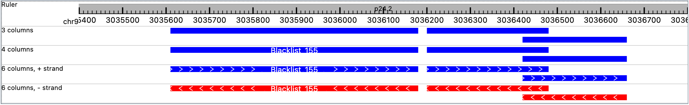

A larger example, with the gene track for reference:

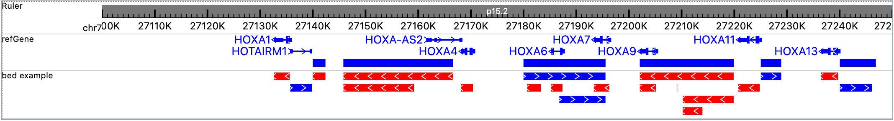

Menu items: **Display mode** (FULL draws each item; DENSITY draws the number of items per pixel), **Max rows (including overflow row)**, **Primary color**, **Secondary color** (reverse strand), **Background color**, **Hide item less than (pixels)**, **Always draw label**. When items do not fit in the rows, the last row says how many items are hidden.

The file must be compressed by bgzip and indexed by tabix; see [Prepare track files](#prepare-track-files).

### bigbed

`bigbed` is the binary form of `bed`. It can be used directly, without bgzip/tabix. For the format, see the [UCSC bigBed](https://genome.ucsc.edu/goldenPath/help/bigBed.html) page. A bed file is converted with UCSC's `bedToBigBed`:

```sh
bedToBigBed peaks.sorted.bed hg38.chrom.sizes peaks.bb
```

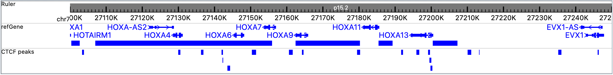

Menu items: **Display mode** (FULL, DENSITY), **Max rows (including overflow row)**, **Primary color**, **Secondary color**, **Background color**, **Always draw label**.

### bedcolor

Similar to a [bed](#bed) track, a `bedcolor` track is a 4 column bed file whose 4th column is a color:

```sh
chr11   108280000   109080000   #ff0100
chr11   109080000   109480000   #0000ff
chr11   109720000   110160000   #018100
chr11   110200000   111400000   #0064fb
chr11   111400000   112640000   #ef8c0a
chr11   112640000   113480000   #7f007f
chr11   113520000   114520000   #520000
chr11   114520000   114880000   #39ae00
```

Each interval is drawn as a full-height block in its own color.

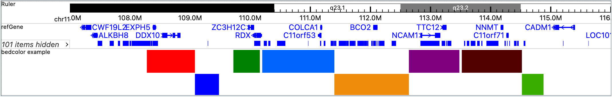

It can be uploaded as a local text track, or compressed with bgzip, indexed with tabix and added as a remote track. Menu items: **Row height**, **Max rows (including overflow row)**, **Hide item less than (pixels)**.

### bigbedcolor

`bigbedcolor` is a bigBed file whose items carry their own color. The Browser reads the color from an extra field named `color` in the file's autoSql definition; the standard bigBed `itemRgb` column is not used. Items are drawn in one row as full-height blocks. This type is not in the **Remote Tracks** type list; add it through a datahub:

```json
{
    "type": "bigbedcolor",
    "name": "my colored regions",
    "url": "https://example.com/regions.bb"
}
```

Menu items: **Display mode** (FULL, DENSITY), **Height (pixels)**, **Background color**.

### refbed

The `refbed` format lets you add a custom gene annotation track. It is similar to the refGene bed-like file from UCSC, with small changes. Each line has these columns, separated by *Tab*:

> chr, transcript_start, transcript_stop, translation_start, translation_stop, strand, gene_name, transcript_id, type, exon (including UTR bases) starts, exon (including UTR bases) stops, and additional gene info (*optional*)

:::tip

The 9th column is the gene type, simplified from the GENCODE/Ensembl annotation to `coding`, `pseudo`, `nonCoding`, `problem` and `other`. Each type is drawn in a different color.
:::

:::tip

The 10th and 11th columns are the exon starts and ends; each list is separated by commas:

```sh
start1,start2,start3,start4 stop1,stop2,stop3,stop4
100,120,140,160 110,130,150,170
```

:::

:::tip

The 12th column holds extra information. You can write it by hand, or download paired Transcript stable IDs and Gene descriptions from [Ensembl Biomart](http://useast.ensembl.org/biomart/martview/). The words in this column must be separated by *spaces*, not tabs.
:::

All of the lines below work as the 12th column:

```sh
Gene ID:ENSMUSG00000103482.1 Gene Type:TEC Transcript Type:TEC Additional Info:predicted gene, 37999 [Source:MGI Symbol;Acc:MGI:5611227]
Gene ID:ENSMUSG00000103482.1 Gene Type:TEC Transcript Type:TEC
ENSMUSG00000103482.1 TEC
Additional Info:predicted gene, 37999 [Source:MGI Symbol;Acc:MGI:5611227]
My Favorite Gene
```

A few lines in refbed format made from gencode.vM17.annotation.gtf (mouse mm10):

```sh
chr1    24910461    24911659    24910461    24911659    -   RP23-109H7.1    ENSMUST00000187022.1    pseudo  24911220,24910461   24911659,24910681   Gene ID:ENSMUSG00000100808.1 Gene Type:processed_pseudogene Transcript Type:processed_pseudogene Additional Info:predicted gene 28594 [Source:MGI Symbol;Acc:MGI:5579300]
chr1    25203443    25205696    25203443    25205696    -   Adgrb3  ENSMUST00000190202.1    coding  25203443    25205696    Gene ID:ENSMUSG00000033569.17 Gene Type:protein_coding Transcript Type:retained_intron Additional Info:adhesion G protein-coupled receptor B3 [Source:MGI Symbol;Acc:MGI:2441837]
chr1    25276404    25277954    25276404    25277954    -   RP23-21P2.4 ENSMUST00000193138.1    problem 25276404    25277954    Gene ID:ENSMUSG00000104257.1 Gene Type:TEC Transcript Type:TEC Additional Info:predicted gene, 20172 [Source:MGI Symbol;Acc:MGI:5012357]
chr1    26566833    26566938    26566833    26566938    +   Gm24064 ENSMUST00000157486.1    nonCoding   26566833    26566938    Gene ID:ENSMUSG00000088111.1 Gene Type:snoRNA Transcript Type:snoRNA Additional Info:predicted gene, 24064 [Source:MGI Symbol;Acc:MGI:5453841]
```

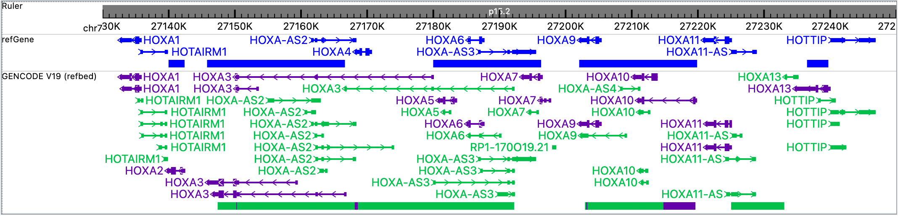

The optional last column is used as the gene description. The format can be made from the refGene.bed downloads of UCSC. GENCODE and Ensembl GTF files can be converted with the `Converting_Gencode_or_Ensembl_GTF_to_refBed.bash` script in the eg-react [scripts](https://github.com/lidaof/eg-react/tree/master/backend/scripts) folder. By default the script puts `Gene ID:`, `Gene Type:` and `Transcript Type:` in the additional information column. If you also give it an annotation file with the columns Transcript_ID and Description (separated by a tab), it adds "Additional Info" to the 12th column. The script needs bedtools, bgzip and tabix. An `awk` array in the script reclassifies the gene types and can be edited for other gene types.

```sh
bash Converting_Gencode_or_Ensembl_GTF_to_refBed.bash Ensembl my.gtf my_optional_annotation.txt
bash Converting_Gencode_or_Ensembl_GTF_to_refBed.bash Gencode gencode.vM17.annotation.gtf
bash Converting_Gencode_or_Ensembl_GTF_to_refBed.bash Gencode gencode.vM17.annotation.gtf biomart_2col.txt
```

:::danger important

`GTF` files use spaces as delimiters, so replace spaces inside gene names before processing, for example:

```sh
sed -i 's/ (1 of many)/_(1_of_many)/g' Danio_rerio.GRCz10.91.chr.gtf
```

:::

The file must be compressed by bgzip and indexed by tabix; see [Prepare track files](#prepare-track-files).

Menu items: **Display mode** (FULL, DENSITY), **Max rows (including overflow row)**, **Primary color**, **Secondary color**, **Background color**.

### hammock

`hammock` is the scored annotation format of the 1st-generation browser. It is supported so that existing files and legacy datahubs keep working; for new data, [bed](#bed) or [bedGraph](#bedgraph) are recommended.

A hammock file is a 4 column, bgzip compressed and tabix indexed bed-like file. The 4th column describes the item as comma separated `key:value` fields:

```sh
chr1    3661194 3661958 scorelst:[3.37749,5.17927],id:1,name:"peak_1",
chr1    4775253 4776272 scorelst:[4.67955,10.92129],id:2,name:"peak_2",strand:"+",
```

- `name`: the item's name
- `id`: the item's identifier
- `strand`: `+` or `-` (`>` and `<` are also accepted)
- `scorelst`: one or more scores of the item

Any other field is listed when the item is clicked.

The track has three display modes, set with the `displayMode` option:

- `barplot` (default): each item is a bar as tall as its score. `scoreIndex` selects which entry of `scorelst` is plotted (0 is the first), and the y-axis follows the `yScale`/`yMax`/`yMin` options (see [Track properties](../datahub/track_properties.md)). If no item has a non-zero score the items are drawn as full height boxes. Items are never hidden for being narrow; when several items narrower than a pixel fall on the same pixel, the tallest one is drawn.
- `full`: items are drawn as boxes with their names, same as a [bed](#bed) track.
- `density`: the number of items per pixel.

```json
{
    "type": "hammock",
    "name": "Pol2 peaks",
    "url": "https://example.com/peaks.hammock.gz",
    "options": {
        "displayMode": "barplot",
        "scoreIndex": 0,
        "scoreNames": ["signal value", "P value (-log10)"],
        "color": "#990005",
        "height": 40
    }
}
```

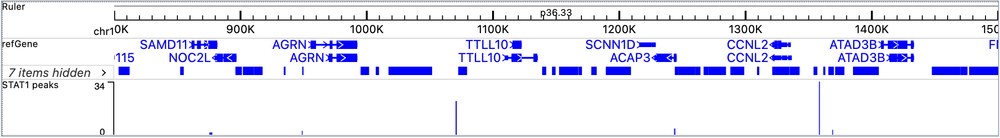

### categorical

Categorical tracks show genomic bins that belong to different categories. The most common example is chromHMM data, which marks each region as a likely enhancer, promoter, and so on. Other uses include types of methylation regions (DMRs, DMVs, LMRs, UMRs, ...) or peaks colored by tissue.

The `categorical` format uses the first three columns of the [bed](#bed) format (`chromosome`, `start position` (0-based), `end position` (not included)) plus a 4th column with the category, which can be a string or a number:

```sh
chr1    start1  end1    category1
chr2    start2  end2    category2
chr3    start3  end3    category3
chr4    start4  end4    category4
```

The name and color of each category are set with the `category` option, in the track's **Options** or in a datahub:

```json
{
    "type": "categorical",
    "name": "E071 Brain Hippocampus Middle chromHMM",
    "url": "https://egg2.wustl.edu/roadmap/data/byFileType/chromhmmSegmentations/ChmmModels/core_K27ac/jointModel/final/E071_18_core_K27ac_hg38lift_stateno.bed.gz",
    "options": {
        "category": {
            "1": {"name": "Active TSS", "color": "#ff0000"},
            "2": {"name": "Flanking TSS", "color": "#ff4500"},
            "5": {"name": "Strong transcription", "color": "#008000"},
            "9": {"name": "Active Enhancer1", "color": "#ffc34d"},
            "18": {"name": "Quiescent/Low", "color": "#ffffff"}
        }
    }
}
```

(The example above lists only some of the 18 states.)

:::danger important

When numbers such as 1, 2 and 3 are used as category names, write them as strings (`"1"`, not `1`) in the `category` option.
:::

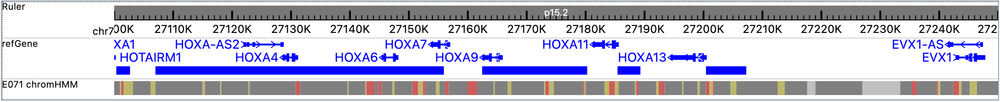

Menu items: **Row height**, a **Category**/**Color** table where you can change the color of each category, **Background color**, **Max rows (including overflow row)**, **Hide item less than (pixels)**.

The file must be compressed by bgzip and indexed by tabix; see [Prepare track files](#prepare-track-files).

### RepeatMasker {#repeatmasker}

The `repeatmasker` track shows RepeatMasker annotation from a bigBed file, colored by repeat class. An hg38 file that works is `https://vizhub.wustl.edu/public/hg38/rmsk16.bb`. The file can be used directly, without bgzip/tabix.

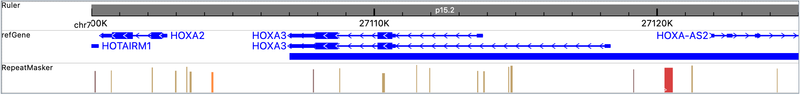

Menu items: **Display mode** (FULL, DENSITY), **Height (pixels)**, **Background color**, **Hide item less than (pixels)**.

### rmskv2

`rmskv2` (RepeatMasker V2) shows the structure of each repeat, colored by class, as in the T2T genome browsers. If you have your own RepeatMasker output, convert it to bigBed with these steps:

1. Use [rm2gff3](https://github.com/clemgoub/rm2gff3) to convert the `repeatmasker.out` file to GFF3.
2. Use the [format_gff.py](https://github.com/lidaof/eg-react/files/14272508/format_rmgff.py.txt) script (rename it to a `.py` file after download) to convert the GFF3 into the BED9+4 format expected by `rmskv2`.
3. Run `bedToBigBed -as rmskv2.as -type=bed9+4 repeatmasker.bed genome.chrom.sizes repeatmasker.bb` with this [rmskv2.as](https://github.com/lidaof/eg-react/files/14272535/rmskv2.as.txt) file.

See [this discussion](https://github.com/lidaof/eg-react/issues/345#issuecomment-1942661099) for more details.

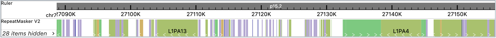

Menu items: **Display mode** (FULL, DENSITY), **Height (pixels)**, **Background color**, **Hide item less than (pixels)**.

### jaspar

The `jaspar` track shows predicted transcription factor binding sites from a [JASPAR](https://jaspar.elixir.no/) bigBed file, such as `https://hgdownload.soe.ucsc.edu/gbdb/hg38/jaspar/JASPAR2022.bb` from UCSC. Each site is labeled with its factor and drawn more opaque the higher its score. For hg38 the track is also in **Tracks** > **Annotation Tracks** as **JASPAR Transcription Factors 2022**. It is not in the **Remote Tracks** type list; to add another file, use a datahub. See the figure in [dynseq](#dynseq).

Menu items: **Display mode** (FULL, DENSITY), **Max rows (including overflow row)**, **Primary color**, **Secondary color**, **Background color**, **Hide item less than (pixels)**, **Always draw label**.

## Variant tracks

### VCF {#vcf}

`VCF` files of variant calls can be displayed. The file must be compressed by bgzip and indexed by tabix. The track has 3 display modes: **AUTO**, **DENSITY** and **FULL**. In **AUTO** (the default), a region wider than 100 kb is shown as a numerical track of the number of variants, and a region of 100 kb or less is shown in **FULL** mode, one item per variant. The example below is the 1000 Genomes chromosome 7 file `https://hgdownload.soe.ucsc.edu/gbdb/hg38/1000Genomes/ALL.chr7.shapeit2_integrated_snvindels_v2a_27022019.GRCh38.phased.vcf.gz` from UCSC.

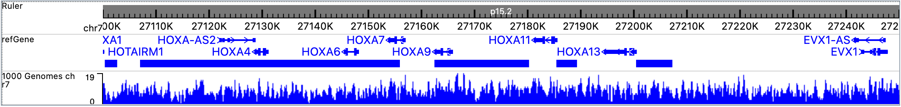

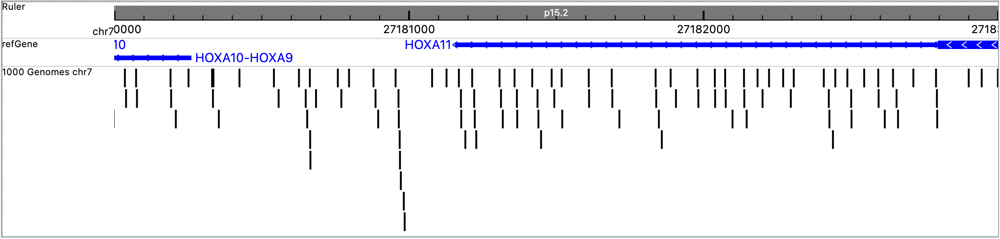

Menu items: **Display mode**, **Color variant by** (allele frequency **AF**, or quality **QUAL**) with **High value color** and **Low value color**, **Ensembl Style**, **Background color**, **Row height**, **Max rows (including overflow row)**, **Always draw label**.

## Numerical tracks

Numerical tracks show a value along the genome, such as ChIP-seq signal or conservation. All of them share these menu items:

- **Display mode**: **AUTO** (the default, a bar chart), **BAR**, or **HEATMAP** (the value as color intensity, useful for many tracks in little space).
- **Height (pixels)**.
- **Y-axis scale**: **AUTO** fits the data in view; **FIXED** lets you set the maximum and minimum.
- **Aggregate method**: how values that fall in the same pixel are combined: **MEAN**, **SUM**, **COUNT**, **MIN** or **MAX**.
- **Smooth (pixels)**: average over a window of this many pixels.
- **Primary color** (positive values), **Secondary color** (negative values), **Background color**.
- **Ensembl Style**: tick this when the file names chromosomes `1`, `2`, ... instead of `chr1`, `chr2`, ....

### bigWig {#bigwig}

`bigWig` is a popular binary format of numerical values over genomic coordinates. See the [UCSC bigWig](https://genome.ucsc.edu/goldenpath/help/bigWig.html) page to learn more.

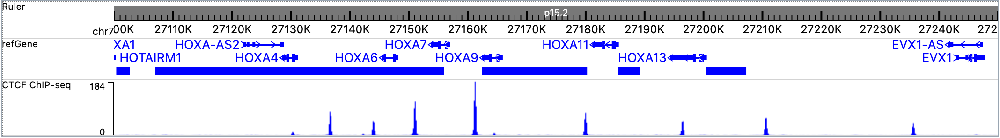

### bedGraph {#bedgraph}

`bedGraph` also defines values at genomic locations. See the [UCSC bedGraph](https://genome.ucsc.edu/goldenpath/help/bedgraph.html) page for the format.

Example lines:

```sh
chr12   6537598 6537599 28.80914
chr12   6537599 6537600 28.96908
chr12   6537599 6537612 -2
chr12   6537600 6537601 29.30229
```

Every line has 4 fields separated by `Tab`: `chromosome`, `start position` (0-based), `end position` (not included), and `value`.

:::tip

You can use negative values for the reverse strand. Positive and negative values may overlap the same coordinates. In `bigWig` negative values are allowed too, but they cannot overlap positive values.
:::

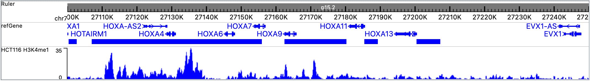

The file must be compressed by bgzip and indexed by tabix; see [Prepare track files](#prepare-track-files).

### qBED {#qbed}

qBED is a tab-delimited, plain text format for discrete genomic data, such as transposon insertions (calling cards). It has at least four and at most six columns. The four required columns are CHROM, START, END and VALUE, where VALUE is a number (integer or float). As in BED files, START and END are 0-based. The optional fifth and sixth columns are STRAND and ANNOTATION. ANNOTATION can hold sample- or entry-specific information, such as a replicate barcode. A four-column qBED file:

```sh
chr1    41954321        41954325        1
chr1    41954321        41954325        18
chr1    52655214        52655218        1
chr1    52655214        52655218        1
chr1    54690384        54690388        3
chr1    54713998        54714002        1
chr1    54713998        54714002        1
chr1    54713998        54714002        13
chr1    54747055        54747059        1
chr1    54747055        54747059        4
chr1    60748489        60748493        2
```

A six-column qBED file:

```sh
chr1    51441754        51441758        1       -       CTAGAGACTGGC
chr1    51441754        51441758        21      -       CTTTCCTCCCCA
chr1    51982564        51982568        3       +       CGCGATCGCGAC
chr1    52196476        52196480        1       +       AGAATATCTTCA
chr1    52341019        52341023        1       +       TACGAAACACTA
chr1    59951043        59951047        1       +       ACAAGACCCCAA
chr1    59951043        59951047        1       +       ACAAGAGAGACT
chr1    61106283        61106287        1       -       ATGCACTACTTC
chr1    61106283        61106287        7       -       CGTTTTTCACCT
chr1    61542006        61542010        1       -       CTGAGAGACTGG
```

You can have a strand column without a barcode, but not a barcode without a strand column. The file must be sorted by the first three columns:

```sh
sort -k1V -k2n -k3n example.qbed > example_sorted.qbed
# or, with bedops
sort-bed example.qbed > example_sorted.qbed
```

Then compress and index it:

```sh
bgzip example_sorted.qbed
tabix -p bed example_sorted.qbed.gz
```

Each entry is drawn as a circle whose height is its value, colored by strand (**Primary color** for `+`, **Secondary color** for `-`).

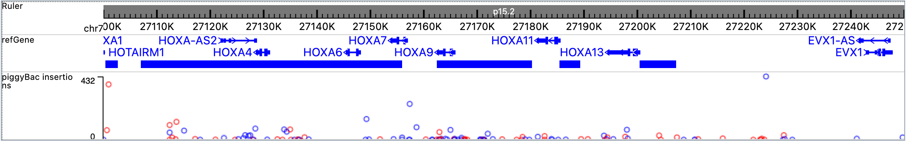

Menu items: **Height (pixels)**, **Y-axis scale**, **Logarithm** (**NONE** or **LOG10**), **Show** (**ALL** entries, or a **SAMPLE** of them when there are many), **Opacity**, **Marker size**, **Primary color**, **Secondary color**, **Background color**, **Horizontal line** (draw a line at a value you choose).

### boxplot

A `boxplot` track reads a [bigWig](#bigwig) or [bedGraph](#bedgraph) file and shows its values as box plots over windows of the genome. See [Statistical tracks](stats-tracks.md).

### dynseq

`dynseq` was proposed and first developed by Surag Nair in Anshul Kundaje's lab at Stanford University. Its track file is a `bigWig` file with a score for each nucleotide, for example the importance scores of a machine learning model. When you zoom in far enough to see the bases, the track draws the genome sequence as letters whose heights follow the scores (letters below the line for negative scores). Zoomed out, it is drawn like a [bigWig](#bigwig) track.

The figure shows a `dynseq` track of ProCapNet contribution scores at the GAPDH promoter, with a [jaspar](#jaspar) track below it:

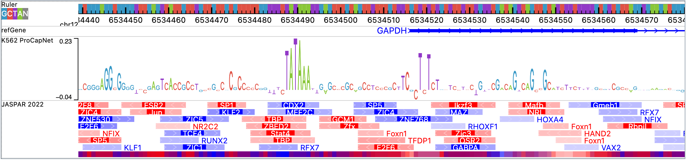

The menu is the same as for a [bigWig](#bigwig) track.

### matplot

A matplot (line plot) draws several numerical tracks on the same axes as lines, to compare them easily.

To make one, hold **Shift** and click two or more [bigWig](#bigwig) or [bedGraph](#bedgraph) tracks to select them, right-click one of them, and click **Apply matplot**. A new track named **matplot wrap**, with all the selected tracks, appears at the bottom; rename it with **Track label**.

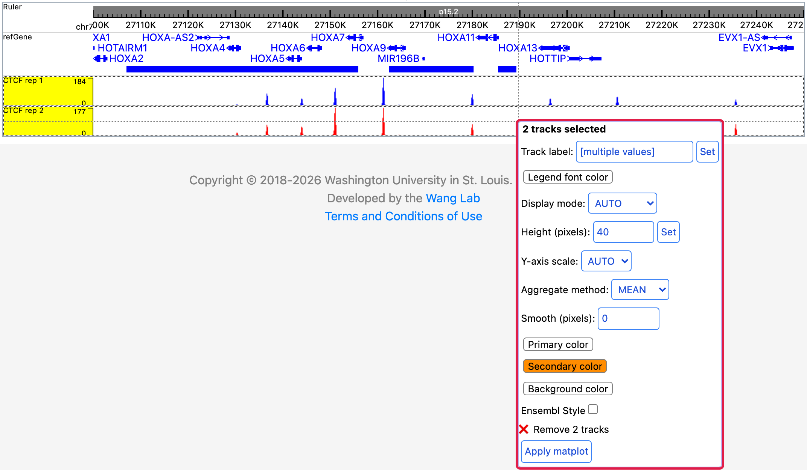

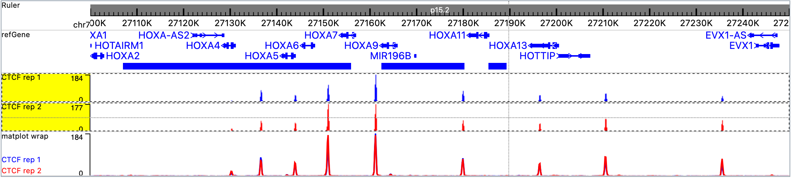

A matplot track can also be defined in a datahub, with its tracks listed in `tracks`:

```json
{
    "type": "matplot",
    "name": "CTCF rep 1 and rep 2",
    "tracks": [
        {"type": "bigwig", "name": "CTCF rep 1", "url": "https://4dn-open-data-public.s3.amazonaws.com/fourfront-webprod/wfoutput/d9b361ca-02fe-4abf-b855-f1e24fe50233/4DNFIYT914XX.bw"},
        {"type": "bigwig", "name": "CTCF rep 2", "url": "https://4dn-open-data-public.s3.amazonaws.com/fourfront-webprod/wfoutput/ac0e7fdd-1226-4b35-9aac-c57aa5115f8c/4DNFI6X18XEP.bw", "options": {"color": "red"}}
    ]
}
```

The color of each line is the **Primary color** of its track. Menu items: **Height (pixels)**, **Y-axis scale**, **Aggregate method**, **Line width**, **Smooth (pixels)**, **Background color**.

## Methylation tracks

MeDIP-seq or MRE-seq data can use the [bigWig](#bigwig) or [bedGraph](#bedgraph) formats. For whole-genome bisulfite sequencing (WGBS), when you want to show read depth, methylation context and methylation level, use [methylC](#methylc). For base modifications called on single long reads, use [modbed](#modbed).

### methylC

`methylC` is a 7 column bed format:

```sh
chr1    10542   10543   CG      0.923   -       26
chr1    10556   10557   CHH     0.040   -       25
chr1    10562   10563   CG      0.941   +       17
chr1    10563   10564   CG      0.958   -       24
chr1    10564   10565   CHG     0.056   +       18
chr1    10566   10567   CHG     0.045   -       22
chr1    10570   10571   CG      0.870   +       23
chr1    10571   10572   CG      0.913   -       23
```

The tab-separated fields are `chromosome`, `start position` (0-based), `end position` (not included), `methylation context` (CG, CHG, CHH, ...), `methylation value`, `strand`, and `read depth`.

The track draws the methylation level of each context as colored bars, the forward strand above the center line and the reverse strand below it, and the read depth as a line.

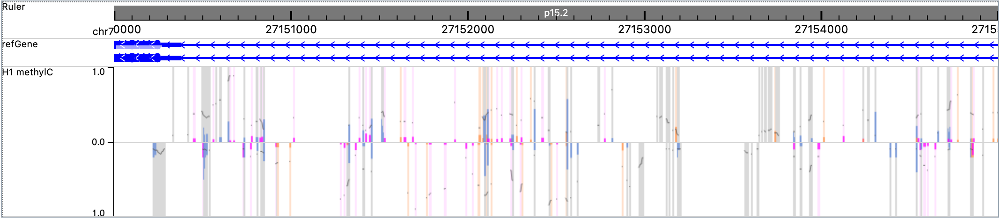

Menu items: **Height (pixels)**, **Combine strands** (draw the two strands as one plot instead of above and below the line), a **Context**/**Color**/**Background** table to change the colors of CG, CHG and CHH (other contexts can be given colors in a datahub), **Methylation value max**, **Depth filter** (hide sites with lower read depth), **Background color**.

The file must be compressed by bgzip and indexed by tabix; see [Prepare track files](#prepare-track-files).

### modbed

`modbed` shows base modifications (for example CpG methylation or m6A) on single long reads, such as PacBio HiFi or Oxford Nanopore reads. Each line is one read, with 8 tab-separated columns:

```sh
chr1    10000   25932   m64011_190830_220126/57868969/ccs   0   +   470,-471,483,-484,488,-489,...   468,-469,588,-589,635,-636,...
```

The columns are `chromosome`, `start`, `end`, `read name`, `score`, `strand`, the positions of the **modified** bases, and the positions of the **unmodified** bases. Positions are comma-separated offsets from the start of the read. The file must be compressed by bgzip and indexed by tabix.

**Display mode** has three choices. In **SUMMARY**, the track shows, for each pixel, the fraction of modified bases among the reads, with a line for the read coverage. In **DETAIL**, each read is drawn as a row with its modified and unmodified bases. **AUTO** (the default) shows the summary when you are zoomed out and the single reads when you zoom in.

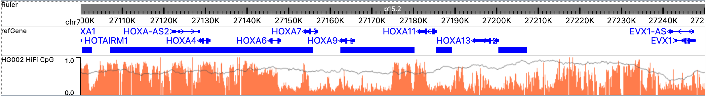

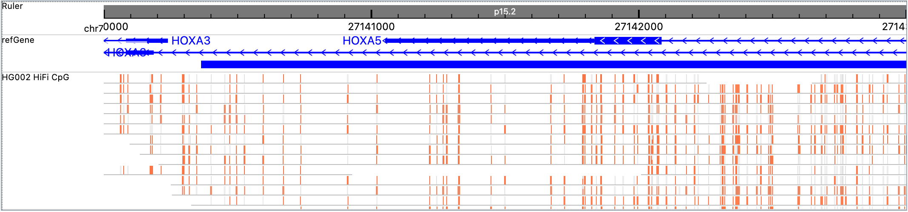

Other menu items: **Row height**, **Primary color** (modified), **Secondary color** (unmodified), **Max rows (including overflow row)**, **Hide item less than (pixels)**, **Height (pixels)**, **Y-axis scale**, **Sort items order**, **Hide minimal items**, **Padding drawing tick**.

## Long-range chromatin interaction

Long-range interaction tracks show relationships between pairs of genomic regions, from experiments such as Hi-C, ChIA-PET, HiChIP or eQTL studies.

All interaction tracks share the **Display mode** item:

- **HEATMAP**: each interaction is a diamond in a triangle below the genome; the color shows the score.
- **ARC**: each interaction is an arc between its two ends.
- **FLATARC**: arcs of the same height.
- **SQUARE**: a square contact matrix.

Other common items: **Height (pixels)**, **Score scale** (**AUTO**, or **FIXED** with a maximum and minimum you set), **Primary color**, **Secondary color**, **Background color**.

### HiC {#hic}

`.hic` files are made by [Juicer](https://github.com/aidenlab/juicer/wiki/Data). They can be used directly.

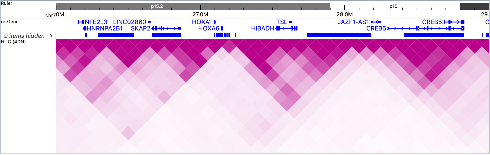

Hi-C tracks have extra menu items: **Bin size** (**AUTO** picks one for the zoom level; or choose 10M down to 1K), **Normalization** (**NONE**, **VC**, **VC_SQRT**, **KR**), **Max Score percentile**, **Max value filter**, **Min value filter**, **Data in current view (no expansion)**, **Both anchors in view window**, and **Scale with height**. In **ARC** and **FLATARC** modes there is also a line width.

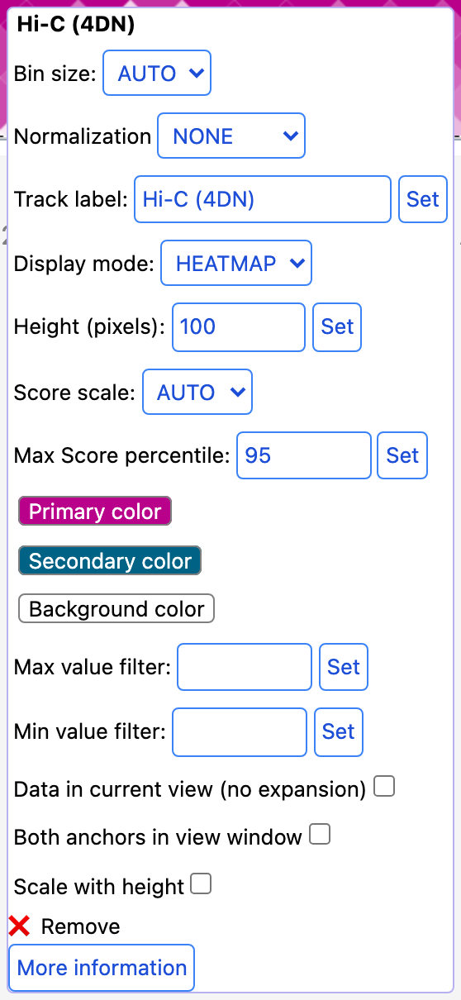

### longrange

`longrange` is a [bed](#bed)-like format. Each line has, from left to right, `chromosome`, `start position` (0-based), `end position` (not included), and the interacting region with the score, written as `chr2:333-444,55`. For example, if "chr1:111-222" interacts with "chr2:333-444" with a score of 55, write these two lines:

```sh
chr1    111 222  chr2:333-444,55
chr2    333 444  chr1:111-222,55
```

:::danger important

Make **TWO** records for each pair of interacting loci, one record for each locus.
:::

The file must be compressed by bgzip and indexed by tabix; see [Prepare track files](#prepare-track-files).

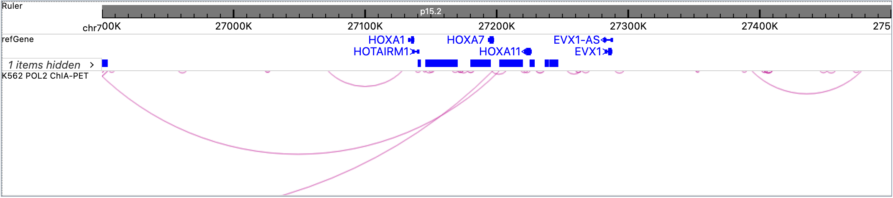

Menu items: the common ones above, plus **Max value filter**, **Min value filter**, **Data in current view (no expansion)**, **Both anchors in view window** and **Scale with height**.

### bigInteract {#biginteract}

The bigInteract format from UCSC can be used directly. For details of the format, see the [UCSC bigInteract format](https://genome.ucsc.edu/goldenPath/help/interact.html) page. The example below is the GTEx eQTL file `https://hgdownload.soe.ucsc.edu/gbdb/hg38/gtex/eQtl/gtexEqtlsCaviarHighConf.interact.bb` from UCSC, in **ARC** mode:

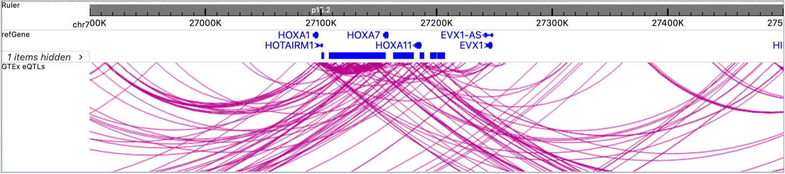

Menu items: the common ones above.

## Read alignment tracks

### bam

The `bam` format is the compressed form of SAM, used for sequence alignments. See the [SAM/BAM specification](https://samtools.github.io/hts-specs/SAMv1.pdf) to learn about the format and how to work with it. BAM files must be coordinate sorted and indexed; see [Prepare track files](#prepare-track-files).

Zoom in to a few kilobases to see the reads. In **FULL** mode each read is drawn as a bar, in the **Primary color** for the forward strand and the **Secondary color** for the reverse strand.

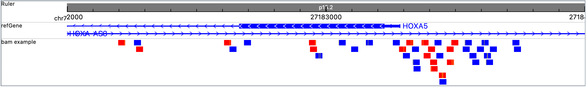

Menu items: **Display mode** (FULL, DENSITY), **Max rows (including overflow row)**, **Primary color**, **Secondary color**, **Mismatched base color** (in FULL mode), **Y-axis scale** and **Smooth** (in DENSITY mode), **Background color**.

### genome-align

`genomealign` tracks show a pairwise whole-genome alignment between the current genome and another genome. See [Comparative browsing](../use-the-browser/comparative-browsing.md).

## Other track types

- **Image tracks** (`omeroidr`) show microscopy images from the Image Data Resource placed on the genes they belong to. See [Image tracks](image-tracks.md).
- **3D structure** (`g3d`) files are shown in the 3D viewer. See [3D structure](3d.md).
- **Dynamic tracks** (`dynamic`, `dynamicbed`, `dbedgraph`, `dynamichic`, `dynamiclongrange`) animate several tracks over time. See [Dynamic tracks](dynamic-tracks.md).
- **Gene annotation** (`geneannotation`) and **SNV** (`snp`) tracks get their data from a web service, not from a file. See [API based tracks](api-tracks.md).

:::info

`rgbpeak`, `cool`, `omero4dn` and the pairwise SNV types (`pairwise`, `snv`, `snv2`) of the previous version of the Browser are not supported in this version.
:::
