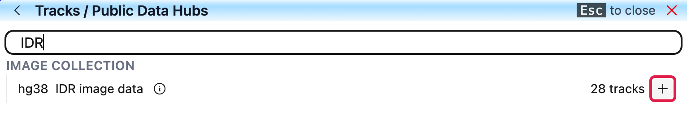

# Image tracks

Image tracks place microscopy images on the genome. Each image is linked to the gene it is about (for example the gene knocked down or tagged in the experiment), so when you view a gene you can see the images of that gene from imaging studies. The Browser supports images from the [Image Data Resource (IDR)](https://idr.openmicroscopy.org/), with the track type `omeroidr`.

## Load the IDR image hub (hg38)

The human hg38 genome has a public data hub with 28 image tracks from IDR studies.

1. Open hg38 and go to a gene, for example `NCAPD2`.
2. Open **Tracks** > **Public Data Hubs**.
3. Type `IDR` in **Search hubs...**. The **IDR image data** hub is listed under **IMAGE COLLECTION**.
4. Click the **+** button at the end of its row.



The button turns into a check mark, one image track of the hub is added to the view, and a facet table of all 28 tracks of the hub appears at the top of the panel. Use the facet table to add the other image tracks (see [Tracks menu](../use-the-browser/tracks-menu.md)).

## Track file format

An `omeroidr` track file is a bed-like file, compressed by bgzip and indexed by tabix (see [Prepare track files](file-tracks.md#prepare-track-files)). Each line is one genomic region, usually a gene, and has 4 tab-separated columns: `chromosome`, `start`, `end`, and a JSON list of the images for that region. Each image has its IDR image ID (`imageId`) and a `details` object describing it:

```sh
chr12    6493355    6531955    [{"imageId": "5514108", "details": {"Dataset Name": "NCAPD2", "Image Name": "c0009_r0004_ana_early.companion.ome", "Characteristics [Cell Line]": "HeLa", "Assay Name": "c0009_r0004_ana_early"}}, {"imageId": "5514107", "details": {"Dataset Name": "NCAPD2", "Image Name": "c0010_r0003_ana_early.companion.ome", "Characteristics [Cell Line]": "HeLa", "Assay Name": "c0010_r0003_ana_early"}}]
```

The line above is shortened from `https://vizhub.wustl.edu/public/imagetrack/hg38/hg38-screenID-754-track.bed.gz`, the hub's track for the IDR study idr0052 (experiment C, a map of condensin proteins). The thumbnails and images are fetched from the IDR server by their image ID. In a datahub, such a track is written as:

```json
{
    "type": "omeroidr",
    "name": "idr0052-walther-condensinmap-experimentC-754",
    "url": "https://vizhub.wustl.edu/public/imagetrack/hg38/hg38-screenID-754-track.bed.gz"
}
```

## Options

Right-click an image track to open its menu:

- **Display mode**: **FULL** (image thumbnails) or **DENSITY**.
- **Image height**: the height of each thumbnail, in pixels.
- **Background color**.

:::info

Images from the 4D Nucleome data portal (`omero4dn` tracks), which the previous version of the Browser showed for mouse mm10, are not supported in this version.
:::
