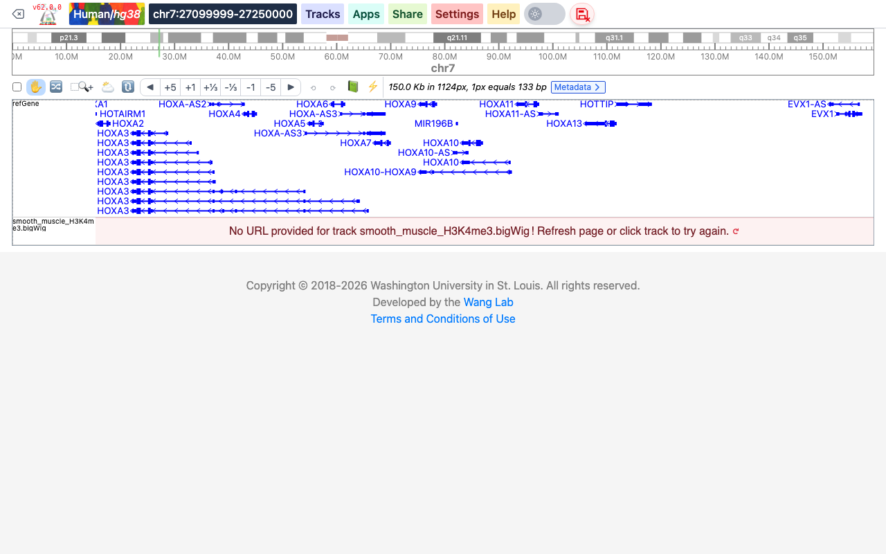
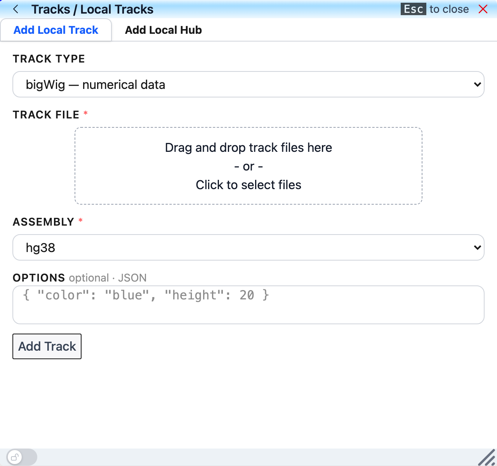
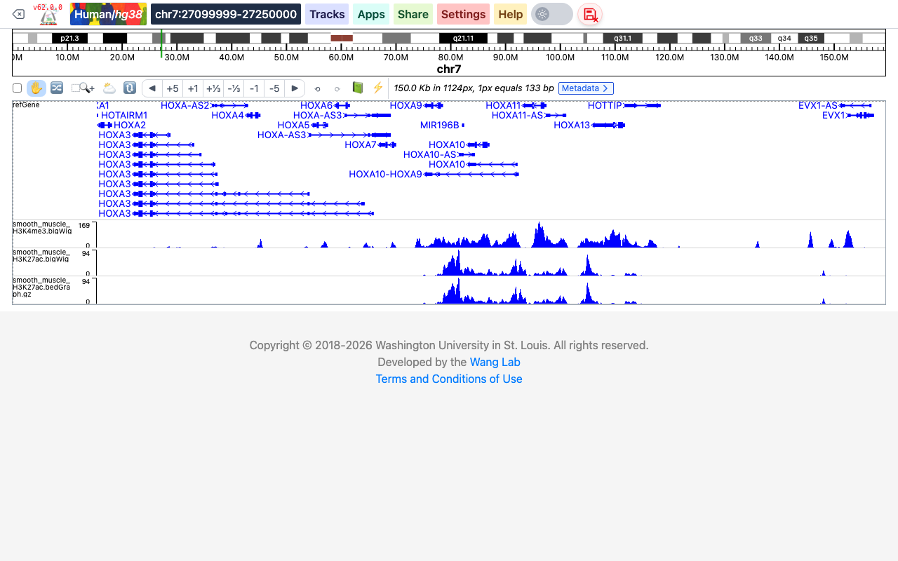
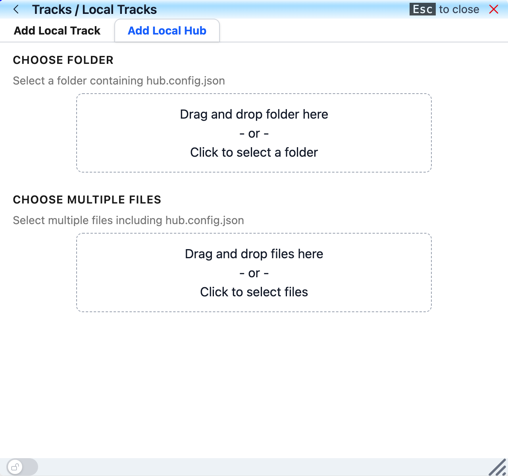
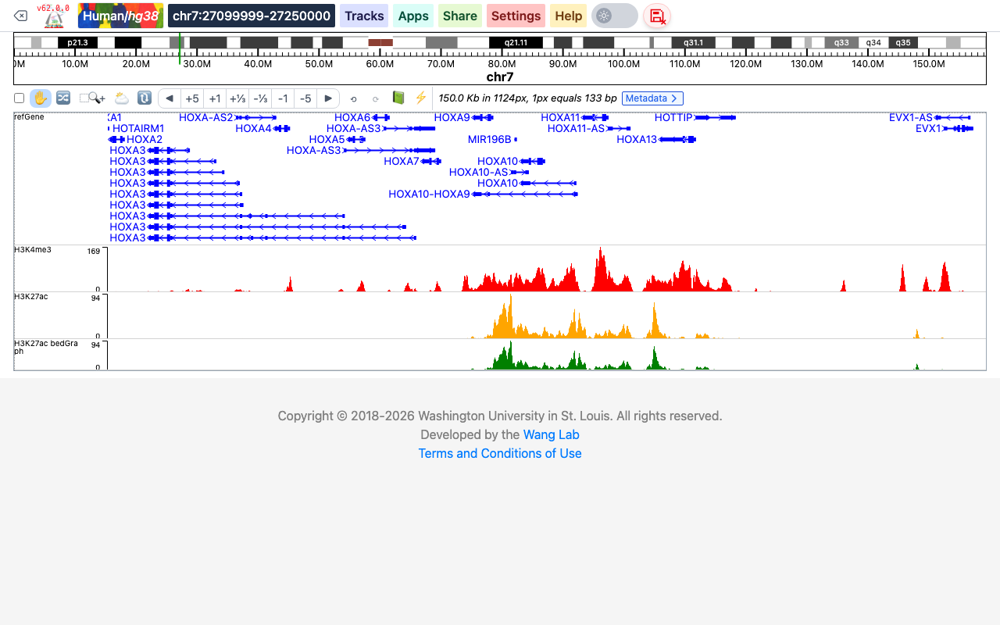

# Local tracks

Not every research group can set up a web server with CORS enabled. With local tracks you can **view** track files that are on your own computer. The files are read by your web browser only; they are not uploaded to any server. The files must be in the same formats as tracks hosted on a web server; see [file-based tracks](./file-tracks.md) for the formats and how to prepare them.

You can add local files one type at a time, or describe many files of different types in a `hub.config.json` file and load them together as a local data hub.

:::warning
Local tracks cannot be kept across a page refresh. Your web browser only lets the page read a file you have chosen in the current visit, so after a page refresh the local tracks stay in the track list but show the message "No URL provided for track ... !" instead of data. Remove them and choose the files again. To avoid choosing many files again and again, describe them in a [local data hub](#view-files-or-a-folder-as-a-data-hub). If you want to save tracks in a session or share them, host the files on a web server and add them as [remote tracks](../use-the-browser/tracks-menu.md).
:::



## View local files as tracks

1. Click **Tracks** in the navigation bar, then **Local Tracks**. The **Add Local Track** tab opens.
2. Choose the **Track Type**.
3. Drag your files onto the **Track File** box, or click the box and select them.
4. Check the **Assembly** (the current genome; if the view contains a genome comparison track, the other genome is also offered).
5. Optionally type **Options** in JSON format, for example `{ "color": "red", "height": 60 }`. They are applied to every track you add with this form; see [track properties](../datahub/track_properties.md).
6. Click **Add Track**. The message "Track added successfully" appears, and the tracks are added at the bottom of the view, labeled with their file names.



The **Track Type** list has two groups:

| Group | Track types | What to select |
| --- | --- | --- |
| Select only the track file (can select many) | bigWig, bigBed, HiC, bigInteract, dynseq, G3D | One or more files of the chosen type. Each file becomes one track. |
| Select track + index file (1 pair at a time) | bedGraph, methylC, modbed, categorical, bed, vcf, refBed, longrange, qBED, BAM | The bgzip-compressed data file **and** its index file, selected together. The index must have the name of the data file plus `.tbi` (`.bai` for BAM), for example `sample.bedGraph.gz` and `sample.bedGraph.gz.tbi`. |

If you choose a type of the second group but select only the data file, the message "Please select both track and index files" appears.

In the example below, two bigWig files were added at once, then a bedGraph file with its index (`smooth_muscle_H3K27ac.bedGraph.gz` and `smooth_muscle_H3K27ac.bedGraph.gz.tbi`):



## View files or a folder as a data hub

To view many files of different types at once, put them in one folder together with a file named `hub.config.json` that lists them. Each entry of `hub.config.json` describes one file:

```json
[
  {
    "filename": "smooth_muscle_H3K4me3.bigWig",
    "type": "bigwig",
    "name": "H3K4me3",
    "options": { "color": "red", "height": 60 }
  },
  {
    "filename": "smooth_muscle_H3K27ac.bigWig",
    "type": "bigwig",
    "name": "H3K27ac",
    "options": { "color": "orange", "height": 60 }
  },
  {
    "filename": "smooth_muscle_H3K27ac.bedGraph.gz",
    "type": "bedgraph",
    "name": "H3K27ac bedGraph",
    "options": { "color": "green" }
  }
]
```

- `filename` is the name of the file in the folder, and `type` its track type.
- `name`, `label`, `options` and `metadata` work as in a remote data hub; see [datahub syntax](../datahub/datahub.md) and [track properties](../datahub/track_properties.md).
- For types that need an index (bedGraph, bed, methylC, BAM, etc.), put the index file in the same folder, named after the data file plus `.tbi` (`.bai` for BAM). Do not list the index file in `hub.config.json`.
- Files that are not listed in `hub.config.json` are skipped. Tracks are added in the order of `hub.config.json`.

The folder for the example above contains:

```text
hub.config.json
smooth_muscle_H3K27ac.bedGraph.gz
smooth_muscle_H3K27ac.bedGraph.gz.tbi
smooth_muscle_H3K27ac.bigWig
smooth_muscle_H3K4me3.bigWig
```

To load it:

1. Click **Tracks**, then **Local Tracks**, and switch to the **Add Local Hub** tab.
2. Either drag the folder onto the **Choose Folder** box (or click the box and select the folder), or drag the files, including `hub.config.json`, onto the **Choose Multiple Files** box (or click the box and select them).



The tracks are added right away, with the names and options given in `hub.config.json`:



If no file is named `hub.config.json`, or none of the listed files is found, nothing is added.

## See also

- [Local text tracks](./text-tracks.md), to view plain-text bed, bedGraph or interaction files without compressing or indexing them.
