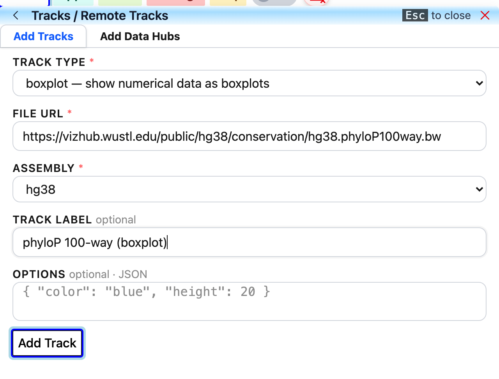
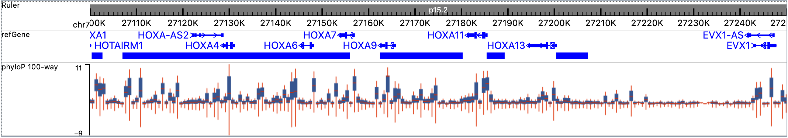
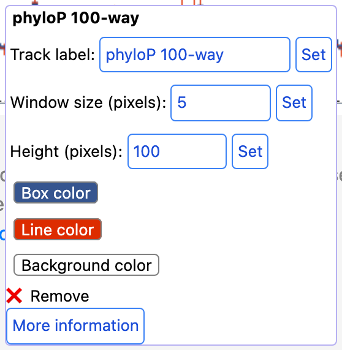

# Statistical tracks

## boxplot

A `boxplot` track shows numerical data as box plots. It reads the same files as the numerical tracks, [bigWig](file-tracks.md#bigwig) or [bedGraph](file-tracks.md#bedgraph). The view is divided into windows a few pixels wide (5 pixels by default). For each window, the track draws a box from the first to the third quartile of the values in it, a line at the median, and a vertical line showing the spread of the values. This gives a quick sense of how variable a signal is along the region, which a bar chart of averages hides.

### Add a boxplot track

Adding a boxplot track is the same as adding a numerical track, except that you choose `boxplot` as the track type:

1. Open **Tracks** > **Remote Tracks**.
2. In **Track Type**, choose **boxplot — show numerical data as boxplots** (in the **Stats** group).
3. Paste the URL of the bigWig file, or of the bgzip-compressed and tabix-indexed bedGraph file, in **File URL**.
4. Check the **Assembly**, type a **Track Label** if you like, and click **Add Track**.



The example uses the hg38 phyloP 100-way conservation scores, `https://vizhub.wustl.edu/public/hg38/conservation/hg38.phyloP100way.bw`. The new track appears at the bottom of the track list:



In a datahub, give the track `"type": "boxplot"`:

```json
{
    "type": "boxplot",
    "name": "phyloP 100-way",
    "url": "https://vizhub.wustl.edu/public/hg38/conservation/hg38.phyloP100way.bw"
}
```

### Options

Right-click the track to open its menu. You can change the **Track label**, the **Window size (pixels)** of each box, the **Height (pixels)** of the track, the **Box color**, the **Line color** (median and whiskers) and the **Background color**.


