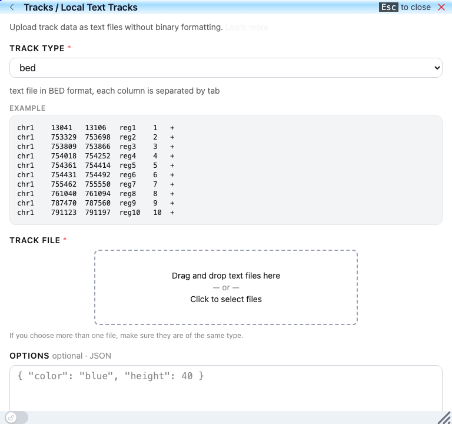
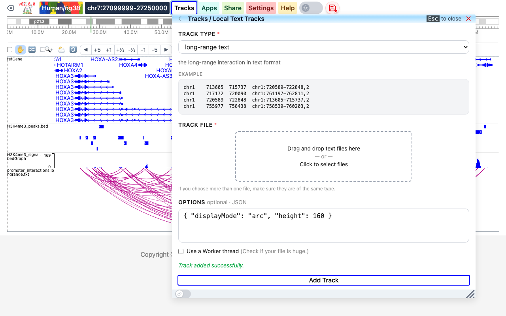
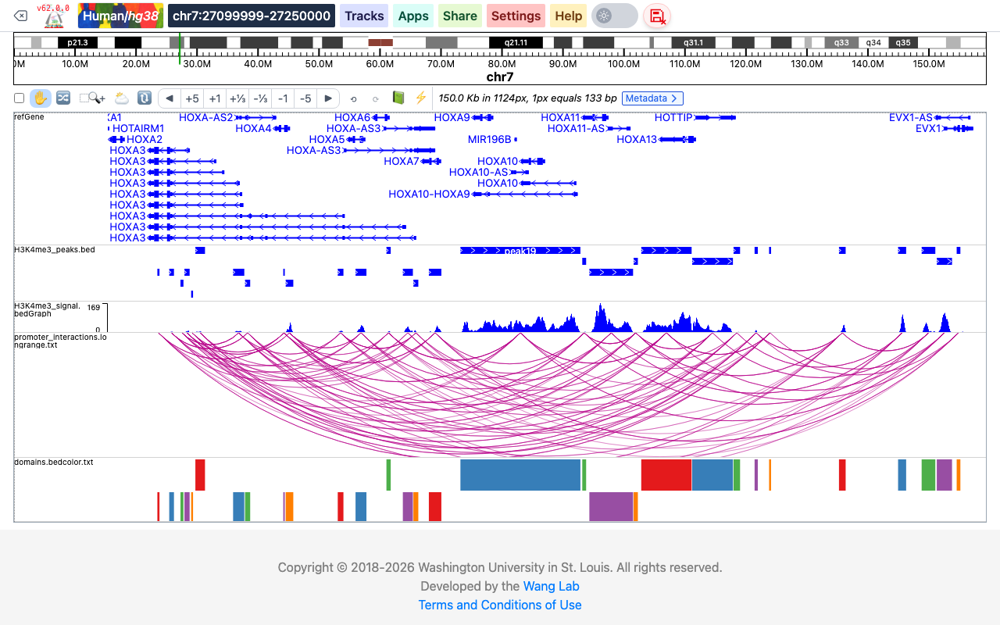

# Local text tracks

Tracks are usually prepared in an indexed or binary format, such as bigWig, bigBed, HiC or bgzip-compressed and tabix-indexed files, so the browser can read just the region on screen. Sometimes it is more convenient to look at a plain-text file directly, without converting it first. **Local Text Tracks** reads a whole text file from your computer and shows it as a track. The file is not uploaded anywhere. Once it is loaded the track is fast, because no further network requests are needed.

:::warning
Like [local tracks](./local-tracks.md), text tracks cannot be kept across a page refresh: after a refresh they stay in the track list but show "No URL provided for track ... !" instead of data. Remove them and add the files again.
:::

## Add a text track

1. Click **Tracks** in the navigation bar, then **Local Text Tracks**.
2. Choose the **Track Type**. A short description and an example of the format are shown below the list.
3. Drag your file onto the **Track File** box, or click the box and select it. You can select several files at once if they are all of the same type; each file becomes one track.
4. Optionally type **Options** in JSON format, for example `{ "color": "blue", "height": 40 }`; see [track properties](../datahub/track_properties.md).
5. If the file is very large, tick **Use a Worker thread** so the file is read in the background.
6. Click **Add Track**. The message "Track added successfully." appears and the track is added at the bottom of the view, labeled with the file name.



## Supported text formats

The **Track Type** list offers these formats. Columns are separated by tabs. For the meaning of each column, see the matching format in [file-based tracks](./file-tracks.md).

| Track Type | Description shown in the browser |
| --- | --- |
| bed | text file in BED format, each column is separated by tab |
| bedGraph | text file in bedGraph format, 4 columns bed file, each column is chromosome, start, end and value |
| refBed gene annotation | gene annotation track in refBed format |
| long-range text | the long-range interaction in text format |
| long-range format by CHiCANE | a long-range interaction format by CHiCANE |
| qBED | Text file in qBED format, comprising 4-6 columns: chrom, start, end, value; and, optionally, strand and annotation |
| bed regions with colors | standard bed 3 column format + 4th column as color string, hex or rgb or color name |

### bed

```text
chr1	13041	13106	reg1	1	+
chr1	753329	753698	reg2	2	+
chr1	753809	753866	reg3	3	+
```

### bedGraph

Chromosome, start, end and value:

```text
chr6	52155366	52155379	14
chr6	52155379	52155408	13
chr6	52155408	52155426	12
```

### refBed gene annotation

Gene models in the refBed format: chromosome, transcript start and end, coding start and end, strand, gene name, transcript ID, gene type, exon starts, exon ends and an optional description:

```text
chr1	11868	14409	11868	11868	+	DDX11L1	ENST00000456328.2	pseudo	11868,12612,13220,	12227,12721,14409,	Homo sapiens DEAD/H (Asp-Glu-Ala-Asp/His) box helicase 11 like 1 (DDX11L1), non-coding RNA.
```

### long-range text

Each line is one interaction: the first anchor as chromosome, start and end, then the second anchor and the score as `chr:start-end,score`:

```text
chr1	713605	715737	chr1:720589-722848,2
chr1	717172	720090	chr1:761197-762811,2
chr1	720589	722848	chr1:713605-715737,2
```

### long-range format by CHiCANE

The output format of the CHiCANE tool, with a header line; the first column holds both anchors as `chr:start-end<->chr:start-end`, and the last column is the score:

```text
"id"	"trans"	"b2b"	"distance"	"count"	"score"
"chr20:49368733-49369493<->chr20:50528173-50533850"	FALSE	FALSE	1161898.5	309	79.7857303792859
```

### qBED

Chromosome, start, end and value, optionally followed by strand and an annotation (for example calling-card insertions):

```text
chr1	51441754	51441758	1	-	CTAGAGACTGGC
chr1	51441754	51441758	21	-	CTTTCCTCCCCA
chr1	51982564	51982568	3	+	CGCGATCGCGAC
```

### bed regions with colors

Chromosome, start, end and a color, given as a hex code, an `rgb(...)` value or a color name:

```text
chr7	128535000	128855000	#0a4be5
chr7	128855000	128960000	#26080f
chr7	128855000	129140000	#b9abed
```

## Example

The view below has four text tracks on hg38 around the HOXA cluster: a bed file of H3K4me3 peaks, a bedGraph file of the H3K4me3 signal, a long-range text file of interactions, and a file of colored regions. Long-range text tracks are drawn as a heatmap by default; this one was added with the options `{ "displayMode": "arc", "height": 160 }`:





After a text track is added you can change it like any other track from its right-click menu; for example, the display mode of an interaction track can be switched between HEATMAP, ARC, FLATARC and SQUARE. See [Add and customize tracks](../use-the-browser/tracks-menu.md).

## What if the text file is huge?

The whole file is read into the browser, so very large text files are slow. For large data it is better to convert the file to an indexed format (for example bgzip and tabix, or bigWig/bigBed) and add it as a [local track](./local-tracks.md) or a remote track. If you still want to use the text file, tick **Use a Worker thread** before clicking **Add Track**, so the file is read in a background thread.

If you need another text format, [contact us](../contact.md).
