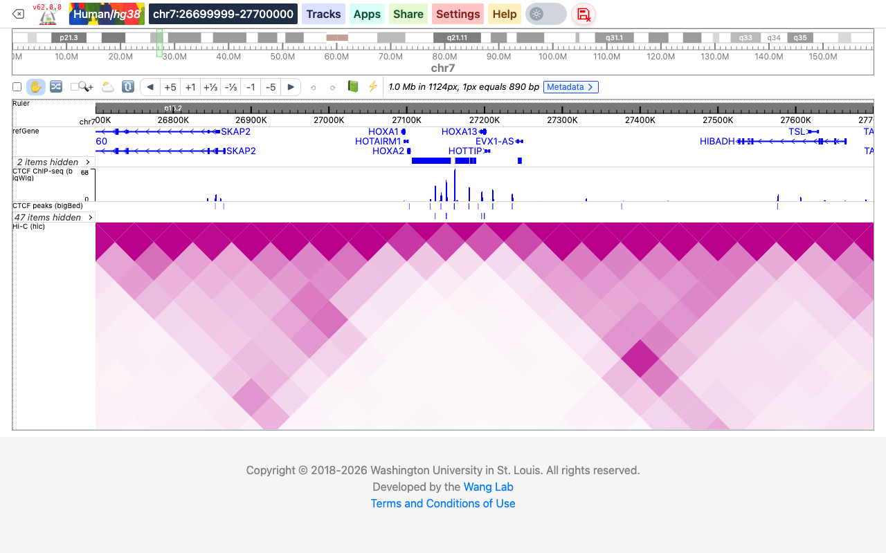

# What are tracks?

Tracks in the **WashU Epigenome Browser** are the rows of data shown under the ruler, one row per dataset. Each track reads data tied to **genomic coordinates**. When you move to a region, the Browser **fetches** the data for that region, **reformats** it and **draws** it.

## Where the data come from

Tracks fall into **two main types**, based on how the data are fetched:

1. **File-based tracks** read data from track files, such as **bigWig, bigBed, BAM, Hi-C or VCF** files, hosted on a web server or on your own computer. Only the part of the file that covers the region on screen is read. See [File-based tracks](file-tracks.md), [Local tracks](local-tracks.md) and [Local text tracks](text-tracks.md).
2. **API-based tracks** get data from a web service (an API) that queries a database: the gene annotation tracks and the SNV track. See [API based tracks](api-tracks.md).

## Kinds of tracks

| Kind | Track types | Page |
| --- | --- | --- |
| Annotation (intervals, genes, repeats, motifs) | `bed`, `bigbed`, `bedcolor`, `bigbedcolor`, `refbed`, `hammock`, `categorical`, `repeatmasker`, `rmskv2`, `jaspar` | [File-based tracks](file-tracks.md) |
| Gene annotation and variants from an API | `geneannotation`, `snp` | [API based tracks](api-tracks.md) |
| Variants from a file | `vcf` | [File-based tracks](file-tracks.md) |
| Numerical | `bigwig`, `bedgraph`, `qbed`, `dynseq`, `matplot` | [File-based tracks](file-tracks.md) |
| Statistics | `boxplot` | [Statistical tracks](stats-tracks.md) |
| Methylation | `methylc`, `modbed` | [File-based tracks](file-tracks.md) |
| Long-range interaction | `hic`, `longrange`, `biginteract` | [File-based tracks](file-tracks.md) |
| Read alignment | `bam` | [File-based tracks](file-tracks.md) |
| Genome alignment | `genomealign` | [Comparative browsing](../use-the-browser/comparative-browsing.md) |
| Dynamic (animated) | `dynamic`, `dynamicbed`, `dbedgraph`, `dynamichic`, `dynamiclongrange` | [Dynamic tracks](dynamic-tracks.md) |
| Images | `omeroidr` | [Image tracks](image-tracks.md) |
| 3D structure | `g3d` | [3D structure](3d.md) |

Track types are not case-sensitive: `bigWig` and `bigwig` are the same type.
