# Apps

The **Apps** button in the top bar opens a panel with tools that work on the current view and its tracks. Click an entry to open it; the arrow at the top left of the panel goes back to the list of apps, and **Esc** or the red **X** closes the panel.

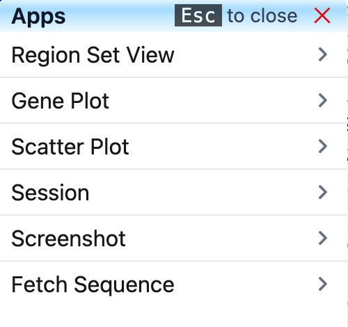

The panel lists:

- [Region Set View](#region-set-view): view a list of genes or regions side by side.
- [Gene Plot](#gene-plot): summarize a numerical track over a gene or region set.
- [Scatter Plot](#scatter-plot): compare two numerical tracks over a gene or region set.
- [Session](#session): save, share and load sessions.
- [Screenshot](#screenshot): export the current view as an SVG or PDF image.
- [Fetch Sequence](#fetch-sequence): get the genomic sequence of the view or of a list of regions.

:::note
The previous version of the Browser also had a **Go Live** app, which mirrored your view on the screens of others in real time. This version does not have it.
:::

## Region Set View

A region set is a list of genes and/or genomic regions. The Browser can show all the regions of a set next to each other in one view, so you can compare the same tracks across many loci at once. Region sets are also the input of [Gene Plot](#gene-plot) and [Scatter Plot](#scatter-plot). They are kept in the current session.

### Create a set

1. Click **Apps**, then **Region Set View**, then **Add New Set**.
2. In the **Create New Set** box, enter gene names or coordinates, one per line. Gene names and coordinates can be mixed. Coordinates must be in the form `chr1:345-678`.

   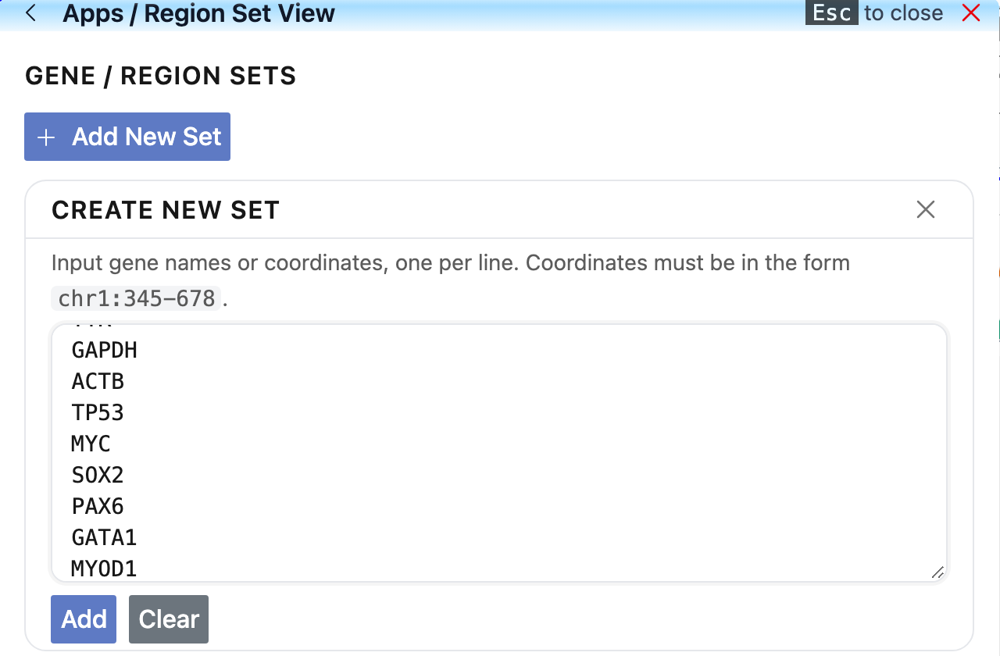

3. Click **Add**. The Browser looks up each gene in the current genome and shows the set editor. **Clear** empties the text box.

:::warning
If any line cannot be found in the genome (a misspelled gene name, for example), the set is not created and the editor does not appear; no message says which line failed. Check the names and click **Add** again.
:::

### Edit the set

The editor has three parts:

1. **Set name**: type a name for the set. The name is how you choose the set later in Gene Plot and Scatter Plot.
2. **Add or remove regions**: add one more region by giving a **Name** and a **Locus** and clicking **Add**, or click **Add Multiple** to paste another list of genes or coordinates. Each row of the table has a **Delete** link. Click a column header to sort the table.
3. **Set flanking region**: choose which part of each feature to view, and how much sequence to add around it. **Surrounding** can be **Whole region**, **Region start** or **Region end**; **Upstream bases** and **Downstream bases** set how many bases to add on each side. Start, end, upstream and downstream follow the strand of each feature. The **Coordinates to view** column shows the result.

By default, features on the minus strand are flipped so that every region reads from 5' to 3'. Check **No flip for regions on - strand** to keep them in genome orientation.

In this example, 12 genes are viewed as their promoters: 2,000 bases upstream and downstream of the gene start (**Region start**).

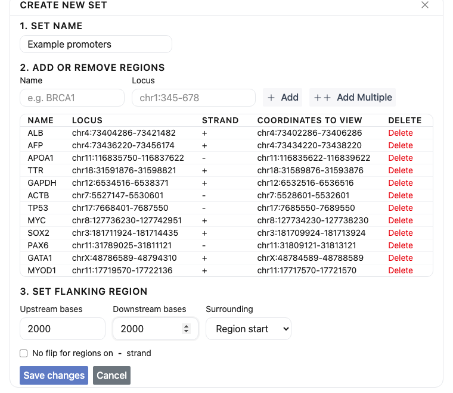

Click **Save changes** to add the set, or **Cancel** to discard it. The set then appears in the list:

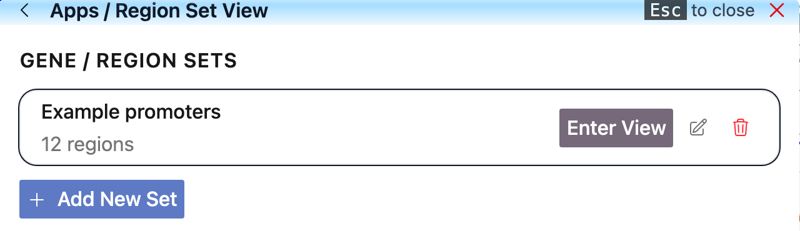

To change a set later, click its pencil icon (**Edit set**); to remove it, click the trash icon (**Delete set**).

### Enter and exit the region set view

Click **Enter View** next to a set. The set is marked **Current view** and **Active view**, and an **Exit region set view** button appears at the top of the panel.

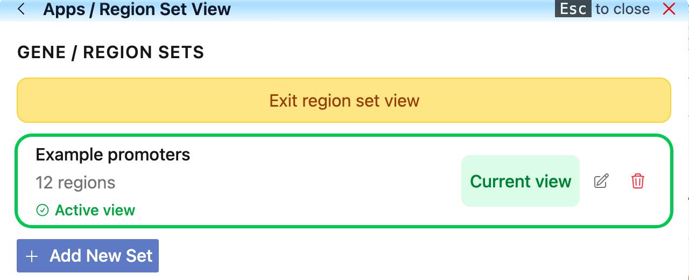

Close the panel to see the result: the regions are shown next to each other, in the order of the set, with their names above the tracks. The box in the top bar shows the span from the first to the last region.

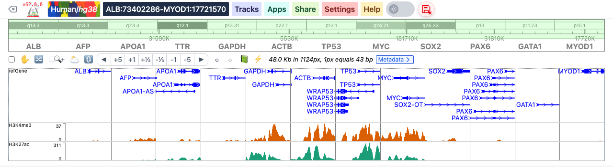

To go back to the normal genome view, open **Apps** > **Region Set View** and click **Exit region set view**.

## Gene Plot

Gene Plot shows the overall signal of a numerical track over a gene or region set. Each region (after flanking, see [Edit the set](#edit-the-set)) is split into the same number of bins, read 5' to 3' relative to its strand, and the track's average value in each bin is computed. Only tracks of type `bigwig` and `bedgraph` that are in the current view can be chosen.

1. Click **Apps**, then **Gene Plot**. If the session has no region set yet, the panel says so and shows the region set tools, so you can [create one](#create-a-set) first.
2. **1. Region Set**: choose the set.
3. **2. Numerical Track**: choose the track.
4. **3. Plot Options**: choose the **Plot type** (**box**, **line** or **heatmap**) and the number of **Data points** (bins per region, 50 to 100).
5. Click **Plot**. "Loading..." shows while the data are fetched; the plot appears below.

The **box** plot has one box per bin, summarizing the values of all regions in that bin. Once a box plot is drawn, a **box color** button lets you change the color of the boxes. Below, the H3K4me3 signal over the 12 promoters of the example set peaks around the gene starts (the middle of the 4 kb windows):

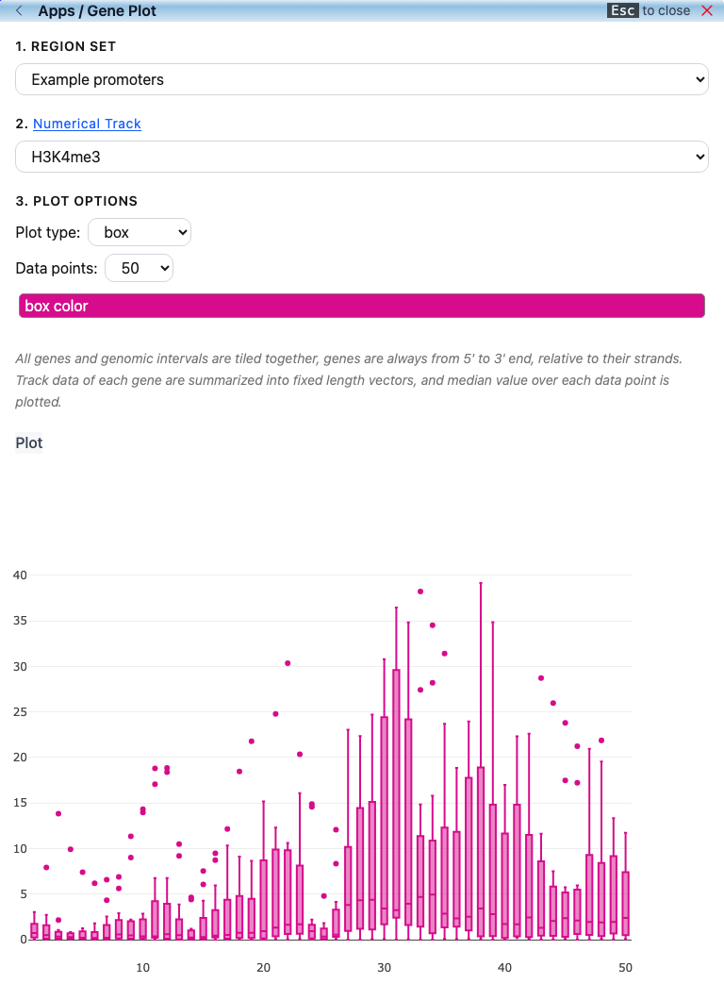

The **line** plot draws one line per region, with a legend of the region names:

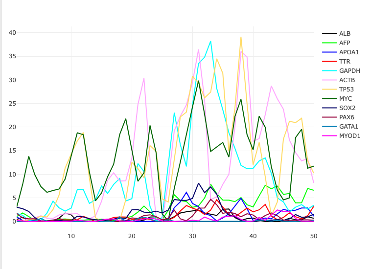

The **heatmap** draws one row per region:

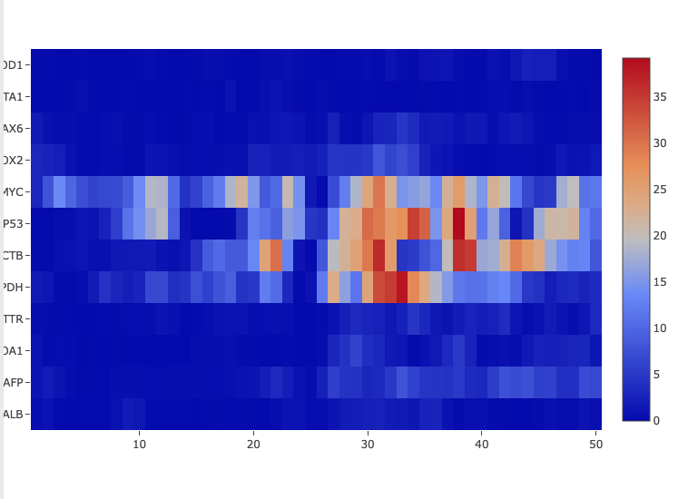

Changing the plot type redraws the same data; click **Plot** again after changing the set, the track or the number of data points. A short description of each plot type is shown above the **Plot** button.

When you move the mouse over the plot, a tool bar appears at its top right. The camera icon (**Download plot**) saves the plot as an SVG file; the other icons zoom, pan and reset the axes.

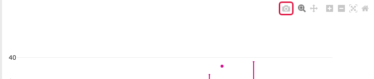

:::note
The plot area is wider than the panel and its left edge is cut off, so the region names of the heatmap are only partly visible. Downloading the plot gives the full image.
:::

## Scatter Plot

Scatter Plot compares two numerical tracks over a gene or region set: each region of the set is one point, placed at the mean of each track's values in that region (X track on the horizontal axis, Y track on the vertical axis). The Pearson correlation of the two tracks over the set is shown above the plot as `R`.

1. Click **Apps**, then **Scatter Plot**. As with Gene Plot, you need a region set first.
2. **1. Region Set**: choose the set.
3. **2. Numerical Track (X-axis)** and **3. Numerical Track (Y-axis)**: choose the two tracks (`bigwig` or `bedgraph` tracks in the view).
4. **4. Plot Configuration**: set the **Marker color** and **Marker size**.
5. Click **Plot**.

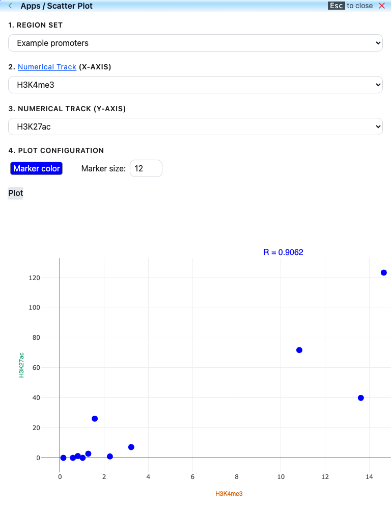

Hovering over a point shows its two values and the region name. The plot's tool bar (camera icon) downloads the plot as an image.

## Session

**Apps** > **Session** offers the same tools as the **Save/Load Session** tab of the session panel: retrieve a saved session bundle by its ID, upload a session file, save the current view remotely to get a bundle ID you can share, and download the current session or its tracks as a JSON file.

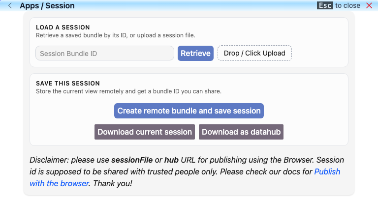

All of this is described in [Manage sessions](manage-sessions.md).

## Screenshot

The Screenshot app re-draws the tracks of the current view as a vector image, for figures in papers and presentations.

1. Navigate to the region you want and set up the tracks.
2. Click **Apps**, then **Screenshot**. The panel shows the re-drawn view, with the track names on the left.
3. Click **Download SVG** or **Download PDF**. The file is named with the date and time, for example `2026-11-21T02:25:58.876Z_eg.svg`.

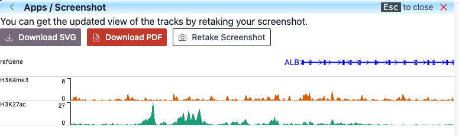

The image is taken when the app opens. If you change the view while the panel is open, click **Retake Screenshot** to update it. If there are no tracks in the view, the panel shows "No tracks in view".

## Fetch Sequence

Fetch Sequence gets the genomic DNA sequence, in FASTA format, of the current view or of a list of regions. It works for genomes that have a sequence file; otherwise it says "Genomic sequence is not added to this genome yet."

### Sequence of the current view

1. Navigate to the region you want. Keep it at 10 kb or less.
2. Click **Apps**, then **Fetch Sequence**. The panel names the current region.
3. Click **Fetch**. The sequence appears below; **Copy** copies it to the clipboard and **Clear** removes it.

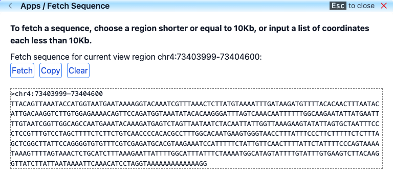

### Sequences of a list of regions

1. In the box below, enter up to 100 coordinates, one per line, for example `chr12:6534300-6534520`. Regions longer than 10 kb are skipped (they come back with an empty sequence).
2. Click **Batch fetch**. Each region is returned as a FASTA record. **Copy** copies them all, and **Reset** empties the box.

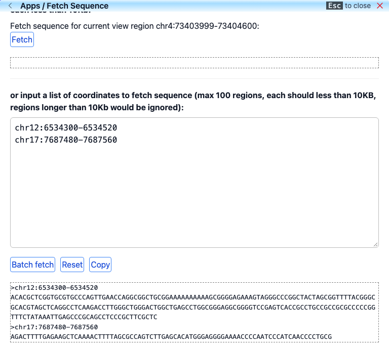

:::note
The 10 kb limit is only enforced for the list. **Fetch** for the current view also returns longer regions, but a long sequence makes the panel slow to use.
:::
