# Browsing the genome

This page describes the main window of the Browser once a genome is open, and how to move around the genome.

## Layout

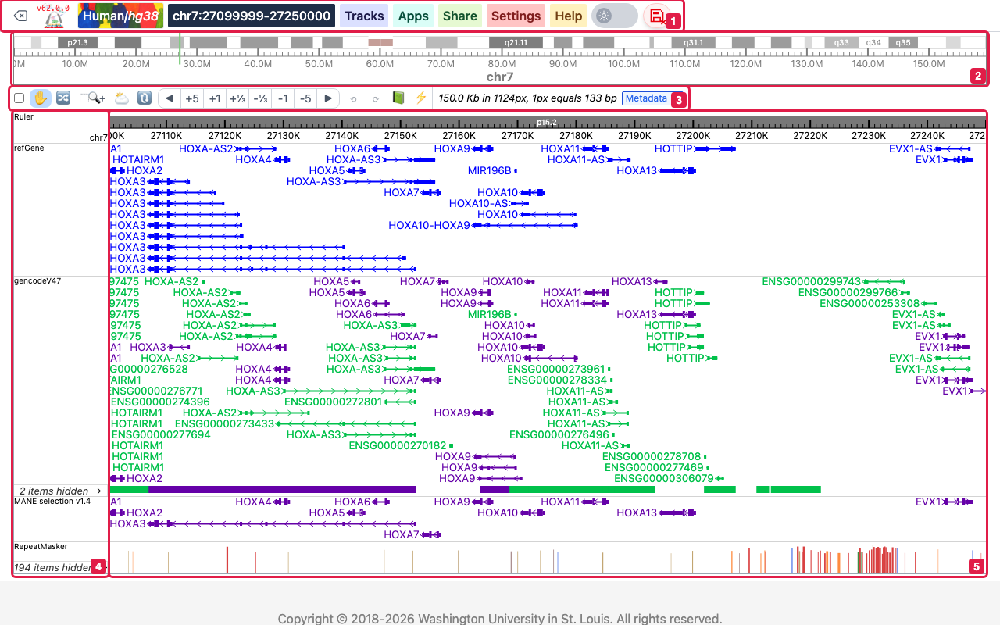

1. **Top bar.** From left to right:
   - the back arrow and the Browser logo (with the version number), which take you back to the start page;
   - the genome button (here **Human/hg38**), which opens a genome picker to switch to another genome (see [Pick a genome](pick-genome.md#switch-to-another-genome));
   - the region button (here `chr7:27099999-27250000`), which shows the current region and opens the **Regions** panel to jump somewhere else (see [Jump to a gene, SNP or region](#jump-to-a-gene-snp-or-region));
   - the **Tracks** and **Apps** menus (see [Tracks menu](tracks-menu.md) and [Apps](apps.md));
   - **Share**, **Settings** and **Help**, and the switch for the dark theme (see [Share, Settings and Help](share-settings-help.md));
   - the session button, which shows whether the current session has been saved (see [Manage sessions](manage-sessions.md)).
2. **Genome navigator.** The chromosome ideogram with its bands and a coordinate scale. A thin green line or box marks the region shown in the tracks. See [Genome navigator](#genome-navigator).
3. **Tool bar.** Tools to move, zoom, reorder and highlight, undo and redo, the size of the current view, and the **Metadata** button. See [Tool bar](#tool-bar).
4. **Track legends.** The name of each track. Their width can be changed in [Settings](share-settings-help.md#settings).
5. **Track area.** The data. Right-click a track to open its menu, where you change its color, height, display mode and other options (see [Tracks menu](tracks-menu.md)).

The text in the tool bar, for example `150.0 Kb in 1124px, 1px equals 133 bp`, gives the size of the region shown, the width of the track area in pixels, and how many base pairs one pixel covers.

The menus of the top bar and the tool bar open as panels. Close a panel with the **×** at its top right, by pressing Esc, or by clicking outside it. The switch at the bottom left of a panel pins it, so that it stays open when you click elsewhere. Drag the bottom-right corner to resize the panel.

## Jump to a gene, SNP or region

Click the region button in the top bar to open the **Regions** panel. It has three ways to go to a place in the genome.

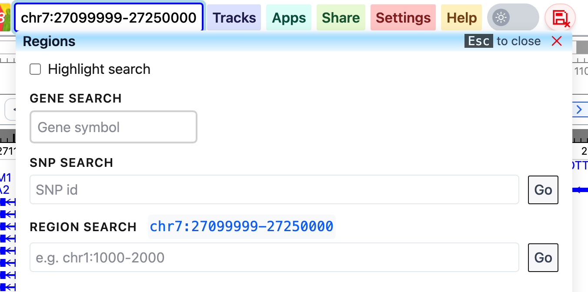

If **Highlight search** is checked, the region you jump to is also highlighted (see [Highlight regions](#highlight-regions)).

### Gene search

Type a gene symbol in the **Gene symbol** box. After three letters, the Browser lists gene symbols that start with what you typed:

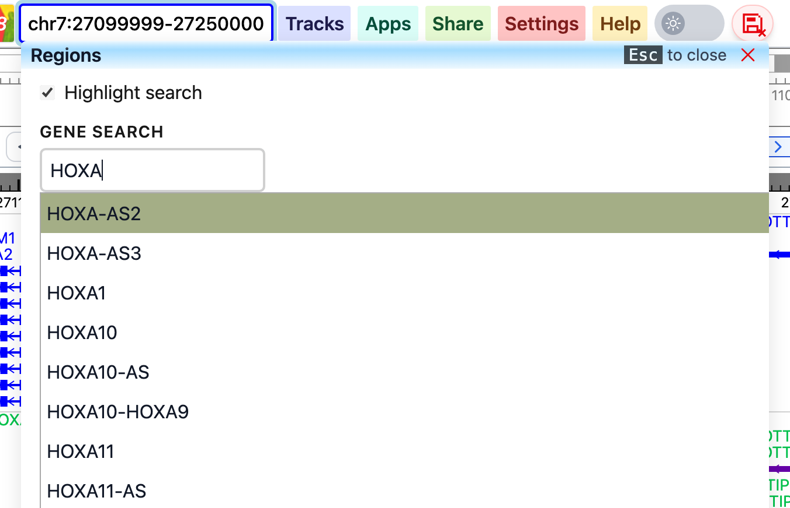

Click a gene. The Browser lists its transcripts (isoforms), with the annotation they come from, their coordinates, their structure and a description:

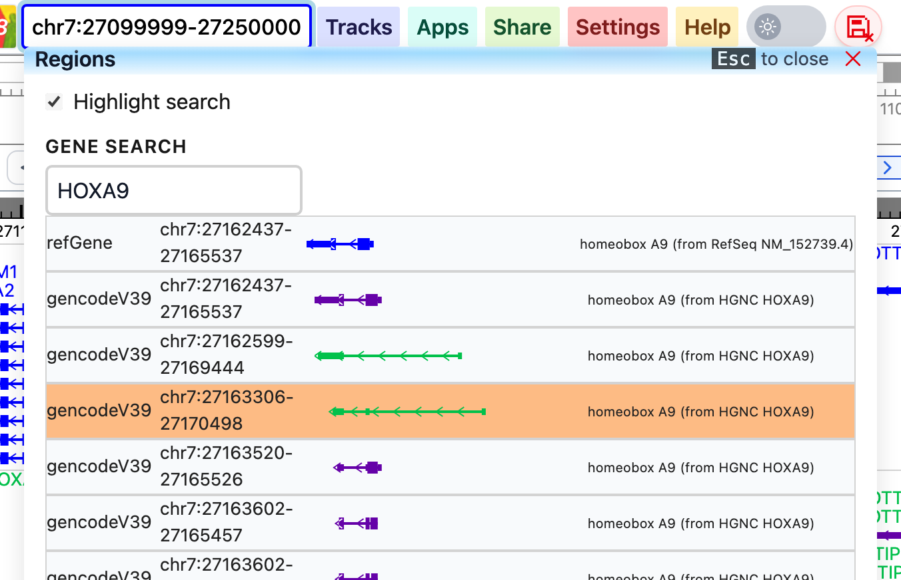

Click a transcript to go to it. The view then covers exactly the transcript. Here, **Highlight search** was checked, and we zoomed out once to see the highlighted gene in its context:

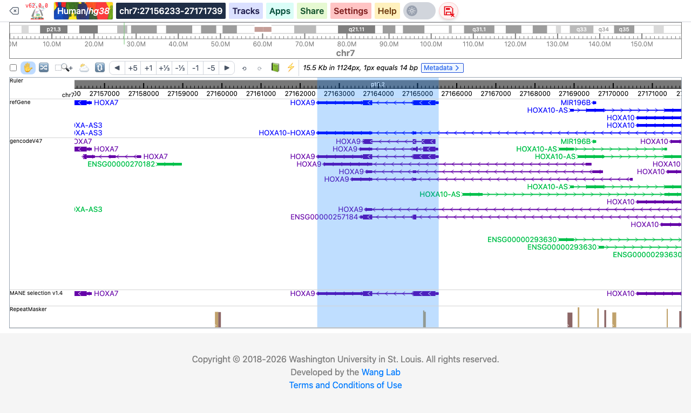

### SNP search

SNP search works for the human genomes `hg38` and `hg19`. It uses the [Ensembl REST API](https://rest.ensembl.org). Type a SNP identifier, for example `rs7412`, in the **SNP id** box and click **Go**. The Browser shows what Ensembl knows about the SNP:

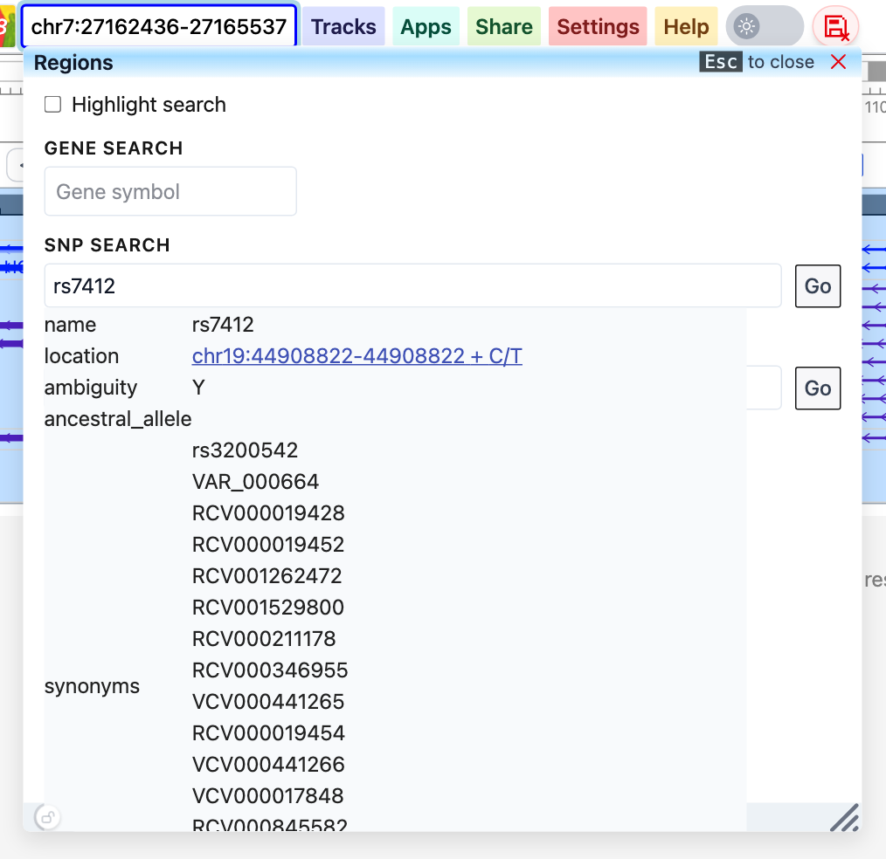

Click the blue link after **location** to go to the SNP.

### Region search

Under **REGION SEARCH**, the current region is shown in blue; click it to copy it. To go to another region, type its coordinates in the box and press Enter or click **Go**. Both `chr6:52258852-52260880` and `chr6 52258852 52260880` work.

:::note
Type the coordinates without commas: `chr6:52,258,852-52,260,880` is not understood. Always give a start and an end.
:::

You can also open the Browser directly at a region with a link such as `?genome=hg38&position=chr7:27100000-27250000`. See [URL parameters](../url-params.md).

## Genome navigator

The genome navigator shows a larger part of the genome around the current region.

- **Drag with the left mouse button** across the navigator to select a region. The tracks jump to it when you release the button.
- **Drag with the right mouse button** to slide the navigator along the genome without changing the tracks.
- **Turn the mouse wheel** over the navigator to zoom the navigator in or out. This also does not change the tracks.
- If the current region is outside the part shown in the navigator, an arrow labeled **GOTO** at its edge brings it back into view.

To leave more room for tracks, hide the navigator with **Show Navigator** in [Settings](share-settings-help.md#settings).

## Tool bar

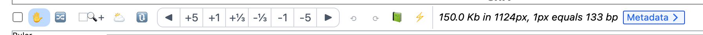

From left to right:

| Button | Name (shown when you point at it) | What it does |
| --- | --- | --- |
| check box | Select All/None tracks | Selects or deselects all tracks. |
| ✋ | Drag tool | Drag the tracks left or right to move along the genome. Selected when the Browser opens. |
| 🔀 | Reorder tool | Drag a track up or down to change the order of tracks. |
| ⬚🔍+ | Zoom-in tool | Drag across a region in the tracks to zoom in on it. |
| ⛅ | Highlight tool | Drag across a region in the tracks to highlight it. |
| 🔃 | Re-order Many | Opens a list of all tracks to reorder many at once. |
| ◀ / ▶ | Pan left / Pan right | Moves one full screen to the left or right. |
| +5, +1, +⅓ | Zoom in 5x, 1x, ⅓ | Zooms in: the region shown becomes 5 times, 2 times or 1.5 times smaller. |
| -⅓, -1, -5 | Zoom out ⅓, 1x, 5x | Zooms out: the region shown becomes 4/3, 2 or 5 times larger. |
| ⟲ / ⟳ | Undo / Redo | Undoes or redoes the last change. |
| 📗 | Operation history | Lists recent changes (see [Undo, redo and history](#undo-redo-and-history)). |
| ⚡ | Highlight list | Lists the highlighted regions (see [Highlight regions](#highlight-regions)). |

The drag, reorder, zoom-in and highlight tools are modes: the selected one has a blue background and stays selected until you choose another. While the reorder, zoom-in or highlight tool is selected, a label next to the pointer names the tool. Click the selected tool again, or press Esc, to deselect it.

:::tip
When no tool is selected, dragging in the track area does nothing. Click ✋ or press Alt+H to get the drag tool back.
:::

The whole tool bar can be hidden with **Show Tool Bar** in [Settings](share-settings-help.md#settings).

### Reorder tracks

With the reorder tool, drag a track up or down and release it where it should go.

To move many tracks at once, click **Re-order Many**. The panel lists all tracks with their type. Drag and drop them into the order you want, then click **Apply**. The **Columns** slider spreads the list over several columns, which helps when there are many tracks.

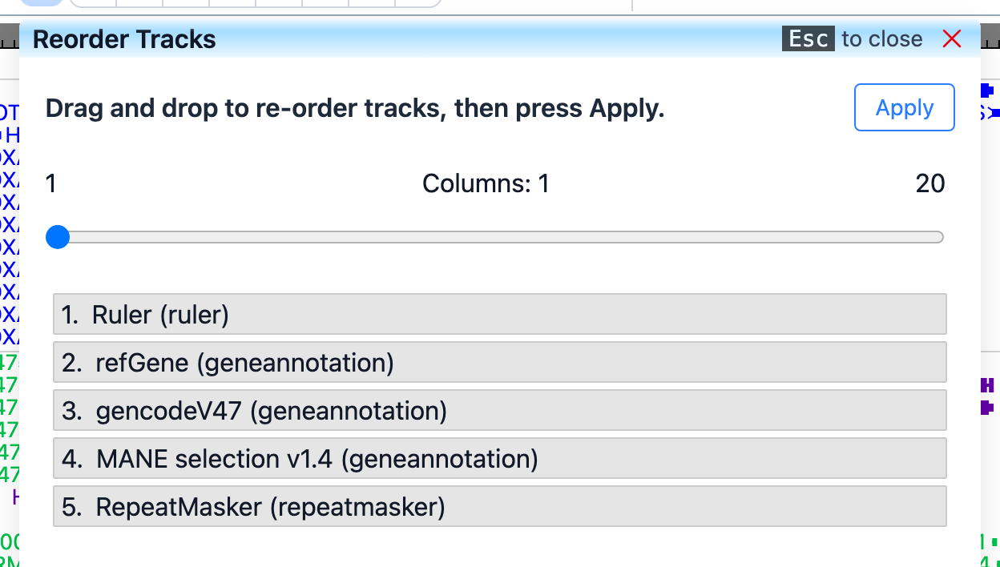

## Highlight regions

To highlight a region, select the highlight tool (⛅) and drag across the region in the track area. The region gets a light blue background in all tracks. A search with **Highlight search** checked also adds a highlight (see [Jump to a gene, SNP or region](#jump-to-a-gene-snp-or-region)).

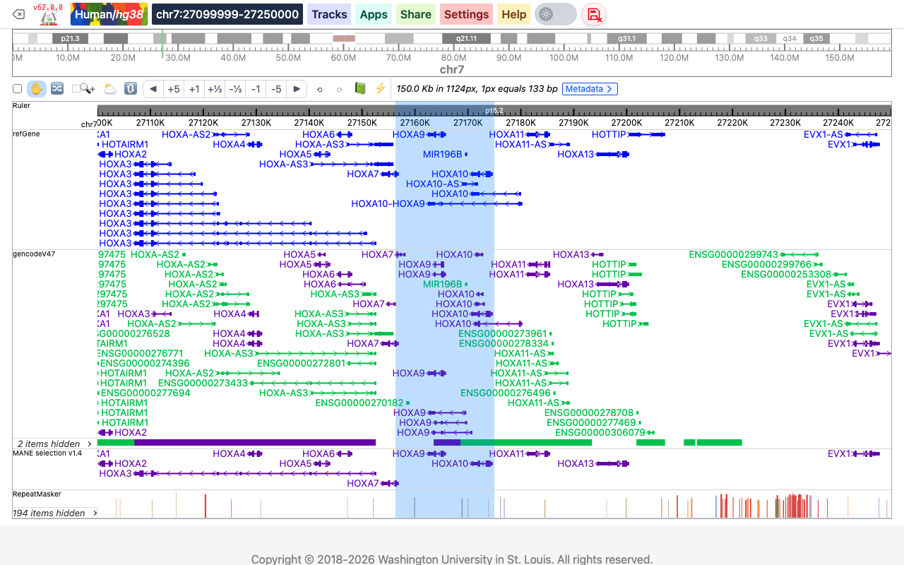

Click **Highlight list** (⚡) to see all highlights. For each highlight you can:

- click the color box to choose another color;
- **Delete** it;
- **Hide** it (and **Show** it again) without deleting it;
- **Jump** to its region.

**Remove all** deletes all highlights.

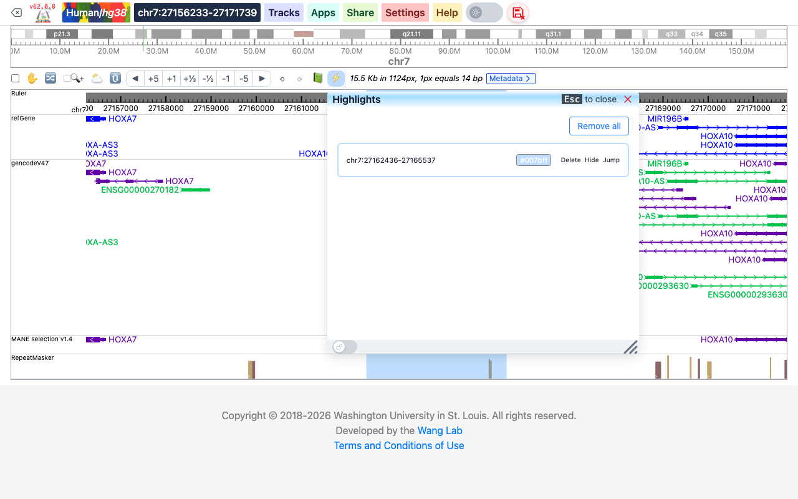

## Undo, redo and history

Moving to another region, adding, removing or reordering tracks, and other changes to the view can be undone with **Undo** (⟲) and redone with **Redo** (⟳). **Operation history** (📗) lists the steps, each with its region and number of tracks: **Go back** for earlier steps, **Current** for the present view and **Go forward** for steps you undid. Click **Select** next to a step to return to it. **Clear History** empties the list. The history keeps the last 20 steps and starts again when you open another session or genome.

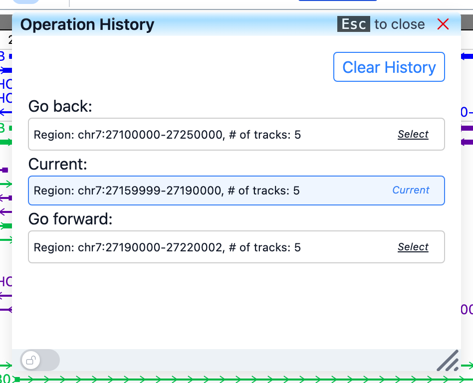

## Keyboard shortcuts

| Keys | Action |
| --- | --- |
| Alt+H or Alt+D | Drag tool |
| Alt+R or Alt+S | Reorder tool |
| Alt+M | Zoom-in tool |
| Alt+N | Highlight tool |
| Esc | Closes the open panels and deselects the current tool |

Pressing the shortcut of the tool that is already selected deselects it.

## Select tracks

Selected tracks have a yellow legend, and the options you choose in the right-click menu apply to all of them.

- Hold Shift and click tracks to select several of them.
- Use the check box at the left of the tool bar to select or deselect all tracks.
- Click a metadata color box to select all tracks with the same value (see below).

## Metadata

Tracks can carry metadata, such as the sample or the assay, usually given in a [data hub](../datahub/datahub.md). The Browser can show it as columns of colored boxes at the right of the tracks, so that tracks with the same value have the same color.

Click **Metadata** in the tool bar to choose the columns. **CURRENT TERMS** lists the columns shown; click **×** to remove one. **SUGGESTED TERMS** lists the metadata found in your tracks, plus **Track type**; click **+** to add one. Under **CUSTOM TERM** you can make up your own term: type a **Term name** and an optional **Value**, click **+**, check the tracks it applies to, and click **Confirm**.

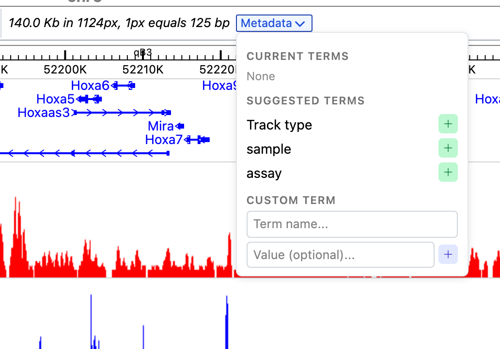

In this example (mouse `mm10`, with two bigWig tracks from a data hub), the terms **Track type**, **sample** and **assay** were added. Point at a box to see its term and value:

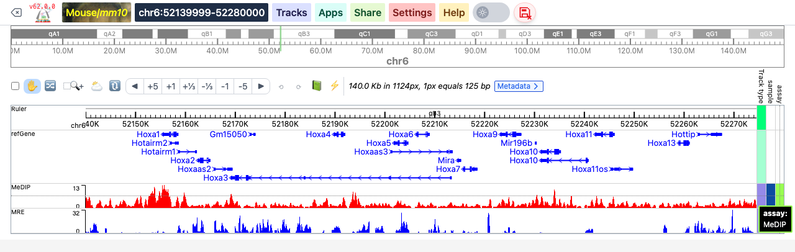

Click a box to select all tracks with the same value, and click it again to deselect them. Here, clicking the **assay** box of the MeDIP track selected that track:

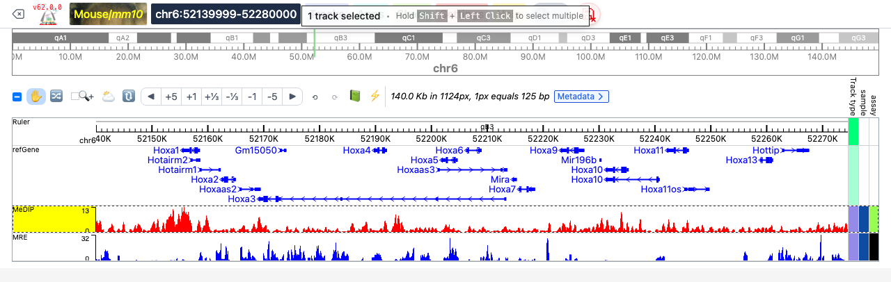

You can also click a term name at the top of a column. A list of its values opens; click a value to select the tracks that have it.

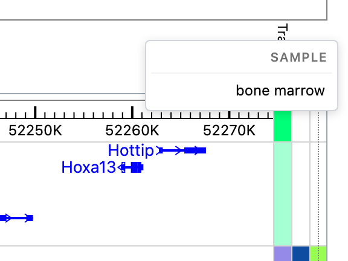
