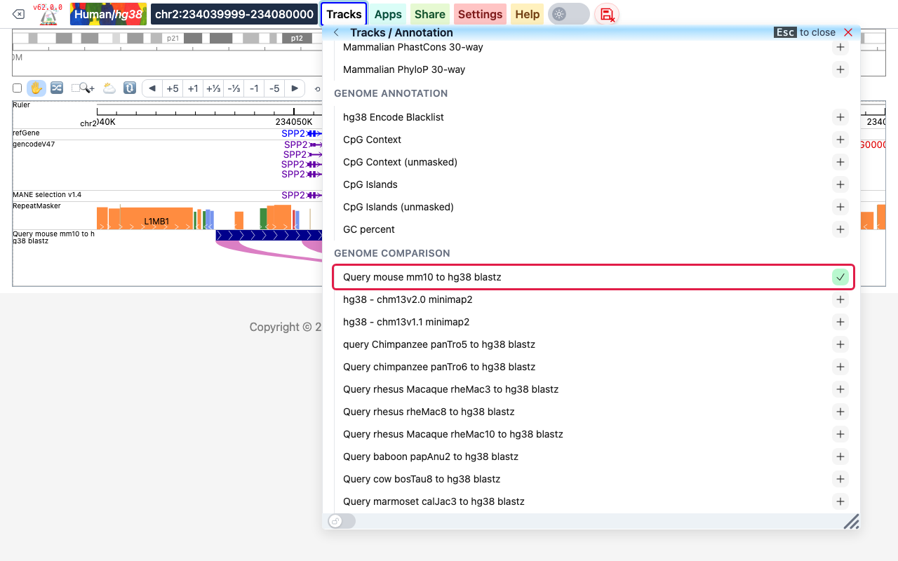
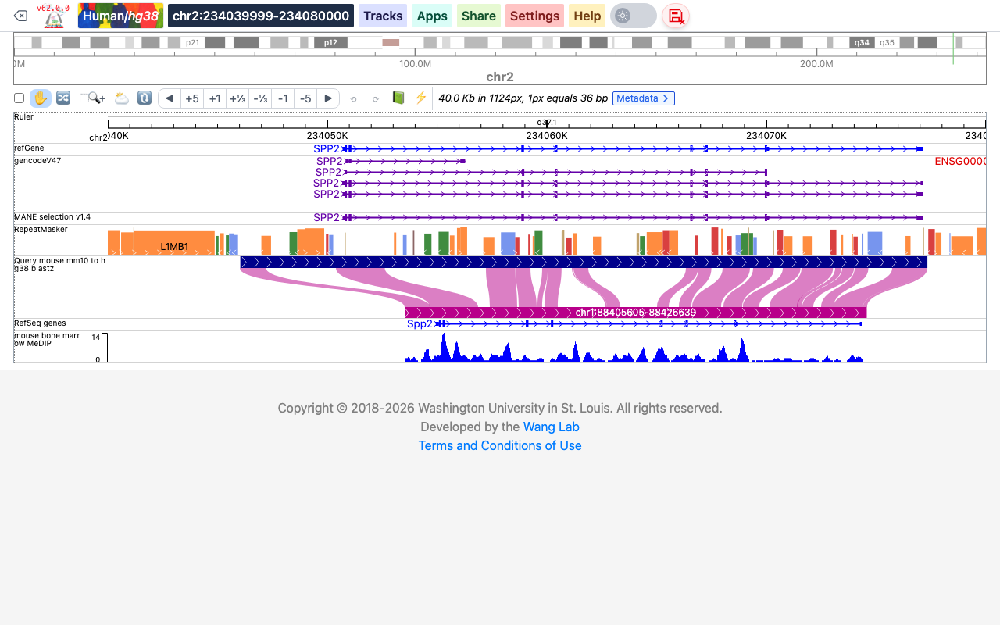
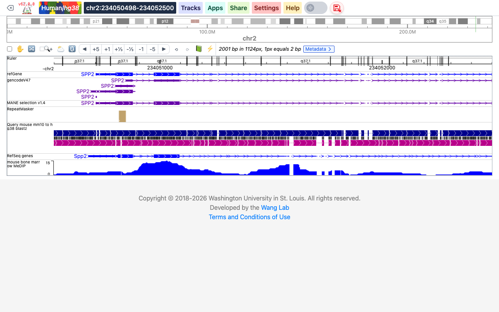
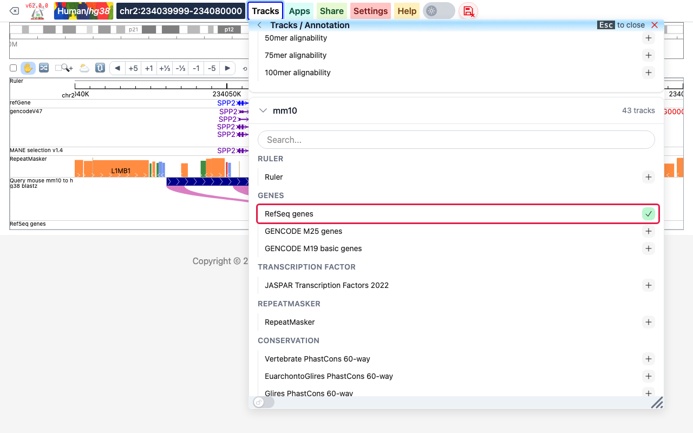
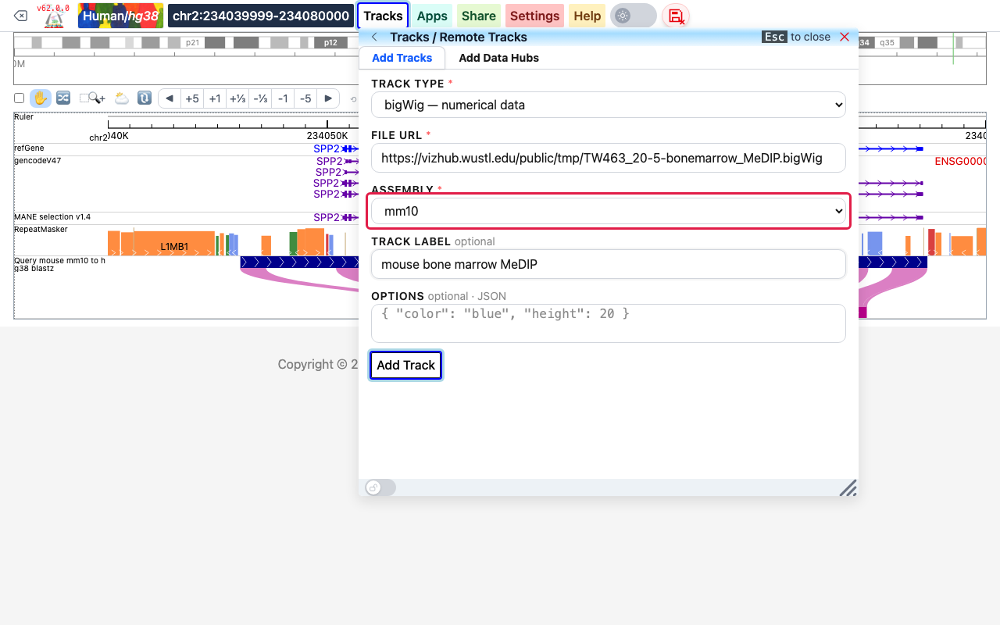

# Comparative browsing

The Browser compares two genomes with a **genome alignment track** (track type `genomealign`). The
genome you are viewing is the *reference* genome; the alignment track links each region of it to the
matching (syntenic) region of a second, *query* genome. Once an alignment track is displayed, tracks
of the query genome, such as its genes or your own data mapped to it, can be shown under the
reference genome, placed through the alignment.

The examples on this page use human hg38 as the reference genome and mouse mm10 as the query genome,
at the human *SPP2* gene (`chr2:234040000-234080000`).

## Add a genome alignment track

The alignment tracks available for a genome are among its annotation tracks.

1. Click **Tracks**, then **Annotation Tracks**.
2. Click the name of the genome (here **hg38**) to open its list of tracks, and scroll to the
   **Genome Comparison** group. Each entry aligns one other genome to the reference genome, for
   example **Query mouse mm10 to hg38 blastz**.
3. Click **+** at the right of the alignment you want. The button turns into a check mark and the
   track is added to the view.



An alignment file of your own (see [Genome alignment file format](#genome-alignment-file-format))
can be added with **Tracks** > **Remote Tracks** > **Add Tracks**: choose the track type
**genomealign — genome pairwise alignment**, give the file URL, and type the name of the other
genome (for example `mm10`) in **Query Genome**. In a [datahub](../datahub/datahub.md), give the
alignment file in `url` and the other genome in `querygenome`, see
[Datahub definition](#datahub-definition).

## Read the alignment

The alignment track has two display modes, chosen automatically from the zoom level.

**Rough view.** When more than about 10 bases fit in one pixel, the top bar (dark blue) shows the
aligned part of the reference genome and the bottom bar (magenta) the matching region of the query
genome, labeled with its coordinates (here `chr1:88405605-88426639` on mm10). Ribbons connect the
aligned blocks of the two genomes, so you can see how the region is conserved, rearranged or
inverted. The tracks of mm10 below the alignment are explained in the next section.



**Fine view.** When you zoom in to less than about 10 bases per pixel, the track shows the aligned
sequences of the two genomes one above the other: the reference genome on top, the query genome at
the bottom, and between them a tick for each base that is identical in both. Gaps in either row are
insertions or deletions. Point at the track to see the sequences around the mouse position.



The colors of the two genomes and the height of the track can be changed in the menu that opens when
you right-click the track (**Height**, **Primary genome color**, **Query genome color**,
**Background color**).

## Show tracks of the query genome

Tracks of the query genome are drawn under the reference genome, through the alignment: each piece
of query-genome data is placed under the reference region it is aligned to, so the two genomes can
be compared directly. In the screenshots above, **RefSeq genes** shows the mouse *Spp2* gene and the
mouse bigWig track sits under the human *SPP2* gene.

### Annotation tracks of the query genome

Once an alignment track is displayed, **Tracks** > **Annotation Tracks** also lists the query genome
(here **mm10**) below the reference genome. Click its name and click **+** next to a track to add it,
for example **RefSeq genes** in the **Genes** group.



### Your own data on the query genome

In **Tracks** > **Remote Tracks** > **Add Tracks**, the **Assembly** list offers the query genome
of each displayed alignment track as well as the reference genome. Choose the genome your file is
mapped to, here **mm10**, then click **Add Track**. **Tracks** > **Local Tracks** has the same
**Assembly** choice for files on your computer.



In a datahub, mark a track of the query genome with a `genome` [metadata](../datahub/track_properties.md#metadata)
term. This hub shows the alignment of the screenshots above, the mm10 RefSeq genes and an mm10
bigWig track, when loaded on hg38:

``` json
[
  {
    "name": "hg38tomm10",
    "label": "Query mouse mm10 to hg38 blastz",
    "querygenome": "mm10",
    "type": "genomealign",
    "url": "https://vizhub.wustl.edu/public/hg38/weaver/hg38_mm10_axt.gz",
    "showOnHubLoad": true
  },
  {
    "type": "geneAnnotation",
    "name": "refGene",
    "label": "RefSeq genes",
    "genome": "mm10",
    "metadata": { "genome": "mm10" },
    "showOnHubLoad": true
  },
  {
    "type": "bigwig",
    "name": "mouse bone marrow MeDIP",
    "url": "https://vizhub.wustl.edu/public/tmp/TW463_20-5-bonemarrow_MeDIP.bigWig",
    "metadata": { "genome": "mm10" },
    "showOnHubLoad": true
  }
]
```

New tracks are added at the bottom of the view. To group the tracks by genome, move them with the
reorder tool of the tool bar; see [User interface](./browsing-ui.md).

## Datahub definition

``` json
{
    "name": "hg38tomm10",
    "label": "Query mouse mm10 to hg38 blastz",
    "type": "genomealign",
    "querygenome": "mm10",
    "url": "https://vizhub.wustl.edu/public/hg38/weaver/hg38_mm10_axt.gz"
}
```

- `type`: `genomealign`.
- `url`: the bgzip-compressed, tabix-indexed alignment file (the index, `.gz.tbi`, sits next to it;
  otherwise give its URL in `indexUrl`).
- `querygenome`: *required*, the name of the other genome as the Browser knows it (`mm10`, `panTro6`,
  `t2t-chm13-v2.0`…). The track is added to the reference genome, the one being viewed.
- `name`, `label`, `showOnHubLoad`: as for any track, see [Track properties](../datahub/track_properties.md).
- `options`: `height` (default 80), `primaryColor` (reference genome, default `darkblue`),
  `queryColor` (query genome, default `#B8008A`) and `backgroundColor`.

## Genome alignment file format

A genome alignment file is a tab-delimited, BED-like text file describing a pairwise whole-genome
alignment. Each line is one aligned block, with four columns: the chromosome, start and end of the
block in the reference genome, and the alignment itself:

```text
chr1    start   end     alignment
```

The fourth column holds an id number and the alignment details, written as JavaScript-style
objects (keys without quotes):

| field | content |
| --- | --- |
| `id` | a number identifying the block |
| `genomealign.chr` | chromosome of the block in the query genome |
| `genomealign.start`, `genomealign.stop` | start and end of the block in the query genome |
| `genomealign.strand` | `+` or `-`: strand of the query genome |
| `genomealign.targetseq` | aligned sequence of the reference genome, with `-` for gaps |
| `genomealign.queryseq` | aligned sequence of the query genome, with `-` for gaps |

`targetseq` and `queryseq` have the same length. Two lines of the hg38 to mm10 alignment used on this
page (sequences shortened here):

```text
chr1	11677	11858	id:1,genomealign:{chr:"chr6",start:121530269,stop:121530440,strand:"-",targetseq:"ccctggagattctta-ttagtg…",queryseq:"ctcTAGGGAGTCTTAGTCAAAG…"}
chr1	12176	12259	id:3,genomealign:{chr:"chr17",start:66149262,stop:66149338,strand:"+",targetseq:"GATTGGAGGAAAGATGAGTGAG…",queryseq:"GGTTGGAGGGAAGATGAGTGAA…"}
```

### Make one from an AXT file

The file is derived from an [AXT](http://genome.ucsc.edu/goldenPath/help/axt.html) alignment, such
as those made by `lastz` or `blastz`. The script `axt2align.py` from the
[eg-react scripts](https://github.com/lidaof/eg-react/tree/master/backend/scripts) converts it. It
takes the chromosome sizes of the query genome (a tab-delimited file of chromosome names and lengths,
used for blocks on the `-` strand), the AXT file (plain or `.gz`) and the name of the output file,
ending in `.gz`:

```sh
python3 axt2align.py mm10.chrom.sizes hg38_mm10.axt.gz hg38_mm10.genomealign.gz
```

The script sorts its output, compresses it with `bgzip` and indexes it with `tabix -p bed`, which
gives `hg38_mm10.genomealign.gz` and `hg38_mm10.genomealign.gz.tbi`; put both files in the same
web-accessible directory. If you write the file another way, sort it by the first three columns,
then compress and index it:

```sh
sort -k1,1 -k2,2n example.genomealign > example.sorted.genomealign
bgzip example.sorted.genomealign
tabix -p bed example.sorted.genomealign.gz
```

An alignment can also be made with `minimap2` and converted to AXT. This is how the hg38 to
CHM13 alignment was made:

```sh
minimap2 -x asm5 --cs=long hg38.fa chm13.fa > hg38-chm13.paf
sort -k6,6 -k8,8n -k9,9n hg38-chm13.paf | perl -ln unique_paf.pl > hg38-chm13.unique.paf
paftools.js view -f maf hg38-chm13.unique.paf > hg38-chm13.maf
maf-convert axt hg38-chm13.maf > hg38-chm13.axt
python3 axtSplit.py 100 hg38-chm13.axt hg38-chm13.split.axt
```

`unique_paf.pl` removes redundant segments of the alignment and `axtSplit.py` splits long alignment
blocks at gaps longer than 100 bp; both are in the same
[eg-react scripts](https://github.com/lidaof/eg-react/tree/master/backend/scripts) folder.
