# Manage sessions

A session is the state of one browser view: the genome, the tracks and their settings, the region you are looking at, highlights and region sets. The Browser saves the current session automatically, in your web browser's local storage, as you work. You can come back to any of your sessions later, switch between them, and save a session remotely to share it with others.

Sessions stored in local storage stay on that computer and in that web browser only. To move a session to another computer or give it to someone else, [save it remotely](#save-a-session-remotely-and-share-it) or [download it as a file](#download-a-session-file).

## How sessions are created

A new session starts when you:

- choose a genome on the genome picker (see [Pick a genome](pick-genome.md));
- open a link that names a genome, such as `?genome=hg38&position=chr7:27100000-27250000` (see [URL parameters](../url-params.md));
- load a session from a bundle ID or a file on the genome picker (see [Load a session](#load-a-session));
- duplicate a session in the session list.

Reloading a link in the same browser tab goes back to the session that link created, with your changes since, instead of making a new one. Opening the same link in a new tab makes a new session.

To start over with another genome, click the Browser logo at the far left of the top bar. This returns to the genome picker; the session you left stays in your list.

## The session button

The session button sits at the right end of the top bar. Its icon shows whether the session is saved remotely: a red disk with a cross means it is not, a green disk means it is. Once a session has a name, the name is shown next to the icon.

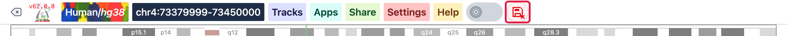

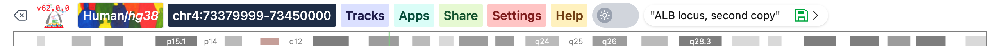

Click it to open the session panel. The panel has two tabs, **Save/Load Session** and **Switch Session**. Close it with the red **X** at its top right, or with **Esc**.

## Switch, rename and duplicate sessions

Open the session panel and click **Switch Session**. **Previous sessions** lists all the sessions stored in this web browser, with their count. Each row shows the session name ("Untitled Session" until you name it), when it was created, the number of tracks, the genome, and either its bundle ID or "Not saved remotely". The session you are in is marked **Current**.

Move the mouse over a session to see more: its **View region**, the number of **Highlights**, and three buttons:

- **Download**: save the session as a JSON file (named after the session).
- **Duplicate**: make a copy of the session.
- **Rename**: give the session a new name.

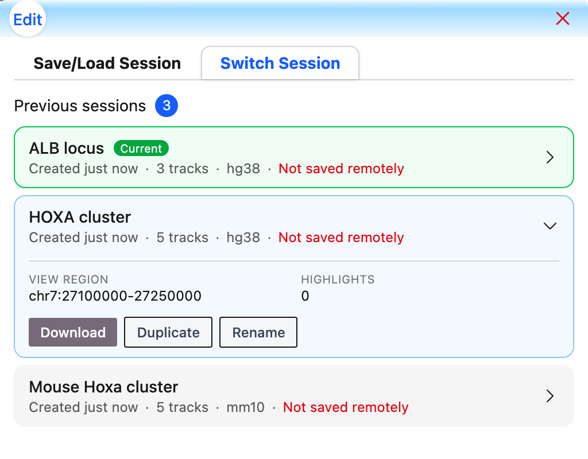

Click any other session to switch to it; the panel closes and the Browser shows that session.

After you rename the current session, its name appears on the session button:

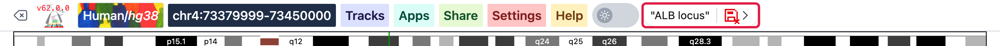

## Delete sessions

1. Open the session panel and click **Edit** at its top left. (The button only appears when there is a session other than the current one.)
2. Click the sessions to delete, or **Select All**. The current session cannot be selected.
3. Click **Delete (n)**, then click **Confirm delete (n)** within 3 seconds.
4. Click the round check mark at the top left to leave the selection mode.

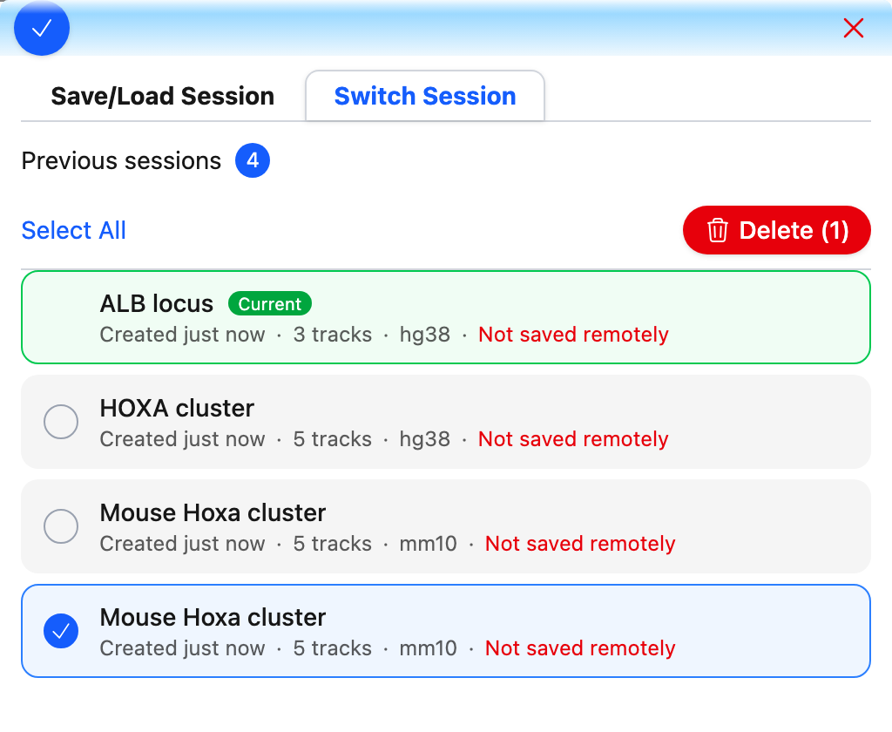

## Sessions on the genome picker

When no session is open, the genome picker shows a **Previous sessions** button with the number of stored sessions. Click it to see the same list. Click a session to open it.

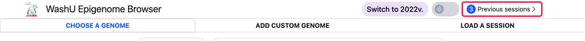

Here the **Filter** button sorts the list by **Date updated** or **Date created**, **Newest first** or **Oldest first**. The **Edit** button works as described in [Delete sessions](#delete-sessions).

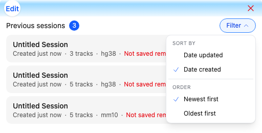

## When storage is nearly full

Local storage has a limited size (a few megabytes, depending on the web browser), so sessions with many tracks can fill it. When it is about 90% full, a notice appears at the top right of the page:

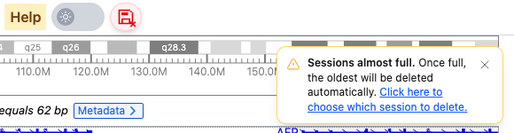

- Click the notice to open the session list in selection mode and [delete](#delete-sessions) the sessions you no longer need.
- Click its **X** to dismiss it. Nothing is deleted.

If storage becomes completely full, the notice changes to "Session full. Oldest sessions will be automatically deleted." The Browser then deletes the oldest sessions, never the current one, until enough space is free. This happens when you dismiss the notice with its **X**, or when you start or switch to another session. To choose yourself what is deleted, click the notice and delete sessions before that. Sessions you want to keep for good should be [saved remotely](#save-a-session-remotely-and-share-it) or [downloaded](#download-a-session-file).

## Save a session remotely and share it

Saving a session remotely stores it on the Browser's server and gives you a **session bundle ID**. A bundle can hold several saved sessions. Anyone with the bundle ID can load these sessions, on any computer.

1. Open the session panel. It opens on the **Save/Load Session** tab, which shows the current session name and its bundle ID ("Not saved remotely" for now). The same tools are in **Apps** > **Session**.

   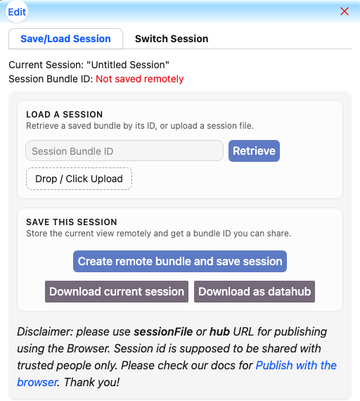

2. Under **Save this session**, click **Create remote bundle and save session**.
3. Type a name for the saved session (optional; without one, the Browser makes up a name), then click **Save** or press **Enter**. **Cancel** goes back.

   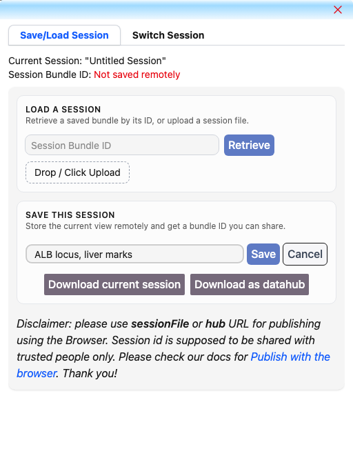

4. The bundle ID now appears next to **Session Bundle ID**, under **Add New Session To Bundle**, and in the session list. Click the ID under **Add New Session To Bundle** to copy it. The session button turns green.

To add more states of your work to the same bundle, change the view, type a name in the **Add New Session To Bundle** box and click **Save session** (or press **Enter**). The orange arrows button fills in a random name. **Sessions In Bundle** lists everything saved in the bundle, sorted by **Date** or **Name**:

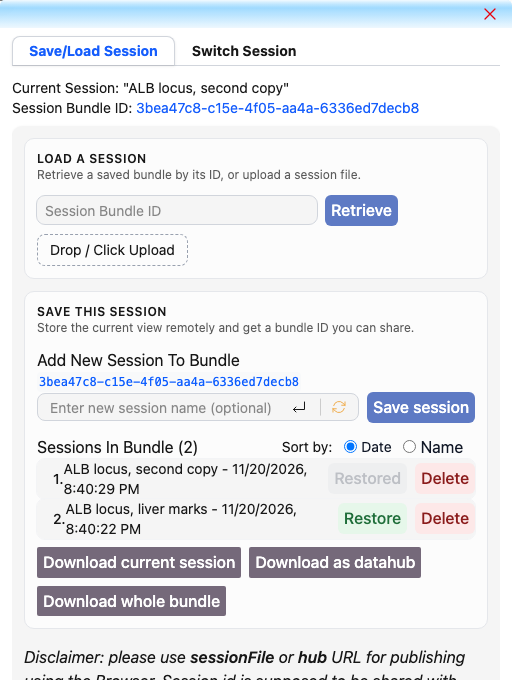

- **Restore** loads that saved session into the current session, replacing what it shows. The session that is loaded is marked **Restored**.
- **Delete** removes that saved session from the bundle.

To share your work, send the bundle ID. The other person can load it as described in [Load a session](#load-a-session), or you can send a link that opens it directly: the Browser's web address followed by `?bundle=` and the ID. The link opens the session of the bundle that was saved or restored last.

If saving fails, the panel shows "Failed to save session. Please check your connection and try again."

:::warning
A bundle ID lets anyone who has it see and change the sessions in the bundle. Share it only with people you trust. To publish a view, for example in a paper, use a session file with the `sessionFile` URL parameter or a datahub with the `hub` URL parameter instead (see [URL parameters](../url-params.md)).
:::

## Download a session file

The **Save/Load Session** tab has buttons to download JSON files:

- **Download current session**: the current session, as a session file (`eg-session-....json`).
- **Download as datahub**: only the tracks of the current session, as a datahub file (`eg-hub-....json`) that can be loaded like any other [datahub](../datahub/datahub.md).
- **Download whole bundle** (after a remote save): a ZIP file, named after the bundle ID, with one JSON file per saved session.

The **Download** button of a session in the session list also saves that session as a JSON file.

## Load a session

**From the genome picker.** Click the **LOAD A SESSION** tab.

- **Import by Session Bundle ID**: paste a bundle ID and click **Import**. The sessions of the bundle are listed; click **Restore** next to the one to open. **Delete** removes a session from the bundle.
- **Import by File**: drag a session file onto the box, or click it to choose the file. The session opens as a new session. If the file belongs to a bundle that still exists, the sessions of the bundle are listed instead, as for **Import**. The link **download an example JSON file** gives an example of the format.

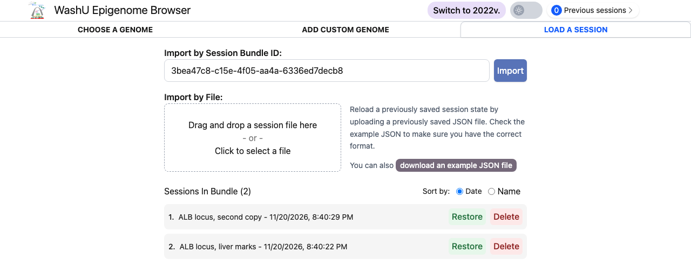

**From an open session.** In the **Save/Load Session** tab, under **Load a session**:

- Paste a bundle ID in the **Session Bundle ID** box and click **Retrieve**. The bundle's sessions are listed under **Sessions In Bundle**; click **Restore** to load one.
- Click **Drop / Click Upload** (or drop a file on it) to load a session file.

Loading from an open session replaces the content of the current session. To keep the current session as it is, [duplicate](#switch-rename-and-duplicate-sessions) it first, or load from the genome picker.

**From a link.** `?bundle=<bundle ID>` (or `?bundleId=`) opens a bundle, and `?sessionFile=<URL of a session file>` opens a session file placed on a web server; see [URL parameters](../url-params.md).
