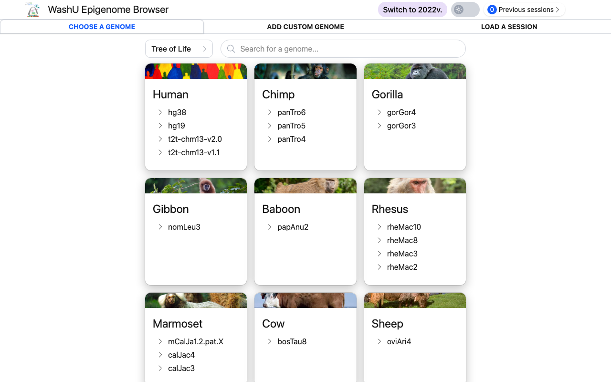
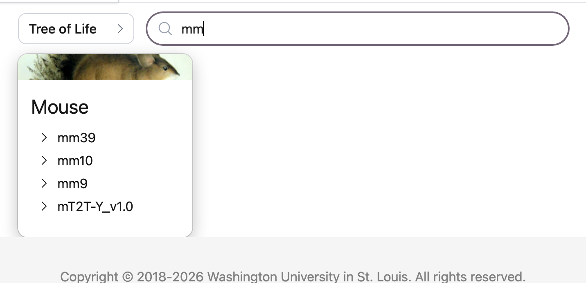
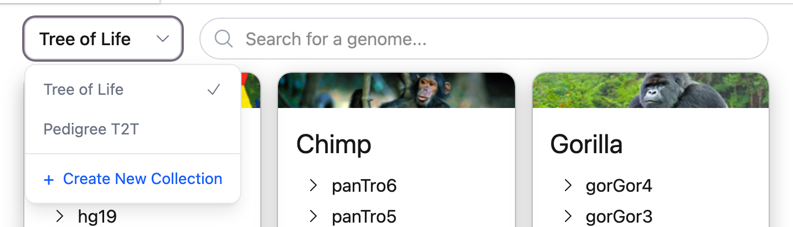
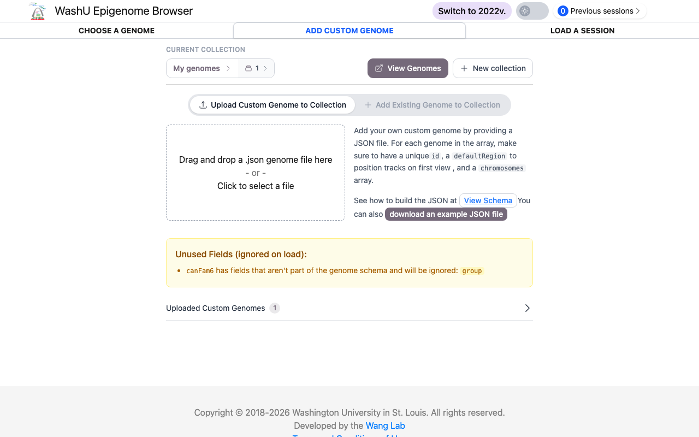
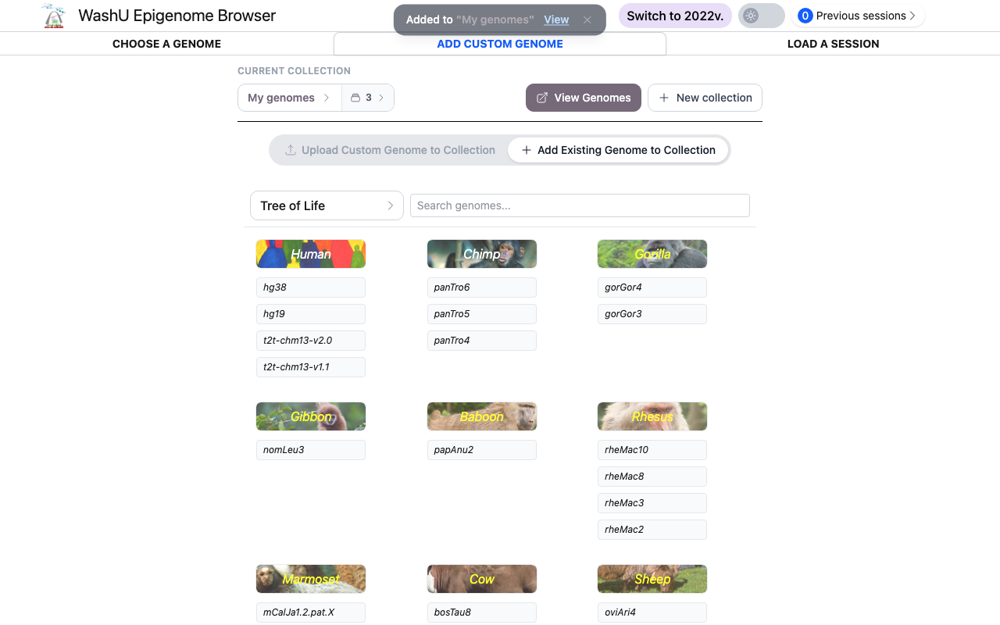
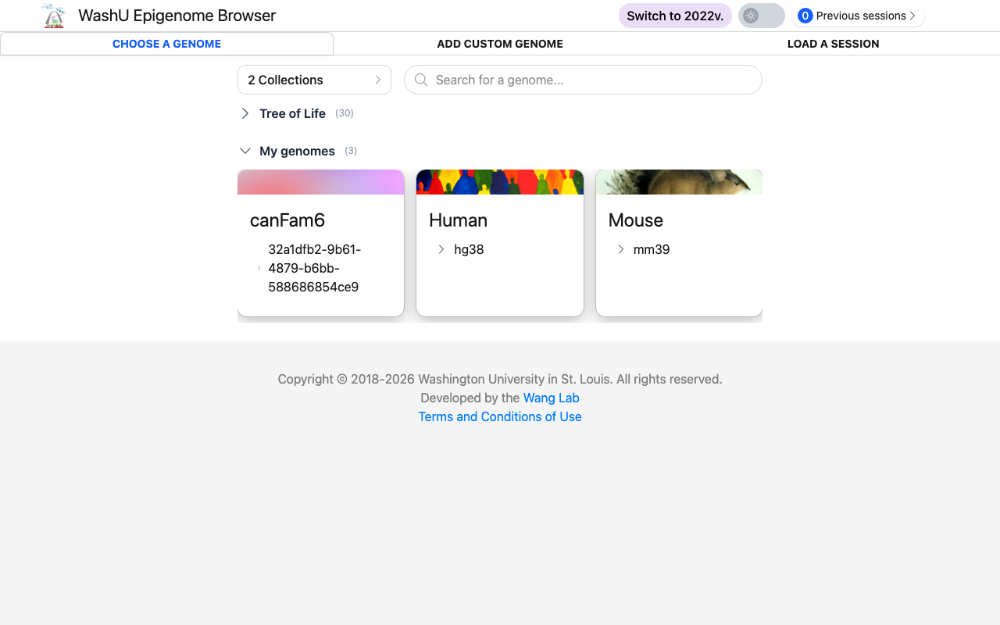
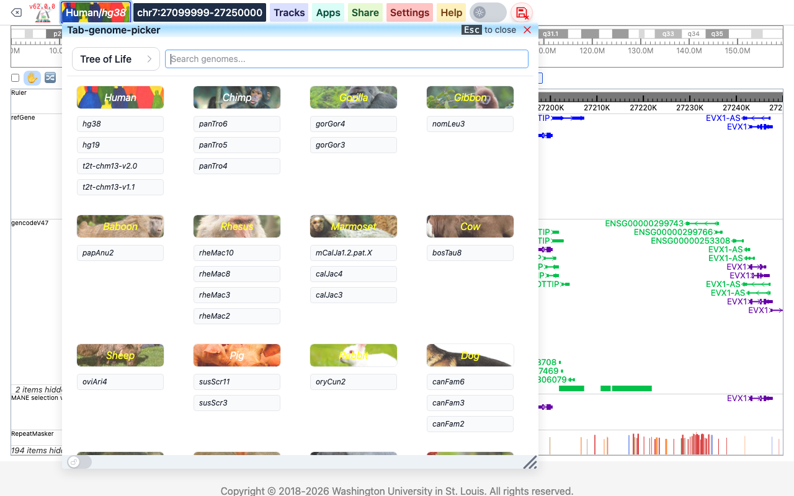

# Pick a genome

When you open the Browser without a link to a particular view, it shows the start page. The start page has three tabs:

- **CHOOSE A GENOME**: the list of genomes the Browser supports.
- **ADD CUSTOM GENOME**: add your own genome assembly, and group genomes into collections.
- **LOAD A SESSION**: open a session file you saved before. See [Manage sessions](manage-sessions.md).

The bar at the top also has a **Switch to 2022v.** button, which opens the previous version of the Browser in a new tab, a switch for the dark theme, and a **Previous sessions** button, which lists the sessions stored in your web browser (see [Manage sessions](manage-sessions.md)).



## Choose a genome

Each card is one species. Click an assembly name in a card, for example `hg38` in the **Human** card, to open that genome. The Browser opens at the genome's default region with its default tracks (for `hg38`: the ruler, gene annotation tracks and RepeatMasker).

To find a genome quickly, type part of the species or assembly name in the **Search for a genome...** box. Only the cards that match stay on the page. Here, typing `mm` leaves the mouse assemblies:



:::tip
You can also open a genome directly with a link, for example `?genome=hg38`. See [URL parameters](../url-params.md).
:::

## Genome collections

Genomes are grouped in collections. The button at the left of the search box shows the current collection; click it to see the others. The Browser comes with two collections:

- **Tree of Life**: the reference genomes of about 30 species, from human to virus (the default).
- **Pedigree T2T**: the maternal and paternal telomere-to-telomere assemblies of the human individuals PAN010, PAN011, PAN027 and PAN028.



Click a collection in the menu to add it to the page, and click it again to remove it. When several collections are shown, the button reads, for example, **2 Collections**, and each collection is a section that you open or close by clicking its name. The number after the name is the number of species in it. The Browser remembers which collections you chose.

**Create New Collection** at the bottom of the menu opens the **ADD CUSTOM GENOME** tab, where you can make your own collection (see below).

## Add a custom genome

If your genome is not in the list, you can add it yourself, as long as you have a JSON file that describes it. Custom genomes are stored in your web browser only: they are not uploaded to a server, and other people do not see them.

1. Open the **ADD CUSTOM GENOME** tab.
2. A custom genome is always added to a collection. If you have none yet, click **New collection**, type a name (here `My genomes`) and press Enter.
3. Under **Upload Custom Genome to Collection**, drag your `.json` file onto the box, or click the box to choose the file.



The genome then appears under **CURRENT COLLECTION**, in the list **Uploaded Custom Genomes**, and in the automatic collection **CUSTOM GENOMES**, which holds every custom genome you uploaded. If the file has fields the Browser does not use, a yellow **Unused Fields (ignored on load)** box lists them; the genome still loads. If the file is not valid, a red **Validation Errors** box explains what is wrong.

### The genome file

The file contains one genome object, or an array of them. Each genome needs:

- `id`: a unique identifier.
- `chromosomes`: an array of chromosomes, each with a `name` and a `length`.
- `defaultRegion`: the region shown when the genome is opened, for example `chr7:26733027-26803027`.

Optional fields include `name`, `cytobands` (to draw chromosome ideograms), `defaultTracks` (tracks shown when the genome is opened), `annotationTracks`, `publicHubList` and `twoBitURL` (the genome sequence in 2bit format). A shortened example:

```json
{
  "name": "canFam6",
  "id": "32a1dfb2-9b61-4879-b6bb-588686854ce9",
  "defaultRegion": "chr7:26733027-26803027",
  "chromosomes": [
    { "name": "chr1", "length": 122014068 },
    { "name": "chrX", "length": 108808365 }
  ]
}
```

Click **View Schema** in the tab to see every field the file can have, or **download an example JSON file** to get a complete example. To make a genome available to everyone instead, it has to be added to the Browser's code: see [Add a new genome](../developer/add-genome.md).

### Add existing genomes to a collection

A collection can mix your custom genomes with genomes the Browser already has. Click **Add Existing Genome to Collection**, then click assembly names (here `hg38` and `mm39`). A message confirms each one: **Added to "My genomes"**.



The button with the collection name (under **CURRENT COLLECTION**) switches to another of your collections; in its menu, the **×** that appears when you point at a collection deletes that collection. The button next to it shows how many genomes the collection has; click it to show or hide the list of genomes. In that list, click the **×** in a tag to take a genome out of the collection, or **Clear all** to empty the collection.

### Open a genome from your collection

Click **View Genomes**. The **CHOOSE A GENOME** tab opens with your collection selected. Click an assembly to open it, as for any other genome. For a custom genome, the assembly is listed under its `id`.



## Switch to another genome

Once a genome is open, its name is shown at the left of the top bar (for example **Human/hg38**). Click it to open a smaller genome picker with the same collection button and search box, and click an assembly to open it.



Opening a genome starts a new session. Your previous view is kept in **Previous sessions**; see [Manage sessions](manage-sessions.md). The back button (the arrow at the far left of the top bar) and the Browser logo take you back to the start page.
