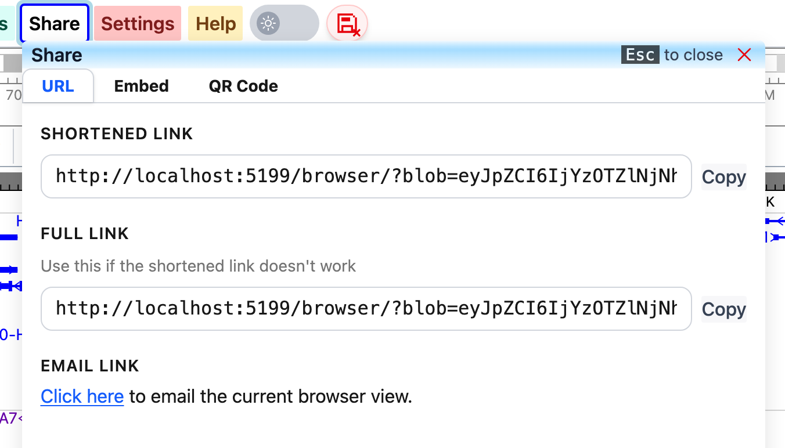
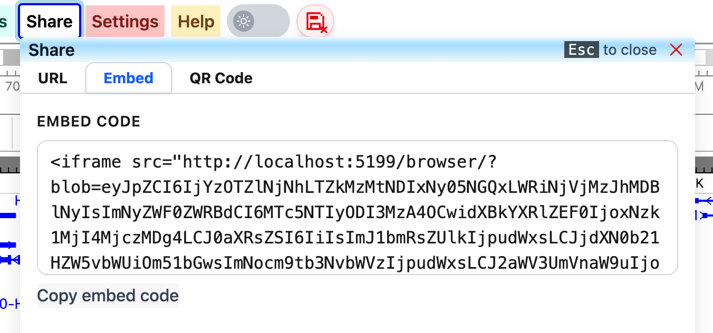
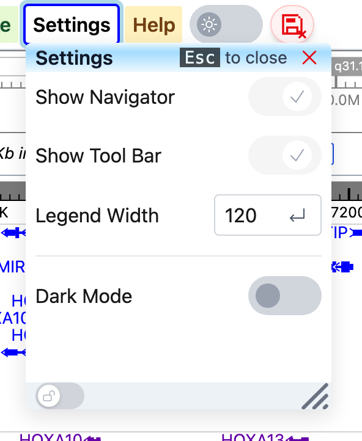
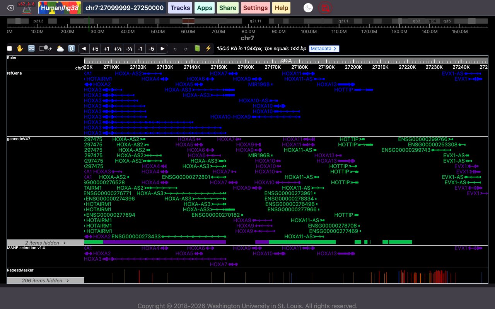
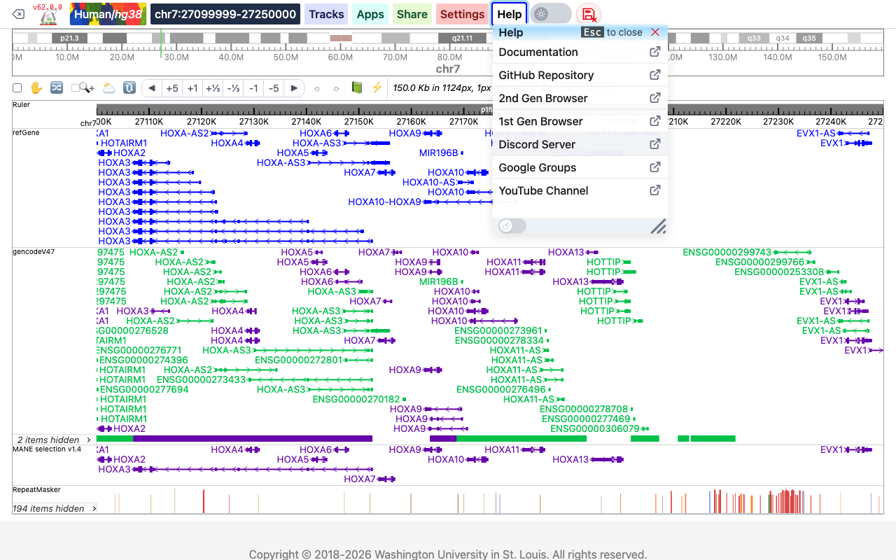

# Share, Settings and Help

The **Share**, **Settings** and **Help** buttons are in the top bar, after **Tracks** and **Apps**. Each opens a panel under the button. Close a panel with the **×** at its top right, by pressing Esc, or by clicking outside it. To keep a panel open while you click elsewhere, turn on the pin switch at its bottom left. Drag the corner at its bottom right to resize it.

## Share

The **Share** panel gives you a link to the current view: the genome, the region, the tracks and their settings. Anyone who opens the link sees the same view. The panel has three tabs.

### URL

- **Shortened link**: a short link to the view, made with the TinyURL service. Click **Copy** to copy it.
- **Full link**: the complete link, with the whole view encoded in it. Use it if the shortened link does not work.
- **Email link**: **Click here** opens your email program with a new message that contains the link.

The links describe the view at the moment you made them. If you change the view while the panel is open, a yellow message says **The shortened link is for an older version of this view.** Click **Refresh link** to make a new one.

### Embed

The **Embed** tab gives the HTML code of an `iframe` that shows the current view inside another web page. Click **Copy embed code** and paste the code into your page. See also [Installation](../installation.md) for other ways to put the Browser in a web page.

### QR Code

The **QR Code** tab shows a QR code of the shortened link. Scan it with a phone to open the same view there.

## Settings

- **Show Navigator**: shows or hides the genome navigator (the chromosome overview under the top bar). Hide it to leave more room for tracks.
- **Show Tool Bar**: shows or hides the tool bar above the tracks (the tools, the zoom and pan buttons, and undo/redo). See [Browsing the genome](browsing-ui.md).
- **Legend Width**: the width, in pixels, of the track labels at the left of the tracks. The default is 120. Type a number and press Enter, or click the arrow in the box. Use a larger width for long track names.
- **Dark Mode**: switches the Browser to the dark theme.

**Show Navigator** and **Show Tool Bar** are turned back on when you reload the page.

## Dark theme

Besides the **Dark Mode** setting, the switch with the sun icon at the right of the **Help** button turns the dark theme on and off. The same switch is on the start page.

## Help

The **Help** panel has links to:

- **Documentation**: this documentation.
- **GitHub Repository**: the source code of the Browser.
- **2nd Gen Browser**: the previous (2022) version of the Browser.
- **1st Gen Browser**: the source code of the retired first version.
- **Discord Server**, **Google Groups** and **YouTube Channel**: where you can ask questions, get support and watch tutorials. See also [Contact](../contact.md).

## New version notice

The Browser checks every few minutes, and whenever you come back to its browser tab, whether a newer version has been published. If so, a dark bar at the bottom of the window says **A new version of the browser is available.** Click **Refresh** to reload the page with the new version, or **×** to dismiss the message and keep working.
