# Add and customize tracks

The browser collects data from large consortia such as Roadmap Epigenomics, ENCODE, 4DN and IGVF. These public data are called public tracks, and they are organized into collections called data hubs. Along with the public hubs and tracks, you can add your own tracks and data hubs, from a web server or from your computer, and compare them with the public data.

Tracks are added from the **Tracks** tab of the navigation bar. Once a track is shown, you change its look from its right-click menu.

## The Tracks tab

Click **Tracks** in the navigation bar to open the Tracks panel. Each entry opens a page of the panel; use the `<` arrow at the top left of the panel to go back, and the red cross (or the `Esc` key) to close the panel.

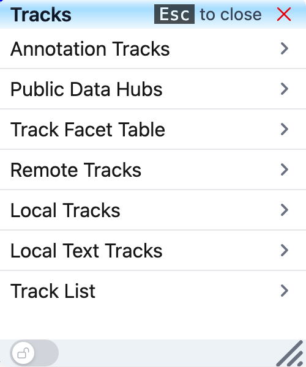

| Entry | What it does |
| --- | --- |
| **Annotation Tracks** | Add annotation tracks of the current genome (genes, repeats, conservation, etc.). |
| **Public Data Hubs** | Load public data hubs for the current genome. |
| **Track Facet Table** | Browse and add the tracks of the hubs you have loaded. |
| **Remote Tracks** | Add a track or a data hub from a URL. |
| **Local Tracks** | View track files from your computer. |
| **Local Text Tracks** | View plain-text track files from your computer. |
| **Track List** | See the displayed tracks as a list, and remove or restore them. |

### Annotation Tracks

**Annotation Tracks** lists the annotation tracks that come with the current genome. Click the genome name (for example **hg38**, marked **Primary**) to expand its list. Tracks are grouped by kind, for example Ruler, Genes, Transcription Factor, Variation, RepeatMasker, Conservation, Genome Annotation (CpG islands, GC percent, blacklist), Genome Comparison and Mappability. Type in the **Search...** box to filter the list.

Click the `+` button next to a track to add it. A green check mark means the track is already displayed.

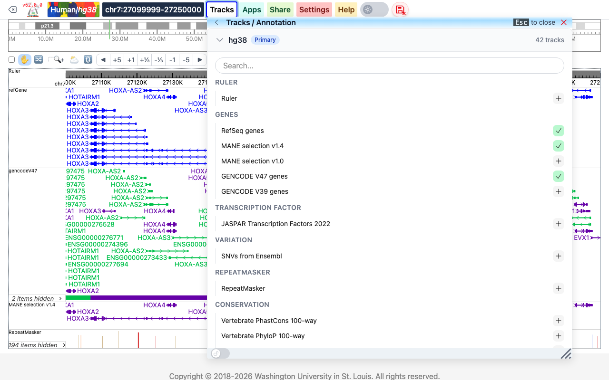

If the view also shows a genome comparison track, the annotation tracks of the other (query) genome are listed under their own genome name, so you can add them as well.

### Public Data Hubs

**Public Data Hubs** lists the public data hubs available for the current genome, grouped by collection (for hg38: HPRC, Roadmap Epigenomics, IGVF, ENCODE, 4D Nucleome Network, and others). Each row shows the genome, the hub name and the number of tracks in the hub. Type in **Search hubs...** to filter the list.

Click the info icon (ⓘ) next to a hub name to read a short description of the hub.

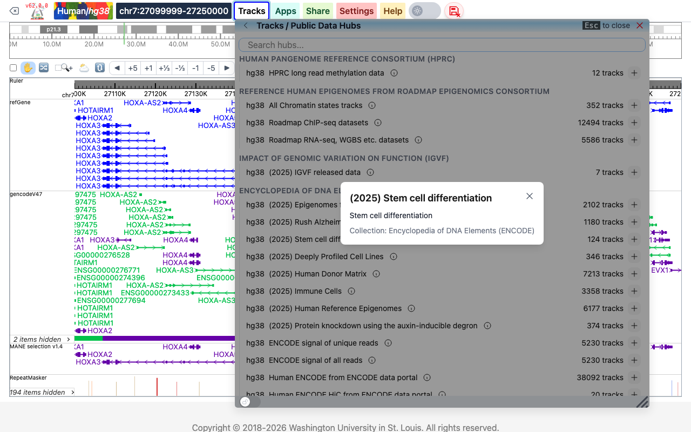

Click the `+` button at the end of a row to load the hub. When loading is done the button turns into a green check mark, the default tracks of the hub (if it defines any) are added to the view, and a facet table with all the tracks of the hub appears at the top of the panel. You can add more tracks from this table, as described below.

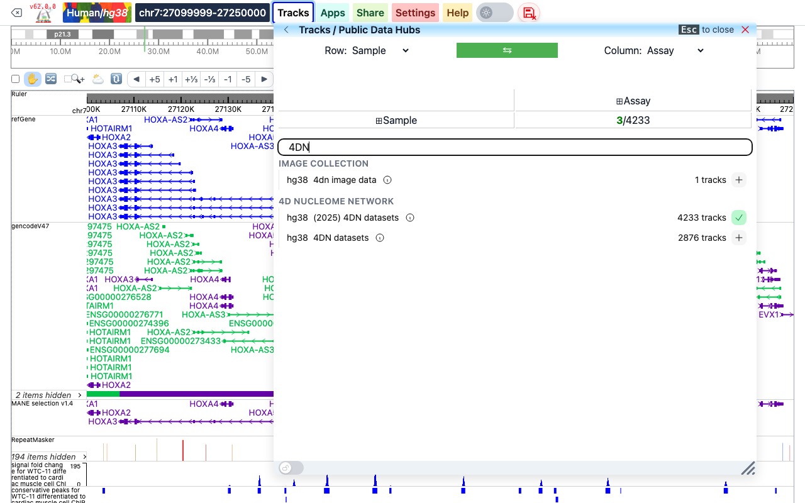

### Track Facet Table

The facet table organizes the tracks of the loaded hubs by their metadata. It appears at the top of the **Public Data Hubs** panel after a hub is loaded, and it is always available from **Tracks > Track Facet Table**. That page has two tabs: **Public**, for the public hubs you loaded, and **Custom**, for tracks and hubs you added from **Remote Tracks**.

- Choose the metadata shown in rows and columns with the **Row** and **Column** menus (for example Sample and Assay). Choose **Not used** to have no columns.
- Click a `⊞` header (for example **⊞Assay**) to expand it into its values; click `⊟` to collapse it again.
- Click the green `⇆` button to swap rows and columns.

Each cell shows two numbers: the number of tracks of that cell that are displayed (green) and the number of tracks in the cell. Below, the rows are assays and the 4DN hub has, for example, 180 ATAC-seq tracks, none displayed.

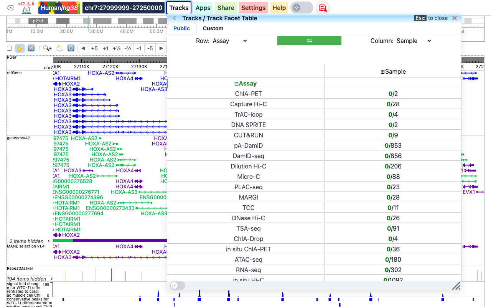

Click a cell to open the **Track Table** with the tracks of that cell. Displayed tracks have a check mark (✓); click `+` to add a track, or **Add all in page** to add every track on the current page. Type in the search box to filter the tracks by label and metadata, and use the page controls to move through long lists. Click **← Back** to return to the facet table.

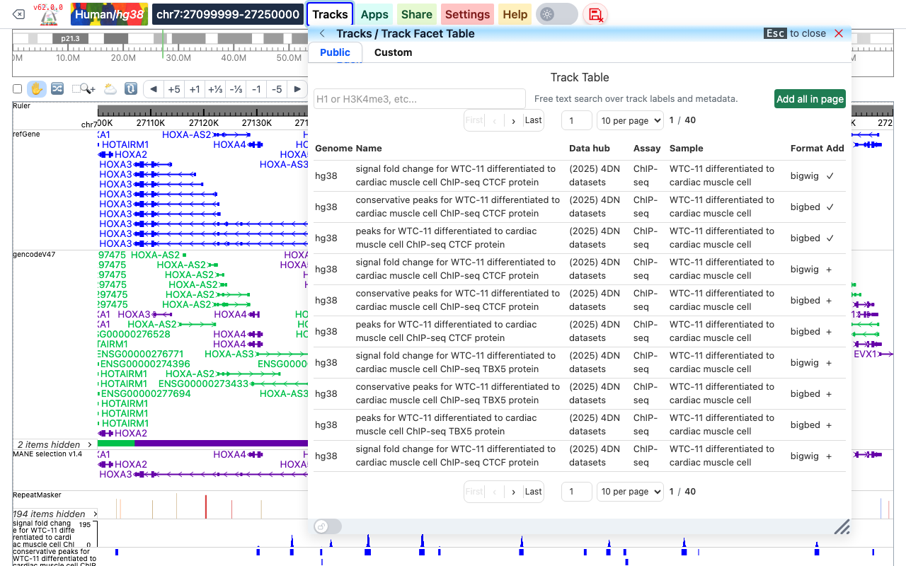

### Remote Tracks

**Remote Tracks** adds tracks that you host on a web server. The server must allow the browser to read the files (CORS); see [file-based tracks](../tracks/file-tracks.md) for the formats and for how to set up your server. The page has two tabs, **Add Tracks** and **Add Data Hubs**.

#### Add a single track

1. On the **Add Tracks** tab, choose the **Track Type**. The list shows the track types the browser can display, grouped by kind (numerical, annotation, methylation, interaction, and so on), each with a short description.
2. Paste the address of the file in **File URL**. For types that need an index file (for example bedGraph, bed, methylC, vcf or BAM), an **Index URL** field appears; fill it only if the index file is not in the same folder as the data file.
3. Check the **Assembly**. It is the current genome; if the view contains a genome comparison track, you can also choose the other genome.
4. Optionally type a **Track Label** and **Options** in JSON format, for example `{ "color": "darkgreen", "height": 60 }`. See [track properties](../datahub/track_properties.md) for the options.
5. Click **Add Track**.

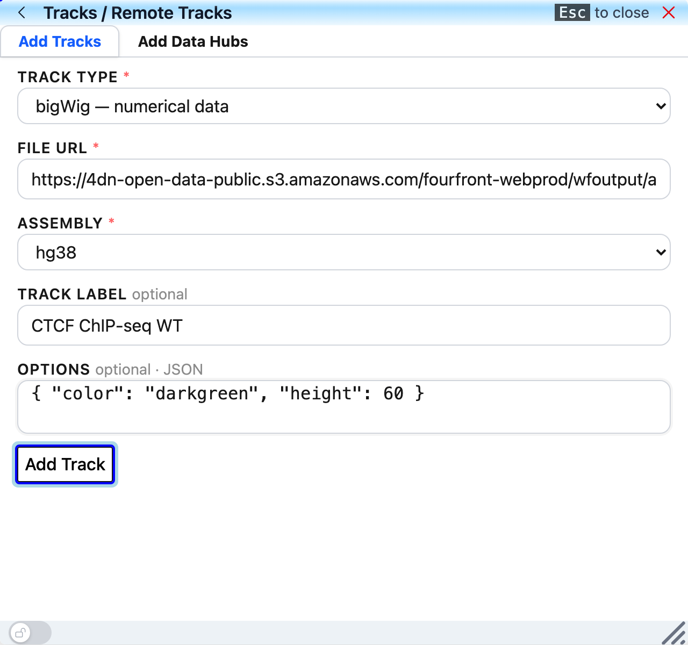

After the track is added, two buttons replace **Add Track**: **Add Same** adds the same track again, and **Add New** clears the form for another track. The tracks you add this way are also listed in an **Available Tracks** facet table at the top of the page (and in **Track Facet Table > Custom**), from which you can add them again later.

#### Add a data hub

A data hub is a JSON file that lists many tracks; see [datahub syntax](../datahub/datahub.md) for how to write one.

1. On the **Add Data Hubs** tab, paste the address of the hub file in **Remote Hub URL**.
2. Click **Load Hub**.

Tracks of the hub that have `"showOnHubLoad": true` are displayed at once. All the tracks of the hub are listed in the **Available Tracks** facet table at the top of the page (and in **Track Facet Table > Custom**), where you can add the others. In the example below, the hub `https://vizhub.wustl.edu/public/hg38/roadmap_hmm.json` has 352 chromatin-state tracks, 3 of which are displayed when the hub is loaded.

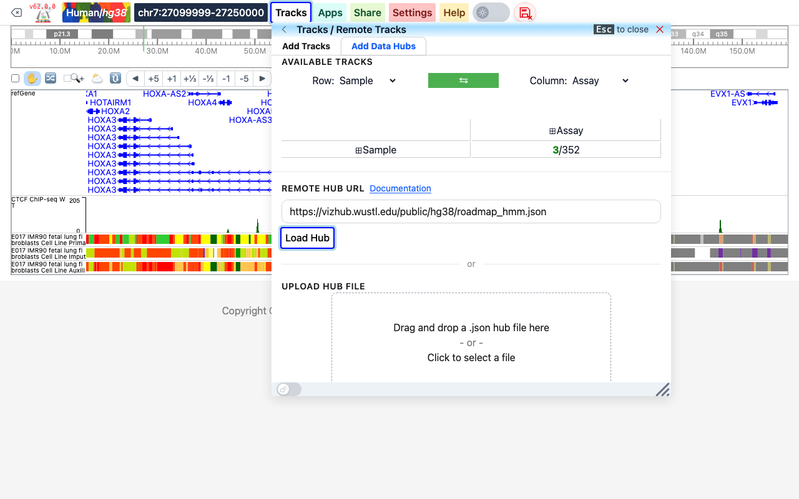

Instead of a URL you can load a hub file from your computer: drag a `.json` hub file onto the **Upload Hub File** box, or click the box to choose the file. In such a file the track `url`s must still point to files on a web server; to view files that are on your computer, use [Local Tracks](../tracks/local-tracks.md).

### Local Tracks

**Local Tracks** shows track files that are on your computer, without uploading them anywhere. On the **Add Local Track** tab you choose a track type and select the files; on the **Add Local Hub** tab you select a folder (or a set of files) that contains a `hub.config.json` file describing the tracks. See [Local tracks](../tracks/local-tracks.md) for details.

### Local Text Tracks

**Local Text Tracks** shows plain-text files (bed, bedGraph, long-range interactions, etc.) from your computer, without converting them to an indexed or binary format first. See [Local text tracks](../tracks/text-tracks.md) for the supported formats.

### Track List

**Track List** shows the displayed tracks in a table with their label and track type. Click the red `×` in the **Remove** column to remove a track from the view. Tracks removed here are kept in a second table below, from which you can put them back with the `+` button in the **Add** column.

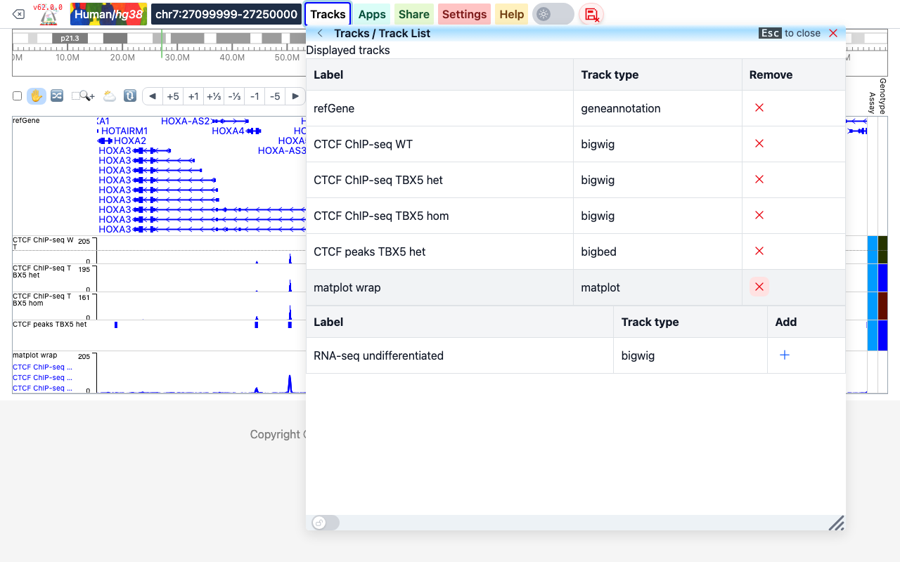

## Track customization

Most changes to a track are made in its context menu, which you open by right-clicking the track.

### Selecting tracks

- **Right-click** a track to select it and open its menu. A selected track has a yellow label and a dashed border, and a note at the top of the window shows how many tracks are selected.
- Hold **Shift** and **left-click** tracks to add them to the selection, or to remove a selected track from it.
- Click the box of a metadata value next to the tracks to select all the tracks with that value (see [Metadata color boxes](#metadata-color-boxes)).
- The check box at the left end of the toolbar selects all tracks, or none.
- To clear the selection, click a track that is not selected (without Shift), or click outside the tracks.

When several tracks are selected, right-click any of them: the menu title shows the number of selected tracks, and every change you make in the menu is applied to all of them.

### The track menu

The menu lists the settings that apply to the type of the selected track. Below is the menu of a bigWig track.

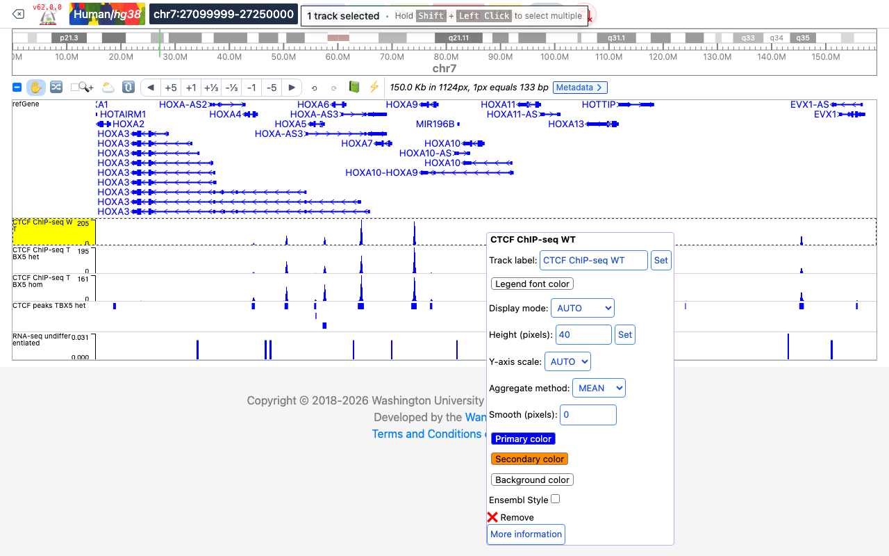

Settings shared by most track types:

- **Track label**: type a new name and click **Set**.
- **Legend font color**: color of the track label.
- **Display mode**: how the data are drawn. Numerical tracks (bigWig, bedGraph) offer **AUTO**, **BAR** and **HEATMAP**; in AUTO mode the track is drawn as a heatmap when its height is less than 21 pixels, and as bars otherwise. Annotation tracks (genes, bed, bigBed, etc.) offer **FULL** (each item on its own row) and **DENSITY**. Interaction tracks (hic, longrange, bigInteract) offer **HEATMAP**, **ARC**, **FLATARC** and **SQUARE**.
- **Height (pixels)**: type a number and click **Set**. Annotation tracks in FULL mode have **Max rows (including overflow row)** instead.
- **Y-axis scale** (numerical tracks): **AUTO** scales the y-axis to the values in the current view. **FIXED** shows **Y-axis max** and **Y-axis min** fields, so that several tracks can share the same scale.
- **Aggregate method** (numerical tracks): how values are combined when several data points fall in one pixel: **MEAN**, **SUM**, **COUNT**, **MIN** or **MAX**.
- **Smooth (pixels)** (numerical tracks): smooth the signal over the given number of pixels.
- **Primary color**, **Secondary color**, **Background color**: click a button to open a color picker. For numerical tracks the primary color is used for positive values and the secondary color for negative values.
- **❌ Remove**: remove the track (or all selected tracks) from the view.
- **More information**: show the track's details, URL and metadata (single track only, see below).

Other items appear for specific track types, for example **Italicize text**, **Hide item less than (pixels)** and **Hide minimal items** for gene tracks, **Always draw label** for bed-like tracks, and, for Hi-C tracks, **Bin size**, **Normalization**, **Score scale**, **Max value filter**, **Min value filter**, **Data in current view (no expansion)**, **Both anchors in view window** and **Scale with height**. The options these items set can also be given in a data hub; see [track properties](../datahub/track_properties.md).

:::tip
To compare tracks side by side, select them all, then set the same **Height** and a **FIXED** y-axis scale in one go.
:::

### More information

Click **More information** at the bottom of the menu to see what is known about the track: the **Details** given in the data hub, the track **URL** (with a **Copy** button) and the track **Metadata**.

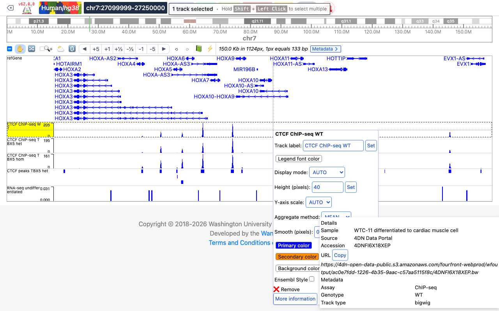

### Changing several tracks at once

Select the tracks (for example with Shift + left-click), then right-click one of them. Changes made in the menu are applied to all selected tracks; for example, typing 80 in **Height (pixels)** and clicking **Set** makes the three tracks below 80 pixels tall. Fields whose value differs between the tracks show `[multiple values]`.

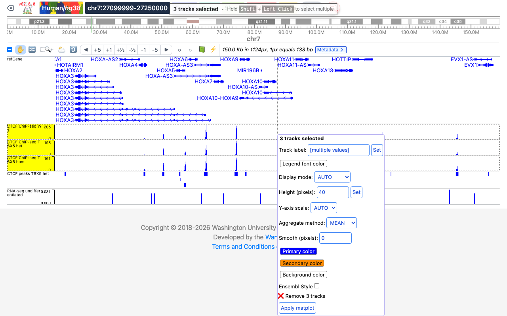

If the selected tracks are of different types, the menu only shows the items they have in common (label, colors and remove).

When all selected tracks are bigWig or bedGraph tracks, the menu also has an **Apply matplot** button. It adds a new track, named "matplot wrap", that draws the selected tracks as lines in one plot. The original tracks stay in the view. See [matplot](../tracks/file-tracks.md) for the matplot track type.

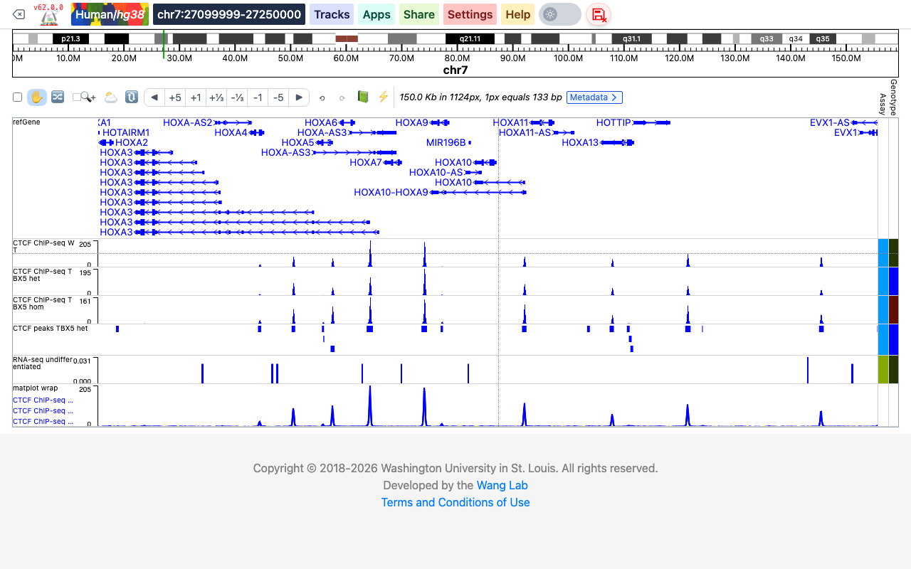

### Reordering tracks

To move a track up or down:

1. Click the **Reorder tool** in the toolbar (the 🔀 button, or press `Alt+R`).
2. Drag the track to its new position.

To rearrange many tracks, click the **Re-order Many** button (🔃) in the toolbar. A **Reorder Tracks** panel lists all tracks; drag them into the order you want (the **Columns** slider spreads the list over several columns) and click **Apply**. See [the user interface](./browsing-ui.md) for the other toolbar tools.

### Metadata color boxes

Tracks from data hubs usually carry metadata such as sample or assay, which the Browser can show as colored boxes to the right of the tracks. Clicking a box selects every track with the same value, so you can then change them together from the right-click menu. See [Metadata](browsing-ui.md#metadata) for how to choose the columns.
